# payment-pro 生产化升级实施计划（IMPLEMENTATION PLAN）

> 版本：v1.0 · 编制日期：2026-11-19 · 状态：待启动
> 上游依据：[ROADMAP.md](ROADMAP.md) v1.0（已拍板 P0/P1/P2 全做）· [DESIGN.md](DESIGN.md) 1.8.0
> 本文档是 ROADMAP 的**执行细化**：把每个编号项（I-x / S-x / M-x / A-x / AC-x / T-x / P-x / C-x / CH-x / R-x / ST-x / N-x / RC-x / G-x / X-x）拆成可直接开工的任务卡。编号与 ROADMAP 一一对应，不另起炉灶。

---

## 0. 范围、硬约束与阅读指引

### 0.1 范围
- 三期全做：**P0「能称生产」→ P1「核心支付能力」→ P2「增值生态」**，共 85 个 ROADMAP 编号项，拆为约 90 张任务卡（XL 项拆 a/b）。
- 交付标准沿用 ROADMAP §7：**双 profile 可运行 + 资金正确性不回归 + 新能力有断言 + 混沌验证 + 文档同步 + 密钥仓库外**。

### 0.2 硬约束（红线，写进每张卡的验收）
1. **保留自研 `tcc-core`（`com.qoder.tcc`），不迁 Seata。** 协调器仍只部署在 payment-payment；参与者路由可由静态 Map 演进为自注册+动态发现，但属组件内增强。
2. **保留 ZooKeeper，不迁 Nacos。** local 内嵌 ZK / docker 共享 ZK 2181 维持现状；集群化是 P2 可选加固。
3. **配置中心用 Apollo**（与注册解耦），不触碰 ZK。
4. **双 profile 保留**：local 零依赖 `./run.sh` 直接运行 + docker `./run.sh --docker` 生产中间件。**每项新能力两套 profile 都要能跑能验证；新增中间件依赖必须有 local 降级实现**（`@ConditionalOnProperty` 开关，local 不加载 Bean、不建连接）。
5. **资金可靠性服务端兜底**：一致性/修复由 TCC、五层幂等、事务 outbox、复式记账、五方对账、差错平台保证；前端补偿只管展示。
6. **不破坏既有正确性机制**，增量演进。smoke-test.py（79 项）+ verify-pro.py（22 项）每期必须全过，试算平衡（D=C 且 Σbalance=0）与对账不回归。
7. **商用级主流框架**：XXL-Job / RocketMQ 事务消息 / ShardingSphere / Sentinel / Micrometer+Prometheus / KMS-Vault / Spring Security OAuth2+RBAC / 风控规则引擎（本计划选 **QLExpress**，理由见 R-1）。控制点走框架扩展位，不自研薄循环。
8. **密钥仓库外**：敏感配置放 `~/.config/payment-pro/`（600），仓库只留 `config/*.example`。
9. **金额全程 long 型「分」**（`MoneyUtil`，上限 1e12），杜绝浮点。

### 0.3 与 ROADMAP / DESIGN 的关系
- ROADMAP 定「做什么、优先级、验收出口」；本文件定「改哪个文件、加什么接口、建什么表、怎么验证、依赖谁、多大量级」。
- DESIGN.md 是现状事实来源（§2.2 域职责、§6 TCC、§7 幂等、§8 outbox、§9 各域、§11 账务、§12 安全、§15 边界、§16 OpenAPI、§18 Docker、附录 C DDL、附录 D 契约）。每张卡的「现状」锚定真实类/表，开工前先核对。
- 每期完成后：回填本文件 §6 台账 + 增补 DESIGN 对应章节 + 更新附录 D 契约 + README 同步。

### 0.4 阅读指引
- **架构/排期**：读 §1（实施顺序与依赖图、关键路径、并行泳道）。
- **开工**：按 §2/§3/§4 找到任务卡，每卡 9 要素（目标/模块类/接口/数据模型/实现要点/双 profile/验证/依赖/量级）。资金卡额外含「资金护航」。
- **验收**：各期出口清单（§2.F / §3.K / §4.G，对齐 ROADMAP §7）。
- **风控**：§5 风险与回滚（分库分表/事务消息/真实渠道/规则引擎/营销资金）。
- **进度**：§6 台账（初始全 ⬜）。
- 量级标尺：**S**≤0.5 人周 · **M**≈1 人周 · **L**≈2–3 人周 · **XL**≥4 人周（相对量级，含双 profile + 断言 + 混沌）。

### 0.5 代码勘误（与 ROADMAP/DESIGN 假设不符之处，开工前必读）
> 以下均经源码核实，直接影响任务卡设计，已在对应卡内处理。

| # | 发现 | 证据 | 影响与处理 |
|---|---|---|---|
| E-1 | **appSecret 明文外泄**：DESIGN §12.2 声称「appSecret 不出现在任何查询 DTO」，实际 `MemberDTO` 含 `appSecret` 字段，`MemberConverter.toDTO` 用 `BeanUtils.copyProperties` 全量拷贝，`/api/members`（list）、`/api/members/{id}`、`getByAppId` 均返回明文密钥 | `payment-facade/.../member/MemberDTO.java`、`payment-member/.../convert/MemberConverter.java`、smoke-test.py 第 102/291 行依赖 create 返回 appSecret | S-1/M-1 必须收敛暴露面：list/get 脱敏，仅 create/rotate 一次性返回；密钥进 KMS |
| E-2 | **recon 实为六项核对**（账务试算平衡/支付单采集/支付-账务/支付-交易/支付-清结算/支付-渠道），ROADMAP/DESIGN 多处称「五方对账」 | `payment-recon/.../service/ReconService.java#run`（6 个 check） | 「五方」=payment/accounting/trade/settle/channel；六项=五方一致+试算+采集。RC-x 卡按真实六项扩展，断言按 checks 数组逐项 |
| E-3 | **risk / cashier 无数据库**（ROADMAP §2.2 标注无库；`application.yml` 无 datasource） | `payment-risk/src/main/resources/application.yml`（web-application-type=none，无 datasource）、cashier 同 | R-1~R-4（规则/名单/限额/处置留痕）、C-2/C-3（付款码/验证会话）需持久化 → 必须新增 local H2 库 + docker `pp_risk`/`pp_cashier`，并扩 `ops-pro/deploy/payment-databases.sql`（现仅 9 库）。见 R-1/C-2 前置子任务 |
| E-4 | **渠道是同步 TCC，无查询/回执 SPI**：`ChannelFacade` 仅 `listTrades`，写操作全经 `TccParticipantFacade`（preauth/capture/voidAuth 同步 CAS）；无「渠道查询」能力 | `payment-channel/.../service/ChannelService.java`、`ChannelTccFacadeImpl.java` | S-5/P-1/CH-1 补单与 CH-2 异步渠道需新增查询 SPI + PROCESSING 收敛 job；异步渠道下「payment SUCCESS ⇔ 渠道已扣款」要求二阶段触发点从「tryAll 后立即 commit」改为「渠道终态回执后 commit」→ 需 tcc-core 增量 `WAITING` 状态。**ROADMAP 把 I-6 组件增强放 P2，但 CH-1(P0)/CH-2(P1) 已依赖此增量 → 依赖前移**，本计划把 WAITING 增量并入 CH-1(P0)，I-6(P2) 只做参与者自注册 |
| E-5 | **XXL-Job admin 已在共享栈，但各域无 executor；Apollo/Vault/Prometheus/Grafana 栈中缺失** | `ops-pro/deploy/middleware-compose.yml`（xxl-job-admin 2.4.1 @127.0.0.1:8094；MySQL8/Redis7/RocketMQ5.1.4/ZK3.9/MinIO 在；无 Apollo/Vault/Prometheus/Grafana） | I-3 接 executor 是新增工作；I-2/I-8/S-1 需向共享栈新增 Apollo/Prometheus/Grafana/Alertmanager/Vault 容器（或 payment-pro 独立 compose overlay） |
| E-6 | **多实例协调器并发隐患**：`ensureFundMerchant()` 用 `synchronized`（单进程锁）；`recover()/driveConfirm` 终态事务无分布式锁，`updateGlobal` 无 version CAS | `PaymentService.java:226`、`TccCoordinator.java#updateGlobal/bumpRetryIfPending` | I-9 多实例下需 ShedLock 锁 recover/outbox 调度 + dtx version 乐观锁，否则重复驱动产生重复 outbox 行（接收端幂等可吸收，但需护栏）。ROADMAP I-9 仅说「无状态化」，未点出此风险 |
| E-7 | **分片键与全局幂等键冲突 + 序列分片重号**：`payment.request_id UNIQUE` 是全局幂等键；ID 走各域 `next_value_for('seq_x')` 序列 | `payment-payment/.../schema.sql`（uk_payment_request）、`payment-common/.../db/H2Sequence.java` | I-5 若按 paymentId/memberId 分片：① DB 唯一键无法跨片保证 request_id 幂等 → 需基因法（requestId 哈希嵌入 paymentId）或独立幂等索引表；② 每片独立 sequences 会重号 → 需全局发号（ShardingSphere KeyGenerator/雪花）。这是资金安全前置，ROADMAP I-5 未点出 |

### 0.6 全局命名与落地约定（所有卡遵循）
- **包名**：业务 `com.qoder.payment.<domain>.*`；TCC 组件 `com.qoder.tcc.*`；契约 `com.qoder.payment.facade.<domain>.*`。
- **新增 facade**：接口+DTO 放 payment-facade 对应包；实现 `<Domain>FacadeImpl`（`@DubboService`，经 `FacadeSupport.execute` 包装）；TCC 参与者 `<Domain>TccFacadeImpl`（`@DubboService(group="<domain>")`，用 `TccParticipantTemplate`）。
- **新增表双份**：local 各域 `src/main/resources/schema.sql`（`CREATE TABLE IF NOT EXISTS` + `CREATE SEQUENCE IF NOT EXISTS seq_x` + `CREATE ALIAS next_value_for`）；docker `schema-mysql.sql`（InnoDB/utf8mb4_unicode_ci + `sequences` 表 + 存储函数 `next_value_for`，`sql.init.mode=never` 一次性建表）。新库需扩 `ops-pro/deploy/payment-databases.sql`。时间戳 BIGINT 毫秒、金额 BIGINT 分、JSON 用 CLOB(local)/LONGTEXT(mysql)。
- **新增系统户**（沿用 `SYS_` 前缀透支语义，`AccountingService.isSystem`）：`SYS_ESCROW` 担保、`SYS_SUSPENSE` 差错挂账、`SYS_MARKETING` 营销、`SYS_PROFIT` 损益结转、`SYS_FX` 汇兑损益、`SYS_DEPOSIT` 保证金。
- **新增幂等 bizType**（`IdempotentTemplate.execute(bizType,bizNo,...)`）：REVERSE / SHARE / SHARE_BACK / ESCROW_CONFIRM / PREAUTH_COMPLETE / COUPON_USE / DISPUTE / SETTLE_BATCH / WITHDRAW_BANK / SIGN / KYC 等，各卡注明。
- **跨域基础设施抽象**（payment-common 新增，双 profile 开关）：`DynamicConfig`（I-2，Apollo/文件）、`JobHandler`+`DistributedLock`（I-3/I-9，XXL-Job/ShedLock+@Scheduled）、`SecretProvider`（S-1，Vault/文件）、`ChannelAdapter`（CH-2，沙箱/模拟银行）、`MetricsSupport`（I-8）。
- **验证脚本**：功能断言扩 `smoke-test.py`（现 79 项，11 节）；并发/混沌/持久化扩 `verify-pro.py`（现 22 项，A/B/C/D，`PP_PROFILE=docker` 双跑）；新域/新中间件可新增 `verify-<topic>.py`。混沌沿用 `stop_svc/start_svc`（按 `run/<name>.pid`）。

### 0.7 跨系统兼容红线（ride-pro 双账本，所有泳道/所有期必须遵守）
> ride-pro 以商户身份经 OpenAPI 镜像资金流（DESIGN §16.3 / ride DESIGN §19）。升级**不得破坏**其调用面与语义。每波集成验收必须跑 ride `verify-integration.py`（24 项，双 docker）全过才算兼容。

**冻结的 OpenAPI 调用面**（入参名/返回字段/幂等键不变，新增字段仅可选 additive）：

| method | 入参 | 返回 | 语义红线 |
|---|---|---|---|
| account.open | name,type | memberId/accountId | 服务端幂等懒开户 |
| fund.topup | accountId,amount,bizNo | payment.id | SYS_FUND/fee=0/BALANCE/无渠道；requestId=bizNo 幂等；账务 bizNo=支付单id、refId=交易单id |
| fund.withdraw | accountId,amount,bizNo | payment.id | 同上；D 账户/C SYS_CASH；同步先扣 |
| account.transfer | fromAccountId,toAccountId,amount,bizNo | — | bizNo 幂等、借贷腿定向划转语义不变 |
| account.balance | accountId | 裸数字 long | 返回结构不变 |
| trade.create | merchantId,subject,amount,outTradeNo | id | merchant+outTradeNo 唯一幂等不变 |
| trade.pay | orderId,accountId,method=BALANCE,callbackUrl | payment.id | **BALANCE/无渠道分支保持同步受理→PROCESSING→SUCCESS 轮询；不得引入 WAITING/异步回执** |
| trade.query | orderId | 订单+支付单 | 供 ride 增量对账回查手续费 |

**其它红线**：
1. HMAC 验签机制不变（appId/sign/timestamp **毫秒**/TreeMap 排序 k=v&）；E-1 脱敏后 getByAppId 仍供内部验签取密钥。
2. **CH-1 的 tcc WAITING 仅对 CARD 异步渠道启用**；BALANCE/资金单（无渠道分支）路径行为逐字节不变。
3. **notify 推送 callbackUrl 必须继续支持 http**；签名三要素头只能 additive（ride 回调不验签也能收、body 结构不变，ride 靠回调留痕）。不得强制 https。
4. 手续费口径不变（feeBps→SYS_FEE；ride 增量对账扣手续费经 trade.query 回查）。
5. 唯一索引/幂等键不变：payment.request_id UNIQUE、trade merchant+out_trade_no UNIQUE、(TOPUP/POST/SETTLE_*,bizNo)。
6. ride 退款**不走 trade.refund**（用 account.transfer 镜像司机追回+平台兜底）；P-4 退款异步化不得改变 account.transfer/post 语义。
7. 回归门禁：每波集成后 ride `verify-integration.py` 24/24 + payment smoke 79/79 双绿；F 段停 pp 重启须继承 --docker。

---

## 1. 总体实施顺序与依赖图

### 1.1 地基先行（P0 内必须最先做）
四条地基决定 P1 能否开工：
1. **I-2 配置中心（Apollo）**：费率/限额/规则/开关动态下发 → R-1 规则引擎、ST-2 费率、T-4 超时策略、CH-5 渠道限额都依赖它。
2. **I-3 分布式调度（XXL-Job）**：日切/对账/结算分片调度 → AC-3 日切、RC-2/RC-5 日切对账、ST-1 T+N 结算、T-4 超时关闭都依赖它。
3. **I-4 可靠消息（RocketMQ 事务消息 + 多 topic）**：支付/退款/分账/结算/签约分 topic → N-3 多事件、P-3 分账、ST-3 分账、X-4 签约通知都依赖它。
4. **X-1 差错平台**：DEAD/对账差错/通知耗尽的兜底闭环 → CH-1 回执丢失、RC-1 对账差错、S-4 自动冲正、N-2 死信工单都挂到它。

资金安全地基：**S-1 密钥（KMS/Vault）** 是 M-1 密钥轮换、S-3/N-1 通知签名、CH-2 渠道密钥的前置。**CH-1 异步回执+补单（含 tcc-core WAITING 增量，见 E-4）** 是 CH-2 真实渠道、P-6/CH-3 路由、S-5/P-1 补单的前置。

### 1.2 依赖图（Mermaid）

```mermaid
graph TD
  subgraph P0["第一期 P0 地基与资金安全"]
    I2["I-2 配置中心 Apollo"]
    I3["I-3 调度 XXL-Job"]
    I4["I-4 事务消息+多topic"]
    I7["I-7 Sentinel 网关治理"]
    I8["I-8 可观测 Prometheus"]
    I5["I-5 ShardingSphere 分片"]
    S1["S-1 密钥 KMS/Vault"]
    S2["S-2 控制台 RBAC"]
    X1["X-1 差错平台"]
    CH1["CH-1 异步回执+补单+tcc WAITING"]
    S4["S-4 自动冲正/挂账"]
    AC1["AC-1 红冲蓝补"]
    S6["S-6 挂账科目+凭证护航"]
    RC1["RC-1 对账差错分类"]
    S5["S-5 查询补单"]
    P1["P-1 支付补单收敛"]
    N1["N-1 通知签名"]
    N2["N-2 死信告警工单"]
    S3["S-3 通知签名HTTPS"]
    S7["S-7 资金防线增强"]
    M1["M-1 密钥轮换"]
    G1["G-1 控制台RBAC审计"]
  end
  subgraph P1["第二期 P1 核心支付能力"]
    CH2["CH-2 真实渠道SPI沙箱"]
    CH3["CH-3 渠道路由"]
    P6["P-6 支付路由"]
    CH4["CH-4 渠道对账文件"]
    CH5["CH-5 渠道限额维护"]
    R1["R-1 规则引擎 QLExpress"]
    R2["R-2 多维限额"]
    R3["R-3 名单服务"]
    R4["R-4 评分分级处置"]
    AC3["AC-3 日切日终"]
    RC2["RC-2 日切批量对账"]
    RC3["RC-3 内外对账"]
    RC5["RC-5 分片对账"]
    ST1["ST-1 T+N结算"]
    ST4["ST-4 提现到银行"]
    ST2["ST-2 费率配置"]
    ST3["ST-3 分账"]
    P2["P-2 组合支付"]
    P3["P-3 分账编排"]
    P4["P-4 退款异步化"]
    T1["T-1 担保交易"]
    T2["T-2 预授权"]
    T3["T-3 多交易产品"]
    T4["T-4 超时关闭"]
    M2["M-2 KYC"]
    M4["M-4 商户进件"]
    X2["X-2 进件审核流"]
    I9["I-9 多实例无状态"]
  end
  subgraph P2["第三期 P2 增值生态"]
    X3["X-3 营销域"]
    P7["P-7 营销抵扣编排"]
    C4["C-4 营销计算"]
    G4["G-4 开放平台"]
    A4["A-4 多币种"]
    AC6["AC-6 多币种账务"]
    I6["I-6 参与者自注册"]
    I1["I-1 ZK集群化"]
    X4["X-4 签约代扣"]
  end

  I2 --> R1
  I2 --> ST2
  I2 --> T4
  I2 --> CH5
  I3 --> AC3
  I3 --> ST1
  I3 --> T4
  I3 --> RC5
  AC3 --> RC2
  RC2 --> ST1
  ST1 --> ST4
  I4 --> N3["N-3 多事件通知"]
  I4 --> P3
  I4 --> ST3
  S1 --> M1
  S1 --> S3
  S1 --> CH2
  S3 --> N1
  X1 --> S4
  X1 --> RC1
  X1 --> N2
  AC1 --> S4
  AC1 --> S6
  S4 --> X1
  CH1 --> S5
  CH1 --> P1
  CH1 --> CH2
  CH2 --> CH3
  CH2 --> P6
  CH2 --> CH4
  CH4 --> RC3
  CH1 --> P4
  R1 --> R2
  R1 --> R3
  R1 --> R4
  S2 --> G1
  I5 --> RC5
  X1 --> I5
  P2 --> P3
  P2 --> X3
  P3 --> ST3
  X3 --> P7
  X3 --> C4
  T3 --> T1
  T3 --> T2
  M4 --> X2
  M2 --> M4
  CH2 --> X4
  I9 --> I6
  A4 --> AC6
```

### 1.3 关键路径（两条，决定总工期）
- **清结算链**：`I-2 → I-3 → AC-3（日切）→ RC-2（日切对账）→ ST-1（T+N）→ ST-4（提现到银行）`。
- **渠道链**：`S-1 → CH-1（异步回执+tcc WAITING）→ CH-2（真实渠道沙箱）→ CH-3/P-6（路由）→ CH-4 → RC-3（内外对账）`。
- 风控链 `I-2 → R-1 → R-2/R-3/R-4` 与营销链 `P-2 → P-3/X-3 → P-7` 可与上述并行。

### 1.4 并行泳道（P0 内）
| 泳道 | 任务 | 说明 |
|---|---|---|
| A 基础设施 | I-2 / I-3 / I-4 / I-7 / I-8 | 互不阻塞，可 5 人并行；I-5 分片单独泳道（资金域需 X-1/RC-1 护航，放 P0 末） |
| B 资金安全 | S-1 → M-1 / S-3 / N-1；S-2 / G-1 | S-1 先行 |
| C 差错与账务 | AC-1 → S-6 → S-4 → X-1 → RC-1；N-2 | X-1 依赖 AC-1/S-4 |
| D 渠道补单 | CH-1（含 tcc WAITING）→ S-5 / P-1 | 与 A/B/C 并行 |
| E 资金防线 | S-7 | 依赖 S-2（二次认证）+ AC-5（P1，账实核对可先做备付金核对雏形） |

> P1/P2 泳道在各章开头给出。每期独立验收出口（§2.F / §3.K / §4.G），严禁跨期混做导致验收失焦。

---

## 2. 第一期 P0「能称生产」

> 出口（ROADMAP §7）：基础设施载体替换完成且 local 降级可用；控制台需登录；通知可验签；DEAD/对账差错进差错平台自动冲正；查询补单收敛终态；监控告警上线。
> 泳道：A 基础设施（I-2/I-3/I-4/I-7/I-8/I-5）· B 资金安全（S-1/S-2/S-3/M-1/G-1）· C 差错与账务（AC-1/S-6/S-4/X-1/RC-1/N-2）· D 渠道补单（CH-1/S-5/P-1）· E 资金防线（S-7）。
> P0 共 23 张卡（I-5 拆 a/b）。

### 2.A 基础设施工作流

#### I-2 配置中心 Apollo ｜ P0·地基 ｜ L
- **目标**：费率/限额/规则/开关从环境变量/静态 `@Value` 改为 Apollo 动态下发，改配置不重启生效，local 有文件降级。
- **模块/类**：新增 `payment-common/.../config/DynamicConfig.java`（接口 `get(key,def)/getLong/getInt/getBool/addListener`）、`ApolloDynamicConfig.java`（`@ConditionalOnProperty(payment.config.apollo.enabled=true)`）、`LocalFileDynamicConfig.java`（`matchIfMissing=true`，读 `~/.config/payment-pro/config.properties` + 定时 reload）。改动 `PaymentService`（`@Value("${payment.fee-bps:60}")` → `dynamicConfig.getInt("payment.fee-bps",60)`）、`ApiController`（同）、`RiskService`（限额/窗口常量改读配置）、各域 `application-docker.yml` 增 apollo 段。新增 `config/apollo.env.example`。
- **接口**：无对外 facade 变更；内部 `DynamicConfig` SPI。控制台新增 `GET /api/config`（只读当前生效配置，脱敏）+ `POST /api/config/refresh`（local 手动 reload，RBAC 保护）。
- **数据模型**：无业务表。Apollo 自身需 `ApolloConfigDB`/`ApolloPortalDB`（共享栈新增容器，见双 profile）。local 降级文件 `~/.config/payment-pro/config.properties`（600）。
- **实现要点**：① 抽象先行，所有动态项经 `DynamicConfig` 读取，禁止散落 `@Value` 硬编码；② Apollo namespace 划分 `application`（公共费率/开关）、`risk-rules`（R-1）、`channel-route`（CH-3）、`settle-fee`（ST-2）；③ 监听变更回调刷新本地缓存（`RateLimiter` 窗口、`RiskService` 限额）；④ 配置项带默认值，Apollo 不可达时用 last-known-good + 默认值，绝不因配置中心宕机阻断支付；⑤ 密钥类配置不进 Apollo 明文（走 S-1 SecretProvider）。
- **双 profile**：local `LocalFileDynamicConfig`（文件 + 30s reload，零依赖）；docker Apollo client（`apollo.bootstrap.enabled=true`，meta=`http://127.0.0.1:8080` 配置服务，共享栈新增 apollo-configservice/adminservice/portal + MySQL apollo 库）。Apollo 整体不可达 → 降级 last-known-good/默认值（与 MerchantCache 降级策略一致，不 fail-fast）。
- **验证**：smoke 新增「改 `payment.fee-bps` 后新支付单手续费按新值」断言（local 改文件 / docker 改 Apollo 发布）；`verify-config.py`：配置中心停掉后支付仍成功（降级）；费率变更不影响在途 TCC（已受理单用受理时快照）。
- **依赖**：无（最先做）。**量级 L**。

#### I-3 分布式调度 XXL-Job ｜ P0·地基 ｜ L
- **目标**：单实例 `@Scheduled` 升级为 XXL-Job 分片调度，对账/日切/结算多实例不重复执行；local 保留 @Scheduled 降级。
- **模块/类**：新增 `payment-common/.../job/JobHandler.java`（SPI `execute(shardIndex,shardTotal,param)`）、`XxlJobRegistrar.java`（`@ConditionalOnProperty(payment.job.xxl.enabled=true)`，注册 executor）、`LocalScheduledRunner.java`（`matchIfMissing=true`，包装现有 `@Scheduled`）、`ShedLockConfig.java`（JDBC 锁，local H2 / docker MySQL 同构）。改动 `PaymentScheduler`（`recoverTransactions`/`dispatchOutbox` 改经 `JobHandler` + 分布式锁）、`NotifyPusher#push`、`ReconService`（新增分片 run 入口）、`OutboxDispatcher`。各域 pom 增 `xxl-job-core`（docker）+ `shedlock-spring`/`shedlock-provider-jdbc-template`。新增 `shedlock` 表（双份）。
- **接口**：无 facade 变更；XXL-Job admin（:8094）注册执行器 `payment-executor`，JobHandler 名 `recoverTransactions`/`dispatchOutbox`/`notifyPush`/`reconRun`/`dayCut`（AC-3）/`settleBatch`（ST-1）。
- **数据模型**：新增 `shedlock(name PK, lock_until BIGINT, locked_at BIGINT, locked_by VARCHAR)`（H2 `schema.sql` / MySQL `schema-mysql.sql`，放 payment 库或公共库）。XXL-Job 自身 `xxl_job` 库已在共享栈（`ops-pro/deploy/xxl-job/tables_xxl_job.sql`）。
- **实现要点**：① 调度触发与业务执行解耦：XXL-Job 只触发，业务幂等/锁仍由 ShedLock + 既有幂等保证；② `recover()`/`dispatchPending()` 加 ShedLock（`@SchedulerLock(name,lockAtMostFor,lockAtLeastFor)`），多实例只有一个执行，防 E-6 重复驱动；③ 分片广播：recon/settle 按 `shardIndex/shardTotal` 取模分片（RC-5/ST-1）；④ **local 降级保留 @Scheduled 语义不变**（fixedDelay 5s/3s），ShedLock 在 local 单实例也生效（H2 锁表），保证两套行为一致；⑤ 调度失败告警接 I-8。
- **双 profile**：local `LocalScheduledRunner`（@Scheduled + ShedLock H2，零依赖，不连 XXL-Job）；docker XXL-Job executor 注册到共享栈 admin :8094（`payment.job.xxl.enabled=true`，accessToken 走 `~/.config/payment-pro/docker.env`），@Scheduled 关闭。XXL-Job admin 不可达 → executor 注册失败但本地 @Scheduled 兜底开关可切（降级）。
- **验证**：`verify-job.py`：起两个 payment 实例（docker），并发触发 recover，断言同一 xid 只被驱动一次（dtx version 单调、无重复 outbox 行）；分片 recon 不重不漏（RC-5）；local 单实例 @Scheduled 行为与现状一致（smoke/verify 全过）。
- **依赖**：I-2（调度开关/分片参数动态配置，弱依赖可并行）。**量级 L**。

#### I-4 可靠消息：RocketMQ 事务消息 + 多 topic ｜ P0·地基 ｜ L
- **目标**：outbox 主投递从「afterCommit 普通消息」升级为 RocketMQ **事务消息**（半消息+回查），并按支付/退款/分账/结算/签约分 topic；local 轮询兜底保留。
- **模块/类**：改动 `payment-payment/.../mq/`：`MqProperties`（增 `transactional`、多 topic 映射）、`RocketMqOutboxPublisher`（改 `TransactionMQProducer` + `LocalTransactionExecuter`/`TransactionListener`）、`OutboxMessageListener`（按 topic 订阅）、`MqConfig`（装配事务生产者）。新增 `mq/OutboxTransactionListener.java`（`executeLocalTransaction`/`checkLocalTransaction`）、`mq/TopicRouter.java`（event→topic）。改动 `PaymentCompletionListener`（outbox 写入与半消息发送协调）、`OutboxDispatcher`（兜底不变）。
- **接口**：无 facade 变更。topic 规划：`PP_PAY`（NOTIFY_PAY/SETTLE_PAY）、`PP_REFUND`（NOTIFY_REFUND/SETTLE_REFUND）、`PP_SHARE`（P-3/ST-3）、`PP_SETTLE`（ST-1 批次）、`PP_SIGN`（X-4）；保留 `PP_OUTBOX` 兼容或迁移。
- **数据模型**：`outbox` 表增 `topic VARCHAR(32)`、`msg_id VARCHAR(64)`（半消息回执）、`half_state VARCHAR(16)`（COMMIT/ROLLBACK/UNKNOWN）；H2 `ALTER TABLE outbox ADD COLUMN IF NOT EXISTS ...`，MySQL 同步。幂等键不变（接收端 `IdempotentTemplate`）。
- **实现要点**：① **事务消息语义**：先发半消息 → 执行本地事务（TCC 终态 + outbox 落库）→ commit/rollback 半消息；② **回查**：`checkLocalTransaction` 按 `outbox` 行状态回查（DELIVERED/PENDING→COMMIT，不存在→ROLLBACK），解决「本地事务成功但 commit 半消息丢失」；③ **outbox 仍是唯一事实来源**，事务消息只是主路径，3s 轮询兜底永不删除（服务端可靠性兜底，红线）；④ 多 topic 分流后消费端按 topic 订阅，投递仍走 `deliverByEventBizId` 同一幂等路径；⑤ 半消息回查与轮询兜底可能双投 → 接收端幂等吸收（SETTLE_PAY/NOTIFY 键不变）；⑥ grace 设计沿用（`next_retry_at=now+4000ms`）。
- **双 profile**：local `payment.mq.enabled=false`，纯 outbox 轮询（零依赖，现状不变）；docker `TransactionMQProducer` 连共享栈 RocketMQ 9876，事务消息 + 轮询兜底。MQ 整体不可用 → 半消息发送失败吞异常（事务已提交不能抛），outbox 留 PENDING 由轮询兜底（与现状 F.9#48/50 一致）。
- **验证**：`verify-mq.py`（docker）：① 支付终态后断言半消息 commit、消费偏移一致、`Consume Diff=0`；② 混沌：commit 半消息前 kill payment → 重启后回查触发 COMMIT，结算/通知不丢不重；③ broker 全停 → 轮询兜底投递成功；④ 多 topic 各事件路由正确。smoke 79 项不回归（local 纯轮询）。
- **依赖**：I-3（兜底调度锁，弱依赖）。**量级 L**。

#### I-7 网关治理 Sentinel ｜ P0 ｜ M
- **目标**：网关/各域接入 Sentinel 限流/熔断/降级 + 防重放/防刷，压测触发限流返回规范错误码。
- **模块/类**：gateway pom 增 `sentinel-core`/`sentinel-spring-webmvc-adapter`/`sentinel-apache-dubbo-adapter`（各域）。新增 `payment-gateway/.../config/SentinelConfig.java`（`SentinelWebInterceptor` 注册、`BlockExceptionHandler` 返回统一错误体）、`payment-common/.../sentinel/SentinelRuleLoader.java`（规则数据源：docker Apollo / local 文件）、`GatewaySupport` 增限流错误码映射。改动 `OpenApiController#verify`（防重放：timestamp 已有 ±300s，增 nonce 去重）、`TraceWebFilter`（埋点）。
- **接口**：无 facade 变更；新增错误码 `A0429 TOO_MANY_REQUESTS`（限流）、`B0003 DEGRADED`（熔断降级）入 `ResultCode`，`GlobalExceptionHandler` 映射 HTTP 429/503。OpenAPI 增可选 `nonce` 参数（防重放，Redis/内存去重 TTL 300s）。
- **数据模型**：无业务表（nonce 去重 local 内存 Caffeine / docker Redis `pp:openapi:nonce:<appId>:<nonce>` TTL 300s）。Sentinel 规则 local 文件 `~/.config/payment-pro/sentinel-rules.json` / docker Apollo namespace `sentinel-rules`。
- **实现要点**：① 网关 QPS 限流（`/openapi/*` 按 appId 热点参数限流，为 G-4 计费铺垫）；② Dubbo 消费端熔断（下游异常比例/慢调用 → 熔断，降级返回 C0001/B0003，不泄漏堆栈）；③ 防刷：同 appId+nonce 重放拒绝（与 timestamp 窗互补）；④ 规则动态下发经 I-2，灰度/回滚走规则版本；⑤ **资金写操作限流要保守**：限流拒绝发生在受理前（不落 PROCESSING 单），避免限流产生悬挂支付单。
- **双 profile**：local Sentinel 无 dashboard 运行（规则本地文件，`sentinel.dashboard` 不配），零依赖；docker 接共享栈新增 Sentinel Dashboard（可选）+ Apollo 规则数据源。Sentinel 不可用 → 规则加载失败用默认放行/保守阈值，不阻断支付。
- **验证**：`verify-sentinel.py`：压测 `/openapi/trade.create` 超阈值 → 429 A0429；停下游 accounting → 熔断降级 B0003/C0001 规范错误体；重放同 nonce → 拒绝；smoke 正常流量不回归。
- **依赖**：I-2（规则动态下发，弱依赖）。**量级 M**。

#### I-8 可观测 Micrometer + Prometheus + Grafana ｜ P0·地基 ｜ L
- **目标**：traceId 日志升级为指标+告警，资金差错/DEAD/通知耗尽/对账失败可告警，指标面板可视。
- **模块/类**：各域 pom 增 `spring-boot-starter-actuator`/`micrometer-registry-prometheus`。新增 `payment-common/.../metrics/MetricsSupport.java`（统一计数器/计时器命名）、各域 `MetricsConfig.java`（暴露 `/actuator/prometheus`）。改动 `TccCoordinator`（DEAD 计数 `tcc_dead_total`）、`OutboxDispatcher`（`outbox_dead_total`/`outbox_pending`）、`NotifyPusher`（`notify_failed_total`）、`ReconService`（`recon_fail_total`/`recon_pass`）、`AccountingService`（`trial_balanced`）、`PaymentService`（`pay_success_total`/`pay_failed_total`/`pay_processing`）。新增 `payment-gateway/.../web/MetricsController.java`（聚合各域指标供控制台）。
- **接口**：各域 management 端口暴露 `/actuator/prometheus`（`management.server.port=1808x`，与 Dubbo/HTTP 错开）；网关 `GET /api/metrics/summary`（聚合关键资金指标）。无 facade 变更。
- **数据模型**：无业务表。Prometheus/Grafana/Alertmanager 共享栈新增容器；告警规则文件 `config/alerts/payment-pro.rules.yml`（仓库留 example，实际部署仓库外）。
- **实现要点**：① 关键告警：`tcc_dead_total>0`、`outbox_dead_total>0`、`notify_failed_total` 增速、`recon_pass==0`、`trial_balanced==0`（资金差错最高优先级）、`pay_processing` 长时间不收敛（补单告警）；② 指标带 traceId 关联（日志已含），面板按域/按事件下钻；③ **资金守恒指标化**：`Σbalance`、`SYS_FEE 余额 vs 结算净手续费` 实时暴露，偏离即告警；④ 告警接 X-1 差错工单（DEAD/对账失败自动生成工单）；⑤ local 不装 Prometheus，仅暴露端点 + 脚本断言指标存在。
- **双 profile**：local 各域暴露 `/actuator/prometheus`（零依赖，不装 Prometheus/Grafana），`verify-metrics.py` 拉端点断言关键指标存在且试算平衡指标=1；docker 共享栈 Prometheus scrape 13 进程 + Grafana 面板 + Alertmanager 告警（webhook 接 X-1 工单/通知）。
- **验证**：`verify-metrics.py`：① 各域 `/actuator/prometheus` 200 且含 `tcc_*`/`outbox_*`/`recon_*`；② 制造 DEAD（停参与者超 8 次重试）→ `tcc_dead_total>0` 且告警触发（docker）/工单生成（X-1）；③ 试算平衡指标恒 1；smoke/verify 不回归。
- **依赖**：I-2（告警阈值动态配置，弱依赖）；告警→工单依赖 X-1（可后置接线）。**量级 L**。

#### I-5a ShardingSphere 试点 + 全局发号改造 ｜ P0 ｜ XL
- **目标**：非资金域（recon/settle）先试点 ShardingSphere-JDBC 分片+读写分离，并完成全局发号改造（解决 E-7 序列重号），local 单库兼容。
- **模块/类**：parent pom 增 `shardingsphere-jdbc`（dependencyManagement）。新增 `payment-common/.../db/ShardingDataSourceConfig.java`（`@ConditionalOnProperty(payment.sharding.enabled=true)`，docker only）、`IdGenerator.java`（全局发号 SPI：雪花/Leaf，替换 `next_value_for` 在分片域的取号）、`ShardingRuleConfig.java`（分片算法）。改动 `H2Sequence`（保留 local）、settle/recon 的 `*Mapper#nextId`（分片域改 `IdGenerator`）、`application-docker.yml`（sharding 数据源）。
- **接口**：无 facade 变更；内部 `IdGenerator.next(prefix)` 返回全局唯一 ID（前缀+雪花，可读性保留）。
- **数据模型**：settle/recon 分片表（`settle_record` 按 `merchant_id` 分 4 片、`recon_report` 按 `id` 哈希）；新增 `pp_settle_0..3`/`pp_recon_0..3` 库（扩 `payment-databases.sql`）或单库分表 `settle_record_0..3`。`sequences` 表在分片域弃用，改全局发号。local 仍单库单表 + `next_value_for`（不变）。
- **实现要点**：① **先非资金域试点**（ROADMAP §8 风险缓解）：settle/recon 跨片查询/分页（`records(merchantId)` 单片路由、`summary()` 跨片 SUM 归并、`recon_report` 分页归并）正确性验证；② 全局发号：雪花 workerId 按实例分配（ZK 临时节点或配置），避免重号；③ 读写分离：写主读从，**资金读己之写**场景强制走主（hint）；④ ShardingSphere 归并引擎处理 ORDER BY/LIMIT/聚合，验证 `summary` 净额跨片求和正确；⑤ local 不加载 ShardingSphere Bean（直连 H2），mapper SQL 两端通用。
- **双 profile**：local 直连 H2 单库（`payment.sharding.enabled=false`，现状不变）；docker ShardingSphere-JDBC 代理 MySQL 分片+读写分离。ShardingSphere 不可用 → 启动 fail-fast（docker 部署前置），local 不受影响。
- **验证**：`verify-sharding.py`（docker）：① settle 按 merchant 分片后 `summary` 净额=各片之和=账务恒等式；② 跨片分页不重不漏；③ 全局发号 10 万 ID 无重号；④ 读写分离下结算登记后立即查可见（读己之写走主）；smoke/verify 全过（local 单库）。
- **依赖**：I-3（分片调度配合）；资金域分片（I-5b）依赖 X-1/RC-1 对账护航。**量级 XL**。

#### I-5b 资金域分库分表（payment/accounting/trade）｜ P0 ｜ XL
- **目标**：资金域按 memberId/paymentId 分片，**解决 E-7 幂等键跨片冲突**，对账护航下灰度切换，保留单库回滚。
- **模块/类**：改动 `payment-common/.../db/ShardingRuleConfig.java`（资金域分片规则）、`PaymentService`（paymentId 生成嵌入分片基因）、`PaymentMapper`/`RefundMapper`/`OutboxMapper`、`AccountingService`（account_balance/ledger_entry 按 account_id 分片）、`TradeService`/`OrderMapper`。新增 `payment-payment/.../mapper/RequestIdIndexMapper.java`（独立幂等索引表，单库不分片）或基因法工具 `ShardGeneUtil.java`。
- **接口**：无 facade 变更；`getPayment(paymentId)`/`selectByRequestId` 路由策略调整（基因法直路由 / 索引表先查片再路由）。
- **数据模型**：`payment`/`refund_record` 按 payment_id 分片（基因法：paymentId 尾部嵌 requestId 哈希后 4 位，使同 requestId 落同片，`uk_payment_request` 片内有效）；或独立 `payment_request_index(request_id PK, payment_id, shard)` 单库表保证全局幂等。`account_balance`/`ledger_entry` 按 account_id 分片（同账户同片，排序加锁/试算片内成立）；`trade_order` 按 merchant_id 分片。`dtx_transaction`/`dtx_branch`/`outbox` **不分片**（协调器单库，保证全局事务原子）。新增 `pp_payment_0..N` 等库。
- **实现要点**：① **幂等键跨片**（E-7 核心）：优先基因法（requestId→shard 基因嵌入 paymentId，同 requestId 必落同片，DB 唯一键片内即可保证全局幂等）；备选独立索引表（先 insert 索引占位再路由，索引表唯一键兜底）；② **复式记账跨片守恒**：同账户同片 → 单账户余额/冻结片内一致；跨账户转账多片 → 仍由 TCC 各参与者本地事务保证，`trial()` 跨片 SUM 归并（ΣD=ΣC、Σbalance=0 全局成立）；③ **协调器库不分片**：dtx/outbox 单库，终态+outbox 原子性不破坏；④ 排序加锁在片内成立（同账户同片），跨片转账无死锁（TCC 分支顺序）；⑤ **对账护航**：切换前后跑 RC-1/五方对账 + 试算平衡，差异即回滚；⑥ 灰度：双写/影子读比对 → 切流 → 单库保留可回滚。
- **双 profile**：local 直连 H2 单库（不变，零依赖）；docker ShardingSphere 资金域分片。回滚：`payment.sharding.enabled=false` 切回单库（数据需回迁或双写期一致）。
- **验证**：`verify-sharding-fund.py`（docker）：① 8 并发同 requestId 跨片仍只 1 支付单（基因法/索引表幂等）；② 分片后试算平衡 D=C 且 Σbalance=0；③ 五方对账全过；④ 跨片转账（A 片→B 片）TCC 收敛、余额守恒；⑤ 混沌：停某片 MySQL → TCC 补偿挂起 → 恢复收敛；⑥ 切回单库数据一致。**资金护航**：幂等键 request_id（基因法片内唯一）；一致性=TCC+协调器单库原子+复式记账片内守恒；对账=RC-1/五方+试算每步必跑；混沌=verify-pro A/B/C/D 分片版全过。
- **依赖**：I-5a（发号/试点）；X-1/RC-1（对账护航）；I-3（调度锁）。**量级 XL**（P0 末做，资金安全最高风险，§5 专项回滚）。

### 2.B 资金安全工作流

#### S-1 密钥管理 KMS/Vault + RSA2 证书 ｜ P0·地基 ｜ L
- **目标**：appSecret/渠道密钥进 KMS/Vault，轮换、版本化；支持 RSA2 证书模式；密钥不落仓库/日志，轮换不停机，证书到期告警。
- **模块/类**：新增 `payment-common/.../secret/SecretProvider.java`（SPI `getSecret(ref)/getPrivateKey(ref)/getCert(ref)/rotate`）、`VaultSecretProvider.java`（`@ConditionalOnProperty(payment.secret.vault.enabled=true)`）、`LocalFileSecretProvider.java`（`matchIfMissing=true`，读 `~/.config/payment-pro/keys/` 600）。改动 `MemberService#create`（appSecret 生成后存 Vault，member 表只留 `secret_ref`）、`MemberConverter`（**修复 E-1：list/get 脱敏 appSecret**）、`OpenApiController#verify`（经 SecretProvider 取密钥；支持 sign_type=HMAC/RSA2）、`MerchantCache`（缓存 secret_ref 而非明文）。新增 `payment-gateway/.../web/CertController.java`（证书到期查询）。
- **接口**：`MemberFacade` 增 `rotateSecret(memberId)`→`MemberDTO`（一次性返回新密钥）、`getSignConfig(memberId)`；`MemberDTO` 增 `signType`/`secretRef`/`certExpireAt`，`appSecret` 仅 create/rotate 返回，list/get 置 null（E-1）。OpenAPI 请求增可选 `sign_type`（HMAC_SHA256/RSA2）、`app_cert_sn`/`alipay_cert_sn`（证书模式）。
- **数据模型**：`member` 表增 `secret_ref VARCHAR(128)`、`sign_type VARCHAR(16) DEFAULT 'HMAC_SHA256'`、`secret_version INT`；新增 `member_cert(id, member_id, cert_type APP/PLATFORM, cert_sn, public_cert CLOB, expire_at BIGINT, status, created_at)`（H2/MySQL 双份，member 库）。Vault 存实际密钥（KV v2，路径 `payment/member/<memberId>/secret` 版本化）。local 文件 `~/.config/payment-pro/keys/<memberId>.key`（600）。
- **实现要点**：① **密钥与引用分离**：DB 只存 ref，明文密钥在 Vault/文件；② 轮换：生成新版本 → 新旧并存验签（M-1）→ 旧版过期；③ RSA2：商户上传应用公钥证书，平台用平台私钥签名/商户公钥验签，证书 SN 路由；④ 证书到期扫描（I-3 调度）→ I-8 告警；⑤ 日志/DTO 严禁打印密钥（`MemberConverter` 脱敏 + logback 掩码）；⑥ SecretProvider 不可达 → 验签 fail-fast（安全优先，与限流降级策略相反，参照 F.9#51）。
- **双 profile**：local `LocalFileSecretProvider`（文件 keystore，零依赖）；docker Vault（共享栈新增 vault dev/server 容器，token 走 `~/.config/payment-pro/docker.env`）。Vault 不可达 → 验签拒绝（不降级明文）。
- **验证**：smoke 改造：`/api/members` list/get **不再返回 appSecret**（E-1 修复断言），create/rotate 返回一次；`verify-secret.py`：轮换期新旧密钥验签均通过；RSA2 证书验签成功/错证书拒绝；证书到期告警；密钥不出现在日志（grep 日志无明文）。
- **依赖**：无（资金安全地基，最先做）。**量级 L**。

#### S-2 控制台认证 Spring Security OAuth2 + RBAC ｜ P0 ｜ L
- **目标**：控制台无登录 → OAuth2 登录 + 角色鉴权 + 操作审计，无登录不可操作。
- **模块/类**：gateway pom 增 `spring-boot-starter-security`/`spring-boot-starter-oauth2-resource-server`/`spring-authorization-server`。新增 `payment-gateway/.../security/SecurityConfig.java`（`/api/**` 需认证，`/openapi/**` 走 HMAC 独立链，`/actuator/health` 放行）、`OAuth2AuthServerConfig.java`、`RbacPermissionEvaluator.java`、`AuditFilter.java`（操作审计）。新增 `payment-facade/.../auth/AuthFacade.java` + DTO；member 域新增 `AuthFacadeImpl.java`/`AuthService.java`/`ConsoleUserMapper.java`（控制台用户/角色/审计落 member 库，不新增进程）。改动 `static/index.html`（登录页 + token 携带）。
- **接口**：新增 `AuthFacade`：`login(username,password)`→`TokenDTO`、`logout`、`currentUser`、`listRoles`、`grantRole(userId,role)`、`audit(page)`。OAuth2 端点 `/oauth2/token`（password/client_credentials）、`/oauth2/jwks`。`/api/**` 增 `Authorization: Bearer`。角色：ADMIN/OPERATOR/AUDITOR/RISK（按端点鉴权）。
- **数据模型**：member 库新增 `console_user(id, username UK, password_hash, status, created_at)`、`console_role(id, code UK, name)`、`console_user_role(user_id, role_id)`、`role_permission(role_id, permission)`、`audit_log(id, user_id, action, target, detail CLOB, ip, trace_id, created_at)`（H2/MySQL 双份 + seq_audit）。初始 ADMIN 账号经 `~/.config/payment-pro/console.env` 注入（仓库留 example）。
- **实现要点**：① 控制台用户与业务会员（member）分离但同库（console_* 表），避免污染业务会员；② RBAC：端点→permission 映射，`@PreAuthorize` 或 PermissionEvaluator；③ 审计：所有写操作经 AuditFilter 落 audit_log（含 traceId，可追溯）；④ 资金敏感操作（退款/冲正/大额）需 OPERATOR+ 且二次认证（S-7）；⑤ OpenAPI HMAC 链不受 OAuth2 影响（独立 SecurityFilterChain）；⑥ 会话外置（I-9/M-5）：JWT 无状态或 Redis 会话。
- **双 profile**：local 内嵌 Authorization Server（H2 存 console_*，零依赖）；docker 同（MySQL），会话可选 Redis。无外部 OAuth2 IdP 依赖（自建）。
- **验证**：smoke 改造：未登录访问 `/api/members` → 401；登录取 token 后 200；AUDITOR 角色调退款 → 403；审计日志可查且含操作人/traceId；`verify-rbac.py`：各角色越权拦截矩阵。注意：smoke/verify 脚本需先登录取 token（改造 req 携带 Authorization）。
- **依赖**：S-1（密钥/口令哈希）；I-8（审计指标，弱）。**量级 L**。

#### G-1 控制台 RBAC + 审计（落地 S-2 于网关）｜ P0 ｜ M
- **目标**：S-2 能力在网关控制台完整落地，12 视图按角色渲染，操作全审计。
- **模块/类**：改动 `payment-gateway/.../web/ApiController.java`（各写端点加 `@PreAuthorize`）、`static/index.html`（登录态 + 角色菜单 + 审计视图）、新增 `AuditController.java`（`GET /api/audit`）。复用 S-2 的 SecurityConfig/AuthFacade。
- **接口**：`GET /api/audit?page&size&action&userId`（AUDITOR+）；`GET /api/me`（当前用户+角色+权限）；各 `/api/*` 写端点标注所需 permission。
- **数据模型**：复用 S-2 `audit_log`/`role_permission`，无新表。
- **实现要点**：① 视图级权限：会员/账户/充值/下单/支付/退款/渠道/结算/通知/对账/架构/审计 12 视图按角色显隐；② 退款/冲正/状态变更等资金操作二次确认（前端）+ 后端鉴权 + 审计；③ 审计不可篡改（只追加）；④ 与 S-7 大额复核联动（复核操作也审计）。
- **双 profile**：local/docker 同（S-2 已双份）。
- **验证**：smoke：OPERATOR 可见退款按钮、AUDITOR 只读；审计视图列出本批操作；越权端点 403；`verify-rbac.py` 复用。
- **依赖**：S-2。**量级 M**。

#### S-3 通知签名 + HTTPS（商户验签）｜ P0 ｜ M
- **目标**：异步通知体签名（商户可验签）+ HTTPS，篡改/重放被拒。
- **模块/类**：改动 `payment-notify/.../service/NotifyPusher.java`（推送前签名：平台私钥 RSA2 或商户 appSecret HMAC，加 `X-Payment-Signature`/`X-Payment-Timestamp`/`X-Payment-Nonce` 头）、`NotifyService#send`（登记签名要素）。新增 `payment-notify/.../service/NotifySigner.java`（经 SecretProvider 取平台私钥/商户密钥）。改动 `NotifyRequest`（增 `signType`）。notify pom 增对 member facade/SecretProvider 依赖。
- **接口**：`NotifyFacade.send` 入参 `NotifyRequest` 增 `signType`（默认 RSA2）；通知 HTTP 头增签名三要素；商户验签规范写入 DESIGN §12 + 附录 D。`NotifyRecordDTO` 增 `signType`/`signature`（便于商户补查验签）。
- **数据模型**：`notify_record` 增 `sign_type VARCHAR(16)`、`signature VARCHAR(512)`、`nonce VARCHAR(64)`（H2/MySQL 双份，notify 库）。平台签名密钥经 S-1 SecretProvider（ref 存配置）。
- **实现要点**：① 签名内容 = 通知 body + timestamp + nonce，RSA2（平台私钥签，商户用平台公钥验）或 HMAC（商户 appSecret）；② 商户验签：取平台公钥证书（S-1）验 RSA2，防篡改；nonce+timestamp 防重放；③ HTTPS：callbackUrl 支持 https，HttpClient 信任配置（local 自签信任 `config/payment-pro-cert.pem`）；④ 签名失败/密钥缺失 → 通知留 PENDING 退避（不丢），告警；⑤ 与 N-1 同源（N-1 是 notify 域落地，S-3 是安全要求）。
- **双 profile**：local 文件密钥签名 + 自签 HTTPS（零依赖）；docker Vault 密钥 + HTTPS。商户回调地址 http 也兼容（签名仍加，HTTPS 推荐）。
- **验证**：smoke 第 8 节改造：回调接收方验签通过；篡改 body → 验签失败；重放同 nonce → 拒绝；`verify-notify-sign.py`：RSA2/HMAC 双模验签、HTTPS 回调送达。
- **依赖**：S-1（密钥）；N-1 同步落地。**量级 M**。

#### M-1 密钥/证书管理（会员域轮换/多密钥/到期）｜ P0 ｜ M
- **目标**：appSecret 轮换、多密钥并存、证书到期管理，轮换期新旧密钥验签通过。
- **模块/类**：改动 `payment-member/.../service/MemberService.java`（`rotateSecret`：生成新版本存 Vault，旧版保留宽限期）、`MemberMapper`（多版本查询）、`MemberConverter`（脱敏）。新增 `member_cert` 管理（S-1 已建表）+ `CertService.java`（到期扫描）。改动 `OpenApiController#verify`（按 secret_version/cert_sn 选密钥，新旧并存）。
- **接口**：`MemberFacade.rotateSecret(memberId)`→`MemberDTO`（新密钥一次性）、`listCerts(memberId)`、`uploadCert(memberId,cert)`、`revokeCert(certSn)`。`getByAppId` 返回含多版本密钥 ref（供验签选版）。
- **数据模型**：复用 S-1 `member.secret_version`/`member_cert`；新增 `member_secret_version(member_id, version, secret_ref, status ACTIVE/GRACE/REVOKED, expire_at, created_at)`（H2/MySQL 双份，member 库）支持多密钥并存。
- **实现要点**：① 轮换：新 ACTIVE + 旧 GRACE（宽限期可配，I-2）→ 宽限期满旧 REVOKED；② 验签：按请求 `secret_version`/`cert_sn` 选版，未指定则 ACTIVE 优先、GRACE 兜底（轮换期新旧均通过）；③ 证书到期：I-3 调度扫描 `member_cert.expire_at` → I-8 告警 + 通知商户；④ 多密钥：同商户多版本并存，平滑轮换不停机；⑤ 修复 E-1 暴露面（与 S-1 协同）。
- **双 profile**：local 文件多版本密钥；docker Vault 版本化。
- **验证**：`verify-secret.py`（与 S-1 共用）：轮换后旧密钥宽限期内验签通过、宽限期外拒绝；新密钥通过；证书到期告警；list/get 不泄密。
- **依赖**：S-1。**量级 M**。

### 2.C 差错与账务工作流

#### AC-1 红冲蓝补（账务冲正能力）｜ P0·资金 ｜ L
- **目标**：账务冲正凭证（红冲）+ 差错蓝补，冲正后 D=C 且 Σbalance=0，原凭证不可篡改。
- **模块/类**：改动 `payment-accounting/.../service/AccountingService.java`（新增 `reverse(origBizNo,reason)`：读原 transfer_record → 生成借贷反向分录 → 新 bizNo 落凭证 → 标记原凭证 reversed）、`TransferMapper`（增 `selectByBizNo`/`markReversed`/`insertReverse`）、`EntryMapper`。新增 `payment-facade/.../accounting/ReverseRequest.java`/`ReverseResultDTO.java`。改动 `AccountingFacade`/`AccountingFacadeImpl`（增 `reverse`）。
- **接口**：`AccountingFacade.reverse(ReverseRequest{origBizNo,reason,requestId})`→`Result<ReverseResultDTO{reverseBizNo,lines}>`；幂等键 `(REVERSE, origBizNo)`（IdempotentTemplate）。`TransferDTO` 增 `reverseBizNo`/`reversedBy`。REST `POST /api/accounting/transfers/{bizNo}/reverse`（RBAC+二次认证）。
- **数据模型**：`transfer_record` 增 `reverse_biz_no VARCHAR(64)`、`reversed_by VARCHAR(64)`、`reverse_reason VARCHAR(256)`（H2 `ALTER TABLE ADD COLUMN IF NOT EXISTS` / MySQL 同步）；冲正凭证是新 `transfer_record` 行（biz_no=`RV`+seq，lines 为原反向，ref_id=原 bizNo）。`ledger_entry` 追加反向分录（不删原分录）。新增系统户 `SYS_SUSPENSE`（差错挂账，S-6）。
- **实现要点**：① **红冲**：原凭证不动（不可篡改），生成全额反向凭证（D↔C 互换），余额回滚；② **蓝补**：差错挂账后补正确分录（经 `post`，bizNo 幂等）；③ 冲正幂等：`(REVERSE,origBizNo)` 唯一，重复冲正返回原结果；④ 冲正校验：原凭证存在且未被冲正（`reverse_biz_no` 为空）才可冲，已冲正拒绝（防双重冲正）；⑤ 冲正后试算仍平衡（反向分录借贷相等）、Σbalance=0（回滚原变动）；⑥ 部分冲正不支持（全额红冲 + 蓝补差额），避免复杂化；⑦ 冲正与 TCC 退款区分：退款是业务反向交易（reversed=true 凭证），冲正是差错纠正（REVERSE 凭证），两者都守恒。
- **双 profile**：local H2 / docker MySQL 同构（mapper SQL 通用），无新中间件。
- **验证**：smoke 新增「冲正后试算平衡 + 余额复原 + 原凭证仍可查且标记 reversed」；`verify-reverse.py`：重复冲正幂等、已冲正再冲拒绝、冲正后 Σbalance=0、对账通过。**资金护航**：幂等键 (REVERSE,origBizNo)；一致性=反向分录借贷平衡+原凭证不可篡改+余额回滚；对账=冲正后必跑试算+五方；混沌=冲正中途宕机重启后幂等收敛（IdempotentTemplate 占位）。
- **依赖**：无（账务核心能力，S-4/S-6/X-1 前置）。**量级 L**。

#### S-6 红冲蓝补护航（挂账科目 + 凭证不可篡改）｜ P0·资金 ｜ M
- **目标**：差错挂账科目体系 + 原凭证不可篡改护栏，冲正后试算仍平衡。
- **模块/类**：改动 `AccountingService`（新增 `SYS_SUSPENSE` 常量 + 挂账过账 `suspensePost`：长款挂账 D 系统户/C SYS_SUSPENSE，短款 D SYS_SUSPENSE/C 系统户）、`TransferMapper`（凭证只追加，禁 UPDATE lines）。新增 `payment-accounting/.../service/VoucherGuard.java`（凭证不可篡改校验：lines 落库后只读，冲正只能追加反向凭证）。改动 `AccountingFacade`（增 `suspensePost`/`suspenseBalance`）。
- **接口**：`AccountingFacade.suspensePost(PostRequest)`（挂账，bizNo 幂等 `(SUSPENSE,bizNo)`）、`suspenseBalance()`→挂账科目余额。`TrialDTO` 增 `suspenseBalance`（挂账可视）。
- **数据模型**：复用 `account_balance`（SYS_SUSPENSE 行）/`transfer_record`/`ledger_entry`；`transfer_record` 增 `voucher_type VARCHAR(16)`（NORMAL/REVERSE/SUSPENSE）区分凭证类型（H2/MySQL 双份）。无新表。
- **实现要点**：① 挂账科目 `SYS_SUSPENSE` 承接长短款差额，待差错处理（X-1）核销；② 凭证不可篡改：`transfer_record.lines` 落库后任何修改拒绝（VoucherGuard），冲正/挂账只能追加新凭证；③ 挂账后试算仍平衡（挂账分录借贷相等）；④ 挂账余额可查、可核销（X-1 差错闭环时蓝补核销 SYS_SUSPENSE）；⑤ 与 AC-1 协同：AC-1 提供冲正，S-6 提供挂账科目+护栏。
- **双 profile**：local/docker 同构，无新中间件。
- **验证**：`verify-reverse.py` 扩展：挂账后试算平衡、SYS_SUSPENSE 余额=差错差额、篡改原凭证被拒、核销后挂账归零。**资金护航**：幂等键 (SUSPENSE,bizNo)；一致性=挂账分录平衡+凭证只追加；对账=试算含挂账科目仍 Σbalance=0；混沌=挂账中途宕机幂等收敛。
- **依赖**：AC-1。**量级 M**。

#### S-4 差错自动处理（自动冲正/挂账策略）｜ P0·资金 ｜ L
- **目标**：DEAD 事务/对账差错自动识别长款/短款/金额/状态不一致 → 自动冲正/挂账，冲正幂等。
- **模块/类**：新增 `payment-recon/.../service/DisputeAutoFixer.java`（差错分类→修复策略路由）、`payment-recon/.../service/DisputeClassifier.java`（长款/短款/金额不符/状态不符/DEAD/outbox DEAD 分类）。改动 `ReconService`（核对缺失项生成差错单交 X-1）、`TccCoordinator`（DEAD 时发差错事件，经 outbox/直接调 DisputeFacade）。复用 AC-1 `reverse`/S-6 `suspensePost`。
- **接口**：新增 `payment-facade/.../dispute/DisputeFacade.java`：`autoFix(disputeId)`→`Result<DisputeDTO>`、`classify(...)`。内部策略：长款（渠道多扣/账务少记）→ 挂账 SYS_SUSPENSE + 蓝补；短款→ 冲正或挂账；DEAD 事务→ 查分支状态决定 driveConfirm/driveCancel 或挂账人工。
- **数据模型**：复用 X-1 `dispute_order`（差错单）；新增 `dispute_fix_log(id, dispute_id, fix_type REVERSE/SUSPENSE/BLUE_COMPENSATE/MANUAL, biz_no, status, created_at)`（H2/MySQL 双份，recon 库）。幂等键 `(DISPUTE_FIX, disputeId)`。
- **实现要点**：① 分类规则：支付-账务缺失（账务少记=长款挂账）、支付-渠道缺失（渠道未扣但账务已记=短款冲正）、金额不符（差额挂账）、状态不符（人工）、DEAD（分支状态判定）；② 自动修复幂等：`(DISPUTE_FIX,disputeId)` 唯一，重复触发返回原结果；③ 修复经 AC-1/S-6 账务能力，修复后必跑试算+对账验证；④ 无法自动修复 → 转人工工单（X-1），不强行冲正（资金安全保守）；⑤ 自动修复阈值/开关经 I-2 动态配置，灰度（先影子模式只分类不修复）。
- **双 profile**：local/docker 同构（账务能力双份），无新中间件。
- **验证**：`verify-dispute.py`：制造账务缺失（模拟）→ 自动挂账 + 试算平衡；制造 DEAD → 自动分类 + 修复或转人工；重复 autoFix 幂等；修复后对账通过。**资金护航**：幂等键 (DISPUTE_FIX,disputeId)；一致性=修复经复式记账+修复后试算/对账必过；对账=RC-1 差错分类正确+修复后五方通过；混沌=修复中途宕机重启幂等收敛、DEAD 事务修复不重不丢。
- **依赖**：AC-1、S-6、X-1（差错单载体）。**量级 L**。

#### X-1 差错处理平台（独立或归 recon）｜ P0·资金 ｜ L
- **目标**：差错全生命周期闭环（登记→分类→自动修复/人工工单→核销→关闭），与账务冲正联动。
- **模块/类**：归 recon 域（不新增进程）。新增 `payment-recon/.../service/DisputeService.java`、`DisputeOrderMapper.java`、`DisputeWorkOrderMapper.java`、`payment-recon/.../facade/DisputeFacadeImpl.java`。新增 `payment-facade/.../dispute/DisputeFacade.java` + `DisputeDTO`/`DisputeCreateRequest`/`WorkOrderDTO`。改动 `ReconService`（缺失项→`DisputeService.create`）、`OutboxDispatcher`（DEAD→差错单）、`NotifyPusher`（FAILED→工单，N-2）、`TccCoordinator`（DEAD→差错单，经回调/事件）。改动 `ApiController`/`static/index.html`（差错平台视图）。
- **接口**：`DisputeFacade`：`create(DisputeCreateRequest{type,bizNo,source,amount,detail})`→`DisputeDTO`（幂等 `(DISPUTE,type:bizNo)`）、`list(status,type,page)`、`get(disputeId)`、`autoFix(disputeId)`（S-4）、`assignWorkOrder(disputeId,assignee)`、`resolveWorkOrder(orderId,resolution)`、`close(disputeId)`。REST `/api/disputes`、`/api/disputes/{id}/fix`、`/api/disputes/{id}/workorder`（RBAC）。
- **数据模型**：recon 库新增 `dispute_order(id VARCHAR PK `D`+seq, type LONG/SHORT/AMOUNT_MISMATCH/STATUS_MISMATCH/DEAD_TX/OUTBOX_DEAD/NOTIFY_EXHAUSTED, biz_no, source RECON/TCC/OUTBOX/NOTIFY, amount BIGINT, status OPEN/AUTO_FIXING/FIXED/MANUAL/CLOSED, detail CLOB, created_at, updated_at, UNIQUE(type,biz_no))`、`dispute_work_order(id, dispute_id, assignee, status PENDING/PROCESSING/RESOLVED, resolution CLOB, created_at, resolved_at)`（H2/MySQL 双份 + seq_dispute/seq_work_order）。
- **实现要点**：① 差错来源统一接入：ReconService 六项缺失、TCC DEAD、outbox DEAD、notify FAILED 都生成差错单（幂等去重 `(DISPUTE,type:bizNo)`）；② 生命周期状态机：OPEN→（自动）AUTO_FIXING→FIXED / （无法自动）MANUAL→工单→RESOLVED→CLOSED；③ 自动修复调 S-4，修复后核销挂账（S-6）+ 试算/对账验证；④ 人工工单闭环：分派→处理→核销→关闭，全程审计（S-2）；⑤ 差错单与账务冲正联动（修复产生 REVERSE/SUSPENSE 凭证，ref_id=disputeId）；⑥ 告警接 I-8（新增差错单即告警）。
- **双 profile**：local H2 recon 库 / docker pp_recon，无新中间件。
- **验证**：`verify-dispute.py`：① 制造对账缺失→差错单 OPEN→自动修复 FIXED→对账通过；② DEAD 事务→差错单→修复/人工；③ outbox DEAD→差错单；④ notify FAILED→工单（N-2）；⑤ 重复来源同 bizNo 幂等去重；⑥ 工单闭环状态机；⑦ 修复后试算平衡。**资金护航**：幂等键 (DISPUTE,type:bizNo)+(DISPUTE_FIX,disputeId)；一致性=修复经账务+核销挂账+试算/对账；对账=差错单与五方对账缺失项一一对应；混沌=DEAD/宕机差错不丢、修复幂等。
- **依赖**：AC-1、S-6、S-4；I-8（告警接线）。**量级 L**。

#### RC-1 对账差错自动分类接入 ｜ P0·资金 ｜ M
- **目标**：五方对账（实为六项，E-2）缺失/不一致项自动分类为差错单进 X-1，长款/短款/金额/状态分类正确。
- **模块/类**：改动 `payment-recon/.../service/ReconService.java`（各 check 的 missing/bad 明细→`DisputeService.create`，按核对项映射差错类型）、新增 `ReconDisputeMapper.java`（核对项→差错类型映射）。复用 X-1/S-4。
- **接口**：`ReconFacade.run` 返回 `ReconReportDTO` 增 `disputeIds`（本次生成的差错单）；`ReconCheckDTO` 增 `disputeType`/`missingBizNos`（明细可追溯）。无新 facade。
- **数据模型**：复用 X-1 `dispute_order`；`recon_report.report` JSON 增差错关联。无新表。
- **实现要点**：① 映射：支付-账务缺失→AMOUNT_MISMATCH/SHORT（账务少记）、支付-渠道缺失→STATUS_MISMATCH（渠道未扣）、支付-清结算缺失→OUTBOX_DEAD（结算单缺失）、支付-交易缺失→STATUS_MISMATCH；② 逐项故障隔离不变（某域不可达只判该项失败，生成 SOURCE_UNAVAILABLE 差错而非误报资金差错）；③ PROCESSING 在途单仍不参与核对（避免误报，现状保留）；④ 差错分类正确性：长款/短款方向判定（账务 vs 渠道金额比对）；⑤ 分类后交 S-4 自动修复或 X-1 人工。
- **双 profile**：local/docker 同构。
- **验证**：smoke 第 11 节扩展：对账缺失项生成对应类型差错单；`verify-dispute.py`：分类正确（长款/短款/金额/状态）、在途单不误报、域不可达不误判资金差错。**资金护航**：幂等键 (DISPUTE,type:bizNo)；一致性=差错明细与核对计数同源（现状 failSignal 机制保留）；对账=六项逐项+差错关联；混沌=域不可达故障隔离不回归。
- **依赖**：X-1、S-4。**量级 M**。

#### N-1 通知签名 + HTTPS（notify 域落地，≡S-3）｜ P0 ｜ S
- **目标**：S-3 安全要求在 notify 域的具体落地编号：通知体签名 + HTTPS 推送，商户可验签。
- **模块/类**：改动 `payment-notify/.../service/NotifyPusher.java`（签名头注入 + HTTPS HttpClient）、`NotifyService#send`（登记 signType/signature/nonce）、新增 `NotifySigner.java`（S-3 已建，notify 域接线）。复用 S-1 SecretProvider、S-3 签名规范。
- **接口**：`NotifyFacade.send`/`NotifyRequest` 增 `signType`（S-3 已定义）；`NotifyRecordDTO` 透出 signature/signType 供商户 PULL 补查验签。REST `/api/notify/{id}` 返回含验签要素。
- **数据模型**：复用 S-3 `notify_record.sign_type/signature/nonce`（notify 库，H2/MySQL 双份）。无新表。
- **实现要点**：① 与 S-3 同源同规范（RSA2 平台私钥 / HMAC 商户密钥），notify 域负责推送时签名；② HTTPS 回调信任配置（local 自签证书）；③ 签名要素随记录持久化，商户补查可验签；④ 验签失败/密钥缺失留 PENDING 退避 + 告警，不丢通知。
- **双 profile**：local 文件密钥 + 自签 HTTPS；docker Vault + HTTPS（S-3 已双份）。
- **验证**：smoke 第 8 节 + `verify-notify-sign.py`（与 S-3 共用）：商户验签通过、篡改/重放拒绝、HTTPS 送达、PULL 补查含验签要素。
- **依赖**：S-3、S-1。**量级 S**。

#### N-2 通知死信告警 + 工单 ｜ P0 ｜ S
- **目标**：通知重试耗尽触发告警 + 差错工单。
- **模块/类**：改动 `payment-notify/.../service/NotifyPusher.java#retryOrFail`（attempts≥MAX→FAILED 时调 `DisputeFacade.create(NOTIFY_EXHAUSTED,bizId)` + I-8 计数 `notify_failed_total`）。notify pom 增 dispute facade 依赖。
- **接口**：复用 `DisputeFacade.create`；`NotifyRecordDTO` 已有 lastError/attempts。无新 facade。
- **数据模型**：复用 X-1 `dispute_order`（type=NOTIFY_EXHAUSTED）。无新表。
- **实现要点**：① 耗尽即告警（I-8）+ 工单（X-1），商户仍可 PULL 补查（现状 FAILED 记录永久可查保留）；② 工单幂等 `(DISPUTE,NOTIFY_EXHAUSTED:bizId)`；③ 告警含 notifyId/bizId/lastError/callbackUrl（脱敏）。
- **双 profile**：local/docker 同构。
- **验证**：smoke 第 8 节死链场景扩展：耗尽后差错单生成 + 告警计数；`verify-dispute.py` 复用。
- **依赖**：X-1、I-8。**量级 S**。

### 2.D 渠道补单工作流

#### CH-1 渠道异步回执 + 补单（含 tcc-core WAITING 增量）｜ P0·资金·地基 ｜ XL
- **目标**：渠道回执接收 + 主动查询收敛终态，回执乱序/丢失收敛，补单幂等；为异步渠道引入 tcc-core 二阶段「等待外部终态」增量（E-4，不迁 Seata）。
- **模块/类**：
  - **tcc-core 增量**（组件内，红线允许）：`GlobalStatus` 增 `WAITING`；`TccCoordinator` 增 `awaitExternal(xid)`（TRYING 全 TRY_OK 后置 WAITING，recover 对 WAITING 不动作）、`resumeCommit(xid)`（WAITING→CONFIRMING→driveConfirm）、`resumeCancel(xid,reason)`（WAITING→CANCELLING→driveCancel）；`recover()` 的 TRYING 分支保持现状（全 TRY_OK→commit），WAITING 跳过。`TccSchema` 无需改表（status 列已 VARCHAR）。
  - **channel 域**：新增 `payment-channel/.../service/ChannelQueryService.java`（查询渠道单终态）、`ChannelReceiptService.java`（回执接收/落库/驱动支付）、`payment-channel/.../facade/ChannelQueryFacadeImpl.java`；`ChannelService` 增 `submit`（异步受理，落 channel_trade `SUBMITTED`）/`onReceipt`（CAS SUBMITTED→CAPTURED/FAILED）；`ChannelTradeMapper` 增 `casStatus` 已有，增 `selectSubmitted`/`updateChannelOrderNo`。`ChannelTccFacadeImpl#confirm` 语义调整：同步渠道= capture（现状）；异步渠道= 校验已 CAPTURED（幂等 noop）。
  - **payment 域**：新增 `payment-payment/.../service/ChannelCompletionService.java`（回执/查询→resumeCommit/resumeCancel）、`PaymentReconcileJob.java`（扫 PROCESSING 超时单→查渠道→收敛，经 I-3 调度）；改动 `PaymentService#pay`（CARD 异步渠道：tryAll 后 `awaitExternal` 而非立即 commitAsync；同步渠道保持 commitAsync）。
- **接口**：新增 `payment-facade/.../channel/ChannelQueryFacade.java`：`query(bizNo)`→`Result<ChannelTradeDTO>`（含 status/channelOrderNo）、`receiveReceipt(ChannelReceiptRequest{bizNo,channelOrderNo,status,amount,reason})`→`Result<Void>`（幂等）。`ChannelFacade` 增 `queryTrade(bizNo)`。`ChannelTradeDTO` 增 `channelOrderNo`/`submittedAt`。OpenAPI/REST 增渠道回执回调端点 `POST /openapi/channel.receipt`（验签）+ 内部 `POST /api/channel/receipt`。
- **数据模型**：`channel_trade` 增 `channel_order_no VARCHAR(64)`、`submitted_at BIGINT`、`receipt_at BIGINT`，status 枚举增 `SUBMITTED`/`FAILED`（H2 `ALTER TABLE ADD COLUMN IF NOT EXISTS` / MySQL 同步，channel 库）。新增 `channel_receipt_log(id, biz_no, channel_order_no, status, raw CLOB, created_at, UNIQUE(biz_no,status))`（回执乱序去重，H2/MySQL 双份）。`payment` 无需改表（PROCESSING 语义不变）。
- **实现要点**：① **异步二阶段触发点**（E-4 核心）：异步渠道 tryAll（accounting freeze + trade reserve + channel submit）全 TRY_OK → `awaitExternal`（WAITING，资金仍冻结、订单仍 PAYING、payment PROCESSING）→ 渠道回执/查询得 CAPTURED → `resumeCommit`（accounting post + trade markPaid + channel confirm noop）→ CONFIRMED + payment SUCCESS + outbox；渠道 FAILED → `resumeCancel`（解冻+释放+void）→ CANCELLED + FAILED；② **同步渠道（模拟银行）行为不变**：tryAll 后立即 commitAsync（现状），保证 smoke/verify 不回归；③ 回执乱序：`channel_receipt_log` UNIQUE(bizNo,status) 去重 + CAS 状态机（SUBMITTED→CAPTURED 只翻一次），终态回执先到、中间态后到被忽略；④ 回执丢失：`PaymentReconcileJob` 扫 PROCESSING 超阈值（I-2 可配）→ `ChannelQueryFacade.query` → 收敛；⑤ 补单幂等：resumeCommit/resumeCancel 经 tcc 分支幂等 + 全局状态 CAS（WAITING→CONFIRMING 只一次）；⑥ **崩溃恢复矩阵扩展**：WAITING 崩溃 → 补单 job 查询渠道 → resume（新增矩阵行，§5 混沌）；⑦ 渠道查询 SPI 为 CH-2 真实渠道铺垫。
- **双 profile**：local 模拟银行同步模式（现状不变，零依赖）+ 可切异步模式做混沌（`payment.channel.async=true` 开关，模拟银行延迟回执）；docker 同构。tcc-core WAITING 增量两端通用（无中间件）。
- **验证**：`verify-channel-async.py`：① 异步模式支付→PROCESSING（WAITING）→回执 CAPTURED→SUCCESS+对账过；② 回执丢失→补单 job 查询收敛；③ 回执乱序（终态先到）→不重复过账；④ 渠道 FAILED 回执→解冻释放 FAILED；⑤ WAITING 中 kill payment→重启补单收敛；⑥ 同步模式 smoke/verify 79+22 全过（不回归）。**资金护航**：幂等键 channel_trade.bizNo PK + channel_receipt_log UNIQUE + tcc 分支幂等 + 全局状态 CAS；一致性=WAITING 期间资金冻结未过账、回执终态才 resumeCommit 过账（payment SUCCESS⇔渠道已扣款）；对账=PROCESSING 不参与核对（现状）+收敛后五方过；混沌=回执丢失/乱序/宕机/重启全场景不重不丢。
- **依赖**：I-3（补单调度）；I-2（超时阈值）；为 CH-2/S-5/P-1 前置。**量级 XL**。

#### S-5 查询补单（渠道回执丢失主动收敛）｜ P0·资金 ｜ M
- **目标**：渠道异步回执丢失时主动查渠道收敛终态，支付单最终一致。
- **模块/类**：复用 CH-1 `PaymentReconcileJob`/`ChannelCompletionService`/`ChannelQueryFacade`。改动 `PaymentScheduler`（增补单调度入口，经 I-3 + ShedLock）。新增 `payment-payment/.../service/ReconcilePolicy.java`（补单策略：超时阈值/最大查询次数/退避，I-2 可配）。
- **接口**：复用 `ChannelQueryFacade.query`；`PaymentFacade` 增 `reconcile(paymentId)`→`Result<PaymentDTO>`（手动补单，RBAC+审计）。REST `POST /api/payments/{id}/reconcile`。
- **数据模型**：`payment` 增 `reconcile_count INT DEFAULT 0`、`last_reconcile_at BIGINT`（补单留痕，H2/MySQL 双份）。复用 channel_receipt_log。
- **实现要点**：① 补单触发：PROCESSING 超阈值（默认 60s，I-2 可配）→ 查渠道 → CAPTURED resumeCommit / FAILED resumeCancel / 仍 PROCESSING 退避再查；② 补单幂等：resumeCommit/resumeCancel 全局状态 CAS + 分支幂等，重复补单无副作用；③ 最大查询次数耗尽 → 差错单（X-1，type=STATUS_MISMATCH）转人工，不无限查；④ 补单与回执并发：CAS 保证只收敛一次；⑤ 手动补单 API 供运营/商户触发（审计）。
- **双 profile**：local/docker 同构（CH-1 已双份）。
- **验证**：`verify-channel-async.py` 扩展：回执丢失→补单收敛 SUCCESS；补单幂等（重复触发余额不重扣）；查询耗尽→差错单；手动补单 API 生效。**资金护航**：幂等键 paymentId + 全局状态 CAS；一致性=补单经 resumeCommit 复式过账；对账=收敛后五方过；混沌=补单中途宕机重启继续、回执与补单并发不重。
- **依赖**：CH-1。**量级 M**。

#### P-1 支付补单收敛（支付核心侧）｜ P0·资金 ｜ M
- **目标**：支付单 PROCESSING 长时间不收敛时支付核心侧兜底（与 S-5 渠道侧互补），终态最终一致。
- **模块/类**：改动 `payment-payment/.../service/PaymentReconcileJob.java`（CH-1 已建，增支付侧逻辑：查 dtx 状态 + 渠道状态联合判定）、`PaymentService`（增 `reconcile`）。新增 `PaymentReconcileDecision.java`（决策表：dtx WAITING+渠道 CAPTURED→resumeCommit；dtx CONFIRMING 挂起→recover 续驱；dtx DEAD→差错单）。
- **接口**：复用 `PaymentFacade.reconcile`；内部联合 `TccCoordinator.status(xid)` + `ChannelQueryFacade.query`。
- **数据模型**：复用 S-5 `payment.reconcile_count`/`last_reconcile_at`。无新表。
- **实现要点**：① 决策矩阵：dtx TRYING（一阶段崩溃）→recover 现状逻辑；WAITING→查渠道收敛；CONFIRMING/CANCELLING 挂起→recover 续驱（现状）；DEAD→X-1 差错；② 支付侧补单与渠道侧补单（S-5）共用 resume 入口，幂等一致；③ 补单不绕过 TCC（绝不直接改 payment 状态，必须经 resumeCommit/resumeCancel 保证账务/订单/渠道一致）；④ 与对账协同：补单收敛后对账通过。
- **双 profile**：local/docker 同构。
- **验证**：`verify-channel-async.py` + verify-pro C/D 扩展：各 dtx 状态补单决策正确；补单后对账过；不绕过 TCC（断言账务/订单/渠道三方一致）。**资金护航**：幂等键 paymentId+xid 全局 CAS；一致性=补单经 TCC resume 三方一致；对账=五方+试算；混沌=各崩溃点补单收敛不重不丢。
- **依赖**：CH-1、S-5。**量级 M**。

### 2.E 资金防线工作流

#### S-7 资金防线增强（备付金账实核对 + 大额双人复核 + 二次认证）｜ P0·资金 ｜ L
- **目标**：备付金账实差异告警；大额未复核不可动账；敏感操作二次认证。
- **模块/类**：新增 `payment-accounting/.../service/ReserveCheckService.java`（备付金账实核对：SYS_CASH 账务余额 vs 渠道/银行存管实际余额）、`payment-payment/.../service/AmountReviewService.java`（大额复核状态机）、`payment-gateway/.../security/StepUpAuthFilter.java`（敏感操作二次认证）。改动 `PaymentService#refund`/`fundPay`（WITHDRAW 大额→复核）、`AccountingFacade`（增 `reserveCheck`）、`ApiController`（复核/二次认证端点）。
- **接口**：`AccountingFacade.reserveCheck()`→`Result<ReserveCheckDTO{bookBalance,actualBalance,diff,pass}>`；新增 `payment-facade/.../review/ReviewFacade.java`：`submitReview(bizType,bizNo,amount)`、`approve(reviewId,approver)`、`reject(reviewId,reason)`、`list(status)`。`PaymentFacade.refund/fundPay` 大额返回 `REVIEW_PENDING`（新状态/错误码 A0428）。二次认证：敏感端点需 `X-Step-Up-Token`（TOTP/密码再验）。
- **数据模型**：新增 `amount_review(id, biz_type, biz_no, amount, status PENDING/APPROVED/REJECTED, submitter, approver, created_at, reviewed_at, UNIQUE(biz_type,biz_no))`（payment 库，H2/MySQL 双份 + seq_review）；`reserve_check_log(id, book_balance, actual_balance, diff, pass, checked_at)`（accounting 库）。大额阈值/敏感操作清单经 I-2 配置。
- **实现要点**：① 备付金核对：SYS_CASH 账务余额 vs 渠道存管实际（CH-4 渠道账单/银行余额，P0 先用模拟银行存管余额雏形，P1 AC-5 完善）→ 差异告警（I-8）+ 差错单（X-1）；② 大额双人复核：退款/提现/冲正超阈值（默认 100 万分=1 万元，I-2 可配）→ 生成复核单 PENDING → 第二人 approve 才执行动账，未复核拒绝（A0428）；③ 复核幂等 `(REVIEW,bizType:bizNo)`，approve 后才走原 TCC 流程；④ 二次认证：控制台敏感操作（退款/冲正/复核/状态变更）需 step-up token（S-2 会话 + TOTP/密码）；⑤ 复核/二次认证全程审计（S-2）。
- **双 profile**：local H2 / docker MySQL 同构；二次认证 TOTP local 内置（零依赖）/ docker 同。备付金实际余额 local 模拟银行提供 / docker 渠道查询。
- **验证**：`verify-fund-guard.py`：① 大额退款未复核→A0428 拒绝、余额不动；② 复核 approve 后退款成功；③ 同人提交+审批拒绝（双人）；④ 备付金差异→告警+差错单；⑤ 敏感操作无 step-up token→403。**资金护航**：幂等键 (REVIEW,bizType:bizNo)；一致性=未复核不动账+复核后经 TCC；对账=备付金账实核对+试算；混沌=复核中宕机重启复核单不丢、未复核绝不扣款。
- **依赖**：S-2（二次认证/审计）、AC-1（冲正复核）、X-1（差异差错）；AC-5（P1 完善账实核对）。**量级 L**。

### 2.F P0 出口验收清单（对齐 ROADMAP §7）
- [ ] **双 profile 可运行**：`./run.sh`（local 零依赖）与 `./run.sh --docker` 均启动 13 进程健康，新增中间件（Apollo/XXL-Job/RocketMQ 事务消息/Sentinel/Prometheus/Vault/ShardingSphere）均有 local 降级且可验证。
- [ ] **资金正确性不回归**：smoke-test.py 79 项 + verify-pro.py 22 项全过（含 S-2 登录后脚本改造）；试算平衡 D=C 且 Σbalance=0；五方（六项）对账通过。
- [ ] **基础设施载体替换**：I-2 改配置不重启生效（local 文件/docker Apollo）；I-3 多实例调度不重复（ShedLock+XXL-Job 分片）；I-4 事务消息半消息回查+多 topic+轮询兜底；I-7 压测触发限流/熔断规范错误码；I-8 资金差错/DEAD/通知耗尽/对账失败告警+面板；I-5 分片后跨片查询/分页正确+local 单库兼容+幂等键跨片不失效（E-7）。
- [ ] **控制台需登录**：S-2/G-1 无登录 401、按角色鉴权、审计可追溯。
- [ ] **通知可验签**：S-3/N-1 商户验签通过、篡改/重放被拒、HTTPS。
- [ ] **密钥安全**：S-1/M-1 密钥进 KMS/Vault、轮换不停机、证书到期告警、**E-1 修复（list/get 不泄 appSecret）**、密钥不落仓库/日志。
- [ ] **差错平台闭环**：X-1/S-4/RC-1/AC-1/S-6 DEAD/对账差错→自动冲正/挂账+人工工单，冲正幂等、冲正后试算平衡、原凭证不可篡改、挂账核销闭环。
- [ ] **查询补单收敛**：CH-1/S-5/P-1 回执丢失/乱序/宕机→支付单最终一致，tcc-core WAITING 增量崩溃恢复矩阵不回归。
- [ ] **资金防线**：S-7 备付金账实差异告警、大额未复核不可动账、敏感操作二次认证。
- [ ] **N-2 死信告警+工单**。
- [ ] **混沌验证**：停服务/重启/回执丢失/半消息回查/分片单片故障/DEAD 修复全场景不重不丢。
- [ ] **文档同步**：DESIGN 增补（配置中心/调度/事务消息/分片/差错平台/冲正/补单/安全），README 同步，附录 C/D 更新。
- [ ] **密钥仓库外**：新增敏感配置进 `~/.config/payment-pro/`（600），仓库只留 example。

---

## 3. 第二期 P1「核心支付能力」

> 出口（ROADMAP §7）：真实渠道（沙箱）跑通支付/退款/异步回执/对账文件；风控规则引擎+多维限额+名单生效；担保/预授权/组合支付/分账可跑；T+N 结算+提现到银行闭环；日切对账+商户账单产出；商户进件+KYC 全链路。
> 泳道：A 渠道与路由 · B 风控 · C 交易产品 · D 支付编排 · E 收银台 · F 清结算 · G 账务 · H 对账 · I 会员/账户/进件 · J 通知/网关/多实例。
> P1 共 47 张卡（CH-2 拆 a/b）。前置：P0 地基（I-2/I-3/I-4/X-1/S-1/CH-1）已验收。

### 3.A 渠道与路由工作流

#### CH-2a 真实渠道适配 SPI 抽象 + 模拟银行重构 ｜ P1·资金 ｜ L
- **目标**：渠道 SPI 可插拔，模拟银行重构为 SPI 一个适配器（保留为 local 降级与混沌靶），为真实渠道铺路。
- **模块/类**：新增 `payment-channel/.../spi/ChannelAdapter.java`（SPI：`pay(ChannelPayRequest)`/`refund(ChannelRefundRequest)`/`query(bizNo)`/`downloadBill(date)`/`close(bizNo)`，返回 `ChannelResult{status SUCCESS/FAILED/PROCESSING, channelOrderNo, reason}`）、`ChannelAdapterRegistry.java`（按 channelCode 路由）、`MockBankAdapter.java`（重构现有 `ChannelService` 逻辑：0000 拒绝、PREAUTH/CAPTURED 语义，同步返回终态）。改动 `ChannelService`（委托 AdapterRegistry）、`ChannelTccFacadeImpl`（Try=adapter.pay 受理，Confirm=同步 capture / 异步校验）、`ChannelQueryService`（CH-1，委托 adapter.query）。新增 DTO `ChannelPayRequest`/`ChannelRefundRequest`/`ChannelResult`（facade channel 包）。
- **接口**：内部 SPI `ChannelAdapter`（非 Dubbo，channel 域内）；`ChannelFacade` 增 `listChannels()`→渠道配置列表。`ChannelTccContext` 增 `channelCode`（路由 key）。
- **数据模型**：新增 `channel_config(channel_code PK, name, adapter_type, status ENABLED/DISABLED/MAINTENANCE, config CLOB, created_at)`（channel 库，H2/MySQL 双份）；`channel_trade` 增 `channel_code VARCHAR(32)`（CH-1 已增 channel_order_no）。模拟银行 channel_code=`MOCK_BANK`。
- **实现要点**：① SPI 抽象统一同步/异步：`ChannelResult.status=PROCESSING` 触发 CH-1 WAITING 路径，SUCCESS/FAILED 同步收敛；② 模拟银行重构后行为与现状完全一致（0000 拒绝、同步终态），smoke/verify 不回归；③ AdapterRegistry 按 channelCode 选适配器，新增渠道只需实现 SPI + 注册（开闭原则）；④ 适配器密钥经 S-1 SecretProvider（渠道私钥/证书）；⑤ 沙箱/生产环境标识入 channel_config.config。
- **双 profile**：local MockBankAdapter（零依赖，现状）；docker MockBankAdapter + 沙箱适配器（CH-2b）。SPI 两端通用。
- **验证**：smoke 第 6 节银行卡全过（重构不回归）；`verify-channel-spi.py`：MockBankAdapter 经 SPI 路由成功/拒绝；新增空适配器可插拔注册；channelCode 路由正确。
- **依赖**：CH-1（异步语义）、S-1（渠道密钥）。**量级 L**。

#### CH-2b 沙箱渠道适配器 + 异步回执对接 ｜ P1·资金 ｜ XL
- **目标**：真实渠道沙箱可跑通支付/退款/异步回执/查询，SPI 可插拔，模拟银行保留 local 降级。
- **模块/类**：新增 `payment-channel/.../spi/SandboxBankAdapter.java`（沙箱银行：异步受理→回执/查询终态，签名经 SecretProvider）、`spi/ChannelHttpClient.java`（渠道 HTTP 客户端，超时/重试/签名）、`spi/SandboxReceiptController.java`（沙箱回执回调接收，调 CH-1 ChannelReceiptService）。改动 `ChannelAdapterRegistry`（注册沙箱）、`channel_config`（沙箱配置）。可选 `spi/AlipaySandboxAdapter.java`（支付宝沙箱 SPI 示范，验签 RSA2）。
- **接口**：`ChannelAdapter` SPI 实现；渠道回执回调 `POST /openapi/channel.receipt`（CH-1 已建，沙箱验签）；`ChannelQueryFacade.query` 委托 adapter.query。OpenAPI 增 `trade.pay` 可选 `channelCode`（路由指定渠道）。
- **数据模型**：复用 `channel_config`/`channel_trade`/`channel_receipt_log`（CH-1/CH-2a）；沙箱渠道密钥经 S-1（Vault/文件）。无新表。
- **实现要点**：① 沙箱异步模式：pay 受理返回 PROCESSING（channel_trade SUBMITTED）→ 沙箱延迟回执 / 主动 query → CAPTURED/FAILED → CH-1 resumeCommit/resumeCancel；② 渠道签名：请求用渠道私钥/商户密钥签（S-1），回执验渠道公钥；③ 退款异步：refund 受理→回执→退款单终态（P-4）；④ 沙箱与生产隔离（channel_config.env=SANDBOX/PROD），生产适配器同 SPI 替换；⑤ 渠道超时/网络异常→受理状态未知→query 补单收敛（不臆断失败）；⑥ 模拟银行保留为 local 降级与混沌靶（红线）。
- **双 profile**：local MockBankAdapter（同步，零依赖）+ 可选沙箱异步模式混沌；docker SandboxBankAdapter（沙箱环境，真实 HTTP）。沙箱不可达→query 补单/差错单，不阻断 local。
- **验证**：`verify-channel-sandbox.py`（docker）：① 沙箱支付 PROCESSING→回执→SUCCESS+对账过；② 沙箱退款异步回执→退款终态；③ 回执丢失→query 补单收敛；④ 渠道签名/验签正确；⑤ 沙箱宕机→TCC 补偿/差错；⑥ local 模拟银行 smoke/verify 全过。**资金护航**：幂等键 channel_trade.bizNo + 回执去重 + tcc 分支幂等；一致性=异步回执终态才过账（CH-1 WAITING）；对账=收敛后五方+渠道一致；混沌=沙箱回执丢失/乱序/宕机/超时不重不丢。
- **依赖**：CH-2a、CH-1、S-1。**量级 XL**。

#### CH-3 渠道路由（成功率/成本/限额择优 + 故障切换）｜ P1 ｜ L
- **目标**：路由策略可配，按成功率/成本/限额择优，故障自动切换。
- **模块/类**：新增 `payment-channel/.../route/ChannelRouter.java`（路由决策）、`RouteStrategy.java`（SPI：成功率/成本/限额/权重）、`ChannelMetricsCollector.java`（采集各渠道成功率/耗时，接 I-8）、`RouteRuleConfig.java`（I-2 动态规则）。改动 `ChannelService`（受理前经 Router 选 channelCode）、`ChannelAdapterRegistry`。
- **接口**：`ChannelFacade` 增 `route(channelCode?,amount,cardBin)`→`Result<RouteResultDTO{channelCode,reason}>`（决策可观测）；`ChannelTccContext.channelCode` 由 Router 填充。REST `GET /api/channel/route?amount=`（决策预览）。
- **数据模型**：新增 `channel_route_rule(id, priority, condition_expr, channel_code, weight, status, version)`（channel 库，H2/MySQL 双份）；`channel_metrics(channel_code, success_count, fail_count, avg_cost, window_start)`（成功率统计，可 Redis/内存）。路由规则经 I-2 Apollo namespace `channel-route` 动态下发。
- **实现要点**：① 路由因子：成功率（滑动窗口统计）、成本（费率）、限额（CH-5）、维护窗口（CH-5）、卡 BIN；② 择优算法：加权评分（成功率×权重 − 成本×权重），限额/维护硬过滤；③ 故障切换：渠道熔断（I-7 Sentinel）→ 自动绕行的备选渠道；④ 决策可观测：RouteResultDTO 含选中渠道+评分+原因，落日志/指标；⑤ 规则动态下发+灰度+回滚（版本化，I-2）；⑥ 无可用渠道→拒绝（不臆断路由）。
- **双 profile**：local 内存统计 + 文件规则（零依赖）；docker Redis 统计 + Apollo 规则 + Sentinel 熔断。
- **验证**：`verify-channel-route.py`：① 多渠道择优正确（成功率/成本/限额）；② 主渠道熔断→自动切换备选；③ 维护期绕行；④ 规则动态生效；⑤ 决策可观测（RouteResult 含原因）。
- **依赖**：CH-2a/b、CH-5、I-2、I-7、I-8。**量级 L**。

#### P-6 支付路由（支付核心调渠道择优）｜ P1 ｜ M
- **目标**：支付核心受理时调渠道路由择优，路由决策可观测，故障切换。
- **模块/类**：改动 `payment-payment/.../service/PaymentService#pay`（CARD 受理前调 `ChannelFacade.route` 选 channelCode，写入 channelContext）、`PaymentConverter`（透出 channelCode）。新增 `PaymentRouteService.java`（封装路由调用+降级）。
- **接口**：`PayRequest` 增可选 `channelCode`（商户指定渠道，缺省由路由择优）；`PaymentDTO` 增 `channelCode`。复用 `ChannelFacade.route`。
- **数据模型**：`payment` 增 `channel_code VARCHAR(32)`（H2/MySQL 双份）。无新表。
- **实现要点**：① 支付核心不重复实现路由逻辑，委托 channel 域 Router（CH-3）；② 商户指定 channelCode 优先（校验可用性），缺省择优；③ 路由失败/无可用渠道→受理拒绝（不留悬挂单）；④ 路由决策落 payment.channel_code + 日志（可观测）；⑤ 故障切换由 CH-3 承接，支付核心透传。
- **双 profile**：local/docker 同构（CH-3 已双份）。
- **验证**：smoke 扩展：CARD 支付含 channelCode；`verify-channel-route.py`：支付核心路由择优+故障切换+决策可观测。
- **依赖**：CH-3。**量级 M**。

#### CH-4 渠道对账文件下载/解析 ｜ P1·资金 ｜ L
- **目标**：渠道账单文件下载/解析入库，与内部流水核对（RC-3 前置）。
- **模块/类**：新增 `payment-channel/.../bill/ChannelBillService.java`（下载+解析）、`BillParser.java`（SPI：CSV/JSON/各渠道格式）、`ChannelBillMapper.java`、`spi/ChannelAdapter#downloadBill`（CH-2a 已定义）。改动 `ChannelAdapterRegistry`。新增 `payment-facade/.../channel/ChannelBillDTO.java`。
- **接口**：`ChannelFacade` 增 `downloadBill(channelCode,bizDate)`→`Result<ChannelBillDTO{count,status}>`、`listBills(channelCode,bizDate)`、`getBillDetail(billId)`。REST `/api/channel/bills`。I-3 调度日切下载。
- **数据模型**：新增 `channel_bill(id, channel_code, biz_date, file_path, total_count, total_amount, status DOWNLOADED/PARSED/FAILED, created_at, UNIQUE(channel_code,biz_date))`、`channel_bill_detail(id, bill_id, channel_order_no, biz_no, type PAY/REFUND, amount, status, raw CLOB, UNIQUE(bill_id,channel_order_no))`（channel 库，H2/MySQL 双份 + seq_bill）。文件存 `data/bills/`（local）/ MinIO（docker，共享栈已有）。
- **实现要点**：① 下载：adapter.downloadBill(bizDate) → 文件落盘/MinIO；② 解析：BillParser 按渠道格式逐笔入库 channel_bill_detail（幂等 UNIQUE(billId,channelOrderNo)）；③ 金额汇总校验：Σdetail.amount == bill.total_amount（解析完整性）；④ 与内部流水核对交 RC-3（channel_bill_detail vs channel_trade 逐笔）；⑤ 下载失败重试（I-3）+ 差错单（X-1）；⑥ 模拟银行提供 mock 账单（local 降级）。
- **双 profile**：local MockBankAdapter 生成 mock 账单文件 + 文件解析（零依赖）；docker 沙箱账单下载 + MinIO 存储。
- **验证**：`verify-channel-bill.py`：① 账单下载解析入库笔数/金额正确；② 重复下载幂等；③ 解析完整性（汇总=明细和）；④ 与内部流水核对（RC-3）；⑤ 下载失败差错单。**资金护航**：幂等键 (channel_code,biz_date)+(bill_id,channel_order_no)；一致性=解析汇总校验+逐笔核对；对账=RC-3 内外对账；混沌=下载中断重试不重不漏。
- **依赖**：CH-2a/b、I-3。**量级 L**。

#### CH-5 渠道限额/维护窗口 ｜ P1 ｜ M
- **目标**：渠道单笔/日限额、维护窗口，超限拒绝，维护期路由绕行。
- **模块/类**：新增 `payment-channel/.../service/ChannelLimitService.java`（限额校验+累计）、`MaintenanceWindowService.java`（维护窗口）。改动 `ChannelRouter`（CH-3，硬过滤超限/维护渠道）、`ChannelService`（受理前限额校验）。
- **接口**：`ChannelFacade` 增 `getChannelLimit(channelCode)`、`setMaintenance(channelCode,start,end)`；`ChannelConfigDTO` 增限额/维护字段。REST `/api/channel/{code}/limit`、`/api/channel/{code}/maintenance`（RBAC）。
- **数据模型**：`channel_config` 增 `single_limit BIGINT`、`daily_limit BIGINT`、`maintenance_start BIGINT`、`maintenance_end BIGINT`（H2/MySQL 双份）；新增 `channel_daily_usage(channel_code, biz_date, used_amount, used_count, UNIQUE(channel_code,biz_date))`（日累计，H2/MySQL 双份）。限额配置经 I-2 动态下发。
- **实现要点**：① 限额校验：单笔≤single_limit，日累计+本笔≤daily_limit（原子 incr，local 内存/docker Redis）；② 维护窗口：当前时间在 [start,end] → 渠道不可用，Router 绕行；③ 超限拒绝在受理前（不留悬挂单）；④ 日累计跨日重置（biz_date，AC-3 日切）；⑤ 限额/维护动态生效（I-2）；⑥ 与风控限额（R-2）区分：渠道限额是渠道侧约束，风控是用户/商户侧。
- **双 profile**：local 内存日累计 + 文件配置；docker Redis 日累计 + Apollo 配置。
- **验证**：`verify-channel-limit.py`：超限拒绝、日累计跨日重置、维护期绕行、动态生效；smoke 不回归。
- **依赖**：CH-3、I-2、AC-3（日切）。**量级 M**。

### 3.B 风控工作流

> **前置（E-3）**：risk 域现无库。R-1 首先为 risk 新增 datasource：local H2 `data/risk`（`schema.sql` + `seq_risk` + `next_value_for` alias），docker `pp_risk`（扩 `ops-pro/deploy/payment-databases.sql`，`schema-mysql.sql`）。`payment-risk/src/main/resources/application.yml` 增 datasource + mybatis 段（参照 member 域），`application-docker.yml` 增 MySQL。此子任务并入 R-1。

#### R-1 规则引擎 QLExpress + 动态下发/灰度/回滚 ｜ P1·地基 ｜ XL
- **目标**：硬编码风控升级为 QLExpress 规则引擎，规则可视化配置、动态下发、灰度/回滚、影子模式。
- **选型理由**：QLExpress（阿里开源，轻量表达式引擎，无 Drools 重依赖，适合「条件→动作/评分」规则，与 Apollo 动态下发天然契合）；LiteFlow 偏编排、Drools 偏重，本场景规则以条件表达式+评分为主，选 QLExpress。控制点走引擎扩展位（自定义函数/操作符），不自研薄循环。
- **模块/类**：risk pom 增 `qlExpress`。新增 `payment-risk/.../engine/RiskRuleEngine.java`（QLExpress 执行器）、`RiskRule.java`（规则模型）、`RiskRuleLoader.java`（I-2 Apollo 监听刷新规则缓存）、`RiskContext.java`（规则上下文：payerId/merchantId/amount/method/cardBin/deviceId/ip/scene/历史统计）、`RiskFunctionRegistry.java`（自定义函数：`quotaUsed(key,window)`/`inList(type,value)`/`deviceRisk(deviceId)`/`txnCount(payer,window)`）、`RuleGrayRouter.java`（灰度/影子）。改动 `RiskService#check`（重构为 pipeline：名单 R-3→限额 R-2→规则引擎评分 R-1/R-4→处置；保留 `RateLimiter` 作为限频因子接入 `txnCount`）。新增 risk datasource（E-3 前置）+ `RiskRuleMapper`/`RiskDecisionMapper`。
- **接口**：`RiskFacade.check` 入参 `RiskCheckRequest` 扩展 `{payerId,merchantId,amount,method,cardNo,cardBin,deviceId,ip,scene}`；返回 `RiskResultDTO` 扩展 `{pass,reason,score,action PASS/CHALLENGE/REJECT/MANUAL_REVIEW,hitRules[]}`。新增 `RiskRuleFacade`：`listRules(scene)`、`saveRule(RiskRuleDTO)`、`publishRule(ruleId,version,grayPercent)`、`rollbackRule(ruleId,version)`、`shadowMode(ruleId,on)`、`listDecisions(payerId,page)`。REST `/api/risk/rules`、`/api/risk/decisions`（RBAC，RISK 角色）。
- **数据模型**：risk 库（新增）：`risk_rule(id, scene PAY/REFUND/WITHDRAW, priority INT, condition_expr CLOB, action, score INT, gray_percent INT, shadow BOOLEAN, status DRAFT/PUBLISHED/DISABLED, version INT, created_at, updated_at)`、`risk_rule_version(rule_id, version, snapshot CLOB, published_at)`（回滚用）、`risk_decision_log(id, payer_id, merchant_id, amount, scene, score, action, hit_rules CLOB, shadow BOOLEAN, trace_id, created_at)`（处置留痕，H2/MySQL 双份 + seq_risk_rule/seq_risk_decision）。规则经 Apollo namespace `risk-rules` 下发（DB 为权威，Apollo 为分发通道）。
- **实现要点**：① **规则模型**：`condition_expr`（QLExpress 布尔表达式，如 `amount > 500000 && txnCount(payerId,86400000) > 10`）→ `action`（PASS/CHALLENGE/REJECT/MANUAL_REVIEW）+ `score`（风险分）；② **与现有集成**：`RateLimiter.tryAcquire`（InMemory/Redis 双实现保留）封装为 `txnCount`/限频因子；`RiskService.SINGLE_LIMIT` 硬限额改为一条内置规则（可配）；③ **动态下发**：Apollo 监听 → RiskRuleLoader 刷新内存规则缓存（编译 QLExpress 指令集缓存），改规则不重启；④ **灰度**：`gray_percent` 按 payerId 哈希取模命中比例生效；⑤ **影子模式**：`shadow=true` 只记录 decision_log 不拦截（观察误杀率），验证后转正式；⑥ **回滚**：rule_version 快照，一键回滚上版本；⑦ 规则编译失败/引擎异常 → 降级内置保守规则（硬限额+限频），不阻断支付也不静默放行高风险（fail-safe 到保守拦截）；⑧ 处置留痕全量落 decision_log（含 traceId，审计）。
- **双 profile**：local QLExpress + 文件规则（`~/.config/payment-pro/risk-rules.json`）+ H2 decision_log（零依赖）；docker QLExpress + Apollo 下发 + MySQL。引擎不可用→降级内置规则。
- **验证**：`verify-risk-engine.py`：① 规则动态下发不重启生效；② 灰度比例命中正确；③ 影子模式只记录不拦截；④ 回滚上版本生效；⑤ 误配置规则编译失败→降级保守不阻断；⑥ 处置留痕可查；⑦ smoke 风控节（超限/限频）不回归（内置规则等价）。
- **依赖**：I-2（动态下发）；E-3 建库前置。**量级 XL**。

#### R-2 多维限额（单笔/日/月/年/累计 × 用户/商户/卡/渠道）｜ P1·资金 ｜ L
- **目标**：各维度限额独立生效，跨日/月/年重置。
- **模块/类**：新增 `payment-risk/.../quota/QuotaCounter.java`（SPI：`incrAndGet(key,window,amount)` 原子累计）、`InMemoryQuotaCounter.java`（local）、`RedisQuotaCounter.java`（docker Lua 原子）、`QuotaService.java`（限额校验）、`QuotaRuleMapper.java`。改动 `RiskService`（pipeline 增限额环节）、`RiskFunctionRegistry`（`quotaUsed` 函数接 QuotaCounter）。
- **接口**：`RiskRuleFacade` 增 `listQuotas`/`saveQuota(QuotaRuleDTO)`；`RiskCheckRequest` 已含多维 key。`QuotaRuleDTO{dimension USER/MERCHANT/CARD/CHANNEL, period SINGLE/DAY/MONTH/YEAR/TOTAL, limit, scope}`。REST `/api/risk/quotas`。
- **数据模型**：risk 库新增 `quota_rule(id, dimension, period, limit BIGINT, scope_key, status, version)`、`quota_usage(quota_key, period_key, used_amount BIGINT, used_count INT, updated_at, UNIQUE(quota_key,period_key))`（H2/MySQL 双份）。docker 累计走 Redis `pp:risk:quota:<key>:<period>`（Lua 原子 incr+expire），DB 落规则+审计。
- **实现要点**：① 维度×周期矩阵：单笔（即时校验）/日/月/年/累计 × 用户/商户/卡/渠道，各独立计数；② 原子累计：local 内存锁 / docker Redis Lua（incr+expire 原子，参照 RedisRateLimiter 模式），并发不超扣；③ 周期重置：period_key 含日期（biz_date，AC-3 日切），跨日/月/年自然换 key 重置；④ 限额校验在风控 pipeline（受理前），超限拒绝不留悬挂单；⑤ 限额配置动态下发（I-2）；⑥ 与渠道限额（CH-5）独立（用户侧 vs 渠道侧）。
- **双 profile**：local InMemoryQuotaCounter + H2 规则（零依赖）；docker RedisQuotaCounter + MySQL 规则。Redis 不可用→fail-fast（安全优先，参照 F.9#51，不降级内存放行）。
- **验证**：`verify-risk-quota.py`：① 各维度限额独立生效；② 并发累计不超限（8 线程）；③ 跨日重置；④ 动态生效；⑤ 超限拒绝留痕。**资金护航**：幂等=限额校验在受理前（拒绝不落单）；一致性=原子累计不超扣；对账=拒绝单 FAILED 留痕可核对；混沌=Redis 宕机 fail-fast 不静默放行。
- **依赖**：R-1（pipeline/函数）、AC-3（日切周期）。**量级 L**。

#### R-3 名单服务（黑/白/灰 × 用户/商户/卡/设备/IP）｜ P1 ｜ M
- **目标**：名单命中处置正确，动态更新。
- **模块/类**：新增 `payment-risk/.../list/RiskListService.java`、`RiskListMapper.java`、`ListCache.java`（local 内存/docker Redis）。改动 `RiskService`（pipeline 首环节名单校验）、`RiskFunctionRegistry`（`inList` 函数）。
- **接口**：`RiskRuleFacade` 增 `listEntries(type,value)`、`addListEntry(ListEntryDTO)`、`removeListEntry(id)`、`hitList(type,value)`→`Result<ListHitDTO{listType,action}>`。REST `/api/risk/lists`（RBAC）。`ListEntryDTO{listType BLACK/WHITE/GRAY, valueType USER/MERCHANT/CARD/DEVICE/IP, value, action REJECT/CHALLENGE/PASS, reason, expireAt}`。
- **数据模型**：risk 库新增 `risk_list(id, list_type, value_type, value, action, reason, expire_at, status, created_at, UNIQUE(value_type,value))`（H2/MySQL 双份 + seq_risk_list）。docker 缓存 Redis `pp:risk:list:<type>:<value>` TTL。
- **实现要点**：① 名单优先级：白名单放行（跳过部分规则）> 黑名单拦截 > 灰名单增强认证；② 命中处置：BLACK→REJECT，GRAY→CHALLENGE，WHITE→PASS（可配）；③ 动态更新：DB 权威 + 缓存刷新（I-2 监听/定时），新增名单即时生效；④ 过期名单自动失效（expire_at）；⑤ 名单命中留痕（decision_log）；⑥ 多维名单（用户/商户/卡/设备/IP）独立查询。
- **双 profile**：local H2 + 内存缓存；docker MySQL + Redis 缓存。缓存不可用→回源 DB（不阻断）。
- **验证**：`verify-risk-list.py`：黑/白/灰命中处置正确、动态更新即时生效、过期失效、命中留痕；smoke 不回归。
- **依赖**：R-1。**量级 M**。

#### R-4 风险评分 + 分级处置（放行/增强认证/拦截/人审）｜ P1 ｜ L
- **目标**：评分阈值可配，分级处置留痕。
- **模块/类**：新增 `payment-risk/.../score/RiskScoreService.java`（评分聚合）、`DispositionService.java`（分级处置）、`RiskThresholdConfig.java`（I-2 阈值）。改动 `RiskService`（pipeline 末环节评分→处置）、`RiskResultDTO`（score/action/hitRules）。改动 `PaymentService#pay`（action=CHALLENGE→触发收银台增强认证 C-3；MANUAL_REVIEW→挂起人审）。
- **接口**：`RiskFacade.check` 返回 score/action（R-1 已扩展）；`RiskRuleFacade` 增 `getThresholds`/`setThresholds`、`reviewDecision(decisionId,approve)`（人审）。`PaymentFacade` 增 `resumeAfterChallenge(paymentId,challengeToken)`（增强认证后续付）。REST `/api/risk/thresholds`、`/api/risk/review`。
- **数据模型**：risk 库新增 `risk_threshold(id, scene, challenge_score, reject_score, review_score, version)`、`risk_review(id, decision_id, payer_id, amount, status PENDING/APPROVED/REJECTED, reviewer, created_at)`（H2/MySQL 双份）。复用 risk_decision_log。
- **实现要点**：① 评分聚合：各命中规则 score 加权求和（规则引擎输出）；② 分级阈值：score<challenge→PASS，challenge≤score<reject→CHALLENGE（增强认证），reject≤score<review→REJECT，≥review→MANUAL_REVIEW（人审挂起）；③ 阈值可配（I-2 动态）；④ CHALLENGE 联动 C-3（支付密码/生物识别/小额免密）；⑤ MANUAL_REVIEW→人审工单（ approve 后 resumeAfterChallenge 续付，reject 则 FAILED）；⑥ 处置全留痕（decision_log + review）。
- **双 profile**：local H2 + 文件阈值；docker MySQL + Apollo 阈值。
- **验证**：`verify-risk-score.py`：各评分区间处置正确、阈值动态生效、CHALLENGE 续付、人审 approve/reject、处置留痕；smoke 不回归。
- **依赖**：R-1、R-2、R-3、C-3（增强认证）。**量级 L**。

### 3.C 交易产品工作流

#### T-3 多交易产品（产品路由到状态机）｜ P1·资金 ｜ L
- **目标**：即时到账/担保/预授权多产品，按产品类型路由到对应状态机与分录模板。
- **模块/类**：新增 `payment-trade/.../product/TradeProduct.java`（枚举 INSTANT/ESCROW/PREAUTH）、`ProductStateMachine.java`（SPI）、`InstantProduct.java`（现状状态机）、`EscrowProduct.java`（T-1）、`PreAuthProduct.java`（T-2）、`ProductRouter.java`。改动 `TradeService`（按 productType 路由）、`OrderDO`/`OrderMapper`（增 product_type）、`OrderCreateRequest`/`OrderDTO`（增 productType）。改动 `PaymentService#pay`（按产品选分录模板/分支）。
- **接口**：`OrderCreateRequest` 增 `productType`（默认 INSTANT）；`OrderDTO` 增 `productType`；`TradeFacade` 增 `confirmReceive(orderId)`（担保确认收货，T-1）、`completePreAuth(orderId,amount)`/`cancelPreAuth(orderId)`（T-2）。`PayRequest` 增可选 `productType`（与订单一致校验）。
- **数据模型**：`trade_order` 增 `product_type VARCHAR(16) DEFAULT 'INSTANT'`、`escrow_status VARCHAR(16)`、`preauth_amount BIGINT`、`expire_at BIGINT`（H2 `ALTER TABLE ADD COLUMN IF NOT EXISTS` / MySQL 同步，trade 库）。新增系统户 `SYS_ESCROW`（担保）、`SYS_DEPOSIT`（预授权保证金，可选）。
- **实现要点**：① 产品路由：createOrder 落 product_type，pay 按产品选状态机+分录模板；② INSTANT 保持现状（不回归）；③ ESCROW/PREAUTH 状态机扩展见 T-1/T-2；④ 产品与支付分支编排联动（PaymentService 按产品注册不同 accounting context）；⑤ 产品可配（I-2 开关哪些产品启用）。
- **双 profile**：local H2 / docker MySQL 同构，无新中间件。
- **验证**：smoke 扩展：INSTANT 不回归；`verify-trade-product.py`：三产品路由正确、状态机各自正确、分录模板正确。**资金护航**：幂等键订单 (merchantId,outTradeNo)+支付 request_id；一致性=各产品 TCC+复式记账；对账=五方+试算（含 SYS_ESCROW）；混沌=各产品宕机恢复收敛。
- **依赖**：T-1、T-2（状态机）；AC-1（冲正兜底）。**量级 L**。

#### T-1 担保交易（付款→担保→确认收货→打款卖家）｜ P1·资金 ｜ L
- **目标**：确认收货前资金在担保户，超时自动确认。
- **模块/类**：新增 `payment-trade/.../product/EscrowProduct.java`、`payment-payment/.../service/EscrowService.java`（确认收货/超时确认编排）。改动 `TradeService`（escrow 状态机：PAID→ESCROW_HOLD→确认收货→SETTLED）、`PaymentService#accountingContext`（担保支付 C SYS_ESCROW 而非商户）、`PaymentCompletionListener`（担保支付完结写 NOTIFY_PAY，确认收货后写 SETTLE_PAY）。新增 `EscrowConfirmJob.java`（超时自动确认，I-3）。
- **接口**：`TradeFacade.confirmReceive(orderId)`→`Result<OrderDTO>`；`PaymentFacade.confirmEscrow(paymentId,requestId)`→`Result<PayResultDTO>`（确认收货打款）。REST `/api/orders/{id}/confirm`、`/api/payments/{id}/escrow-confirm`。`OrderDTO` 增 escrowStatus。
- **数据模型**：复用 T-3 `trade_order.escrow_status`（HOLD/CONFIRMED/AUTO_CONFIRMED）、`expire_at`；`account_balance` 增 SYS_ESCROW 行。新增 `escrow_confirm_log(id, order_id, payment_id, amount, type MANUAL/AUTO, biz_no, created_at, UNIQUE(order_id))`（trade 库，H2/MySQL 双份）。幂等键 `(ESCROW_CONFIRM, orderId)`。
- **实现要点**：① 担保支付分录：D 付款户 / C SYS_ESCROW（amount），手续费 C SYS_FEE（支付时即收）；资金在担保户，商户未入账；② 确认收货：post D SYS_ESCROW / C 商户（net），bizNo=确认单 id，幂等 (ESCROW_CONFIRM,orderId)；③ 确认收货前退款：从 SYS_ESCROW 退付款户（担保退款）；④ 超时自动确认：expire_at（I-2 可配，默认 7 天）到期 EscrowConfirmJob 自动确认（幂等）；⑤ 确认收货 CAS（escrow_status HOLD→CONFIRMED 只一次）；⑥ 对账：担保户余额=未确认担保金额，确认后商户入账，五方对账扩展担保项。
- **双 profile**：local H2 / docker MySQL；超时确认 local @Scheduled / docker XXL-Job（I-3）。
- **验证**：`verify-escrow.py`：① 担保支付后资金在 SYS_ESCROW、商户未入账；② 确认收货后商户入账、担保户减少；③ 超时自动确认；④ 重复确认幂等；⑤ 担保退款；⑥ 试算平衡+对账过。**资金护航**：幂等键 (ESCROW_CONFIRM,orderId)+escrow CAS；一致性=担保户中转复式记账+确认才打款；对账=担保户余额恒等+五方；混沌=确认中宕机重启幂等、超时确认不重不漏。
- **依赖**：T-3、I-3、AC-1。**量级 L**。

#### T-2 预授权（冻结→完成/撤销→解冻，押金）｜ P1·资金 ｜ L
- **目标**：完成扣款≤冻结额，撤销全额解冻。
- **模块/类**：新增 `payment-trade/.../product/PreAuthProduct.java`、`payment-payment/.../service/PreAuthService.java`、`payment-accounting/.../service/PreAuthAccountingService.java`（预授权冻结/完成/撤销账务）。改动 `AccountingService`（增 `preAuthFreeze`/`preAuthComplete`/`preAuthCancel`，冻结额独立于 TCC frozen 或复用）、`AccountingFacade`（增预授权接口）。改动 `PaymentService`（预授权编排）。
- **接口**：`PaymentFacade.preAuth(FundPayRequest{accountId,amount,requestId})`→`Result<PayResultDTO>`（冻结）、`completePreAuth(paymentId,amount,requestId)`（完成扣款≤冻结）、`cancelPreAuth(paymentId,requestId)`（撤销解冻）。`AccountingFacade.preAuthComplete/preAuthCancel`。REST `/api/payments/preauth`、`/api/payments/{id}/complete`、`/api/payments/{id}/cancel`。
- **数据模型**：新增 `preauth_record(id, payment_id, account_id, auth_amount BIGINT, completed_amount BIGINT, status AUTHORIZED/COMPLETED/CANCELLED/PARTIAL_COMPLETED, request_id UK, created_at)`（payment 库，H2/MySQL 双份 + seq_preauth）；`account_balance.frozen` 承载预授权冻结（或新增 `preauth_frozen` 列区分 TCC 冻结）。幂等键 request_id + `(PREAUTH_COMPLETE, paymentId)`。
- **实现要点**：① 预授权冻结：frozen+=auth_amount（可用余额下降，余额不动），落 preauth_record AUTHORIZED；② 完成扣款：amount≤auth_amount−completed_amount，post D 账户/C 商户（或 SYS_CASH），解冻对应额，completed_amount 累加，全额完成→COMPLETED；③ 撤销：全额解冻剩余冻结额，CANCELLED；④ 完成幂等 (PREAUTH_COMPLETE,paymentId+requestId)，重复完成不重扣；⑤ 完成扣款校验≤冻结额（超扣拒绝）；⑥ 预授权与 TCC 支付区分：预授权是独立资金冻结产品，完成时走 post（bizNo 幂等）；⑦ 对账：预授权冻结额=未完成的 auth−completed，试算平衡（冻结不动余额）。
- **双 profile**：local H2 / docker MySQL 同构。
- **验证**：`verify-preauth.py`：① 冻结后可用余额下降、余额不动；② 完成扣款≤冻结、超扣拒绝；③ 部分完成多次累计≤冻结；④ 撤销全额解冻；⑤ 重复完成幂等；⑥ 试算平衡+对账。**资金护航**：幂等键 request_id+(PREAUTH_COMPLETE,paymentId)；一致性=冻结/完成/解冻复式记账+完成≤冻结校验；对账=预授权冻结恒等+试算；混沌=完成中宕机重启幂等不重扣。
- **依赖**：T-3、AC-1。**量级 L**。

#### T-4 超时自动关闭（延迟消息/定时，策略可配）｜ P1 ｜ M
- **目标**：超时关闭释放预留，配置动态生效。
- **模块/类**：新增 `payment-trade/.../service/OrderExpireService.java`、`OrderExpireJob.java`（I-3 调度）。改动 `TradeService#createOrder`（落 expire_at）、`OrderMapper`（增 `selectExpired`/`closeExpired`）、`OrderDO`（expire_at，T-3 已增）。改动 `PaymentService`（支付受理校验未过期）。
- **接口**：`OrderCreateRequest` 增可选 `expireMinutes`（缺省取 I-2 配置）；`TradeFacade.closeOrder` 已有（复用）；`OrderDTO` 增 expireAt。REST 复用 `/api/orders/{id}/close`。
- **数据模型**：复用 T-3 `trade_order.expire_at`；新增 `order_expire_log(id, order_id, closed_at, type TIMEOUT/MANUAL)`（trade 库，可选）。无新核心表。
- **实现要点**：① 超时策略：expire_at=created_at+expireMinutes（I-2 动态，默认 30 分钟）；② 关闭触发：docker RocketMQ 延迟消息（I-4，delay level）/ local @Scheduled 扫描（I-3 降级）；③ 关闭 CAS：仅 CREATED→CLOSED（PAYING 在途不可关，防与支付竞态）；④ 关闭释放预留：CREATED 无预留（reserve 才 PAYING），超时关闭只改状态；若已 PAYING 则等 TCC 收敛（不强行关）；⑤ 配置动态生效（新单用新策略，在途单用受理时快照）；⑥ 与担保超时确认（T-1）区分：T-4 是未支付订单关闭，T-1 是已支付担保超时确认。
- **双 profile**：local @Scheduled 扫描（零依赖）；docker RocketMQ 延迟消息 + XXL-Job 兜底扫描。
- **验证**：`verify-order-expire.py`：超时自动关闭、配置动态生效、PAYING 在途不误关、关闭后不可支付、并发关闭与支付竞态安全（CAS）。
- **依赖**：I-2、I-3、I-4（延迟消息）。**量级 M**。

### 3.D 支付编排工作流

#### P-2 组合支付（余额+红包+卡多渠道组合）｜ P1·资金 ｜ XL
- **目标**：各腿金额合计=订单额，一腿失败整体回滚。
- **模块/类**：新增 `payment-payment/.../service/ComboPayService.java`、`payment-payment/.../dataobject/PaymentLegDO.java`、`PaymentLegMapper.java`。改动 `PaymentService#pay`（组合支付编排：多腿注册多 TCC 分支）、`PayRequest`（增 legs）、`PaymentDTO`（增 legs）。新增 `payment-facade/.../payment/PayLeg.java`。
- **接口**：`PayRequest` 增 `legs List<PayLeg{method,accountId,cardNo,amount,couponId}>`（缺省单腿兼容现状）；`PaymentFacade.pay` 支持组合；`PaymentDTO` 增 legs 明细。REST `/api/cashier/pay` 支持 legs。
- **数据模型**：新增 `payment_leg(id, payment_id, leg_seq, method, payer_account_id, card_no, amount, coupon_id, status, channel_biz_no, xid_branch, created_at, UNIQUE(payment_id,leg_seq))`（payment 库，H2/MySQL 双份 + seq_leg）；`payment` 增 `pay_mode VARCHAR(16) DEFAULT 'SINGLE'`（SINGLE/COMBO）。幂等键 payment.request_id（主单）+ 各腿 bizNo=legId。
- **实现要点**：① 金额守恒：Σlegs.amount == order.amount（受理前强校验，不等拒绝）；② 编排：单全局事务（begin PAY paymentId）+ 每腿一个 accounting 分支（bizNo=legId，freeze 各腿付款方）+ CARD 腿 channel 分支 + trade 分支（一次 reserve）；③ 一腿 Try 失败→整体回滚（TCC tryAll 现状语义，各腿解冻/空回滚）；④ 各腿 Confirm 过账（bizNo=legId 幂等），商户入账合计=订单额−fee；⑤ 红包/券腿（X-3/P-7）：营销户 SYS_MARKETING D 作为一腿，核销幂等；⑥ 手续费按订单总额计（或各腿分摊，I-2 可配），分摊守恒；⑦ 组合支付与分账（P-3）联动：组合付后可分账。
- **双 profile**：local H2 / docker MySQL；各腿渠道经 CH-2 SPI（local 模拟银行）。
- **验证**：`verify-combo-pay.py`：① 余额+卡组合成功、各腿合计=订单额；② 一腿失败（卡 0000）整体回滚、余额只扣成功腿或全不扣；③ 重复 requestId 幂等；④ 余额+红包组合（X-3 后）；⑤ 试算平衡+对账过；⑥ 8 并发同 requestId 只一单。**资金护航**：幂等键 request_id+各腿 legId bizNo+tcc 分支幂等；一致性=单全局事务多腿原子+金额守恒强校验+一腿失败整体回滚；对账=五方+各腿账务合计=订单额；混沌=某腿渠道宕机整体回滚/补偿收敛不重不丢。
- **依赖**：CH-2、T-3；X-3/P-7（红包腿，P2 联动可后置）。**量级 XL**。

#### P-3 分账编排（实时/延迟/多方分账 + 回退）｜ P1·资金 ｜ L
- **目标**：分账合计≤可分额，回退幂等。
- **模块/类**：新增 `payment-payment/.../service/ProfitShareService.java`、`payment-payment/.../dataobject/ShareOrderDO.java`/`ShareOrderMapper.java`。改动 `PaymentFacade`（增 share/shareBack）、`PaymentCompletionListener`（实时分账触发）。新增 `payment-facade/.../payment/ShareRequest.java`/`ShareBackRequest.java`/`ShareOrderDTO.java`。
- **接口**：`PaymentFacade.share(ShareRequest{paymentId, receivers[{accountId,amount}], requestId, shareType REALTIME/DELAYED})`→`Result<ShareOrderDTO>`；`shareBack(ShareBackRequest{shareId, requestId})`（回退）。REST `/api/payments/{id}/share`、`/api/shares/{id}/back`。OpenAPI `trade.share`/`trade.share.back`。
- **数据模型**：新增 `share_order(id, payment_id, merchant_id, total_amount, share_type, status PENDING/SHARED/BACKED, request_id UK, biz_no, created_at)`、`share_detail(id, share_id, receiver_account_id, amount, status, biz_no, UNIQUE(share_id,receiver_account_id))`（payment 库，H2/MySQL 双份 + seq_share）。幂等键 share.request_id + `(SHARE, shareId)` / `(SHARE_BACK, shareId)`。
- **实现要点**：① 可分额校验：Σreceivers.amount ≤ payment.amount − fee − 已分账额（可分额=净额−已分），超额拒绝；② 实时分账：支付完结后 post D 商户/C 各分账方（bizNo=shareId），幂等 (SHARE,shareId)；③ 延迟分账：先冻结商户可分额（frozen），到期（I-3 调度/I-4 延迟消息）执行分账；④ 多方分账：多 receiver 各一条 detail，合计守恒；⑤ 回退：shareBack 反向 post D 各分账方/C 商户（bizNo=shareBackId），幂等 (SHARE_BACK,shareId)，已回退拒绝重复；⑥ 分账与结算（ST-3）联动：分账明细进结算；⑦ 分账守恒：商户净额=Σ分账+剩余，对账扩展分账项。
- **双 profile**：local H2 / docker MySQL；延迟分账 local @Scheduled / docker XXL-Job+延迟消息。
- **验证**：`verify-share.py`：① 实时/延迟/多方分账成功、合计≤可分额；② 超额拒绝；③ 回退幂等、重复回退拒绝；④ 分账守恒（商户净额=Σ分账+剩余）；⑤ 试算平衡+对账过；⑥ 延迟分账到期执行。**资金护航**：幂等键 request_id+(SHARE,shareId)+(SHARE_BACK,shareId)+transfer.bizNo；一致性=分账复式记账+可分额校验+回退反向守恒；对账=分账守恒恒等+五方；混沌=分账中宕机重启幂等、回退不重不漏。
- **依赖**：P-2（组合付后分账）、I-3/I-4（延迟）、ST-3。**量级 L**。

#### P-4 退款异步化（退款单状态机 + 渠道异步回执 + 补单）｜ P1·资金 ｜ L
- **目标**：退款单独立终态，超退拦截，渠道异步回执收敛。
- **模块/类**：改动 `payment-payment/.../service/PaymentService#refund`（CARD 退款走异步渠道：受理→WAITING→回执收敛，复用 CH-1）、`RefundDO`/`RefundMapper`（退款单状态机扩展）、`PaymentCompletionListener`（退款完结）。新增 `RefundReconcileJob.java`（退款补单，复用 S-5/P-1 模式）。改动 `ChannelTccFacadeImpl`（REFUND 异步语义）。
- **接口**：`PaymentFacade.refund` 返回退款单 PROCESSING（异步），`getRefund(refundId)`→`Result<RefundDTO>`（新增查询）；`RefundResultDTO` 增 refundStatus。REST `/api/refunds/{id}`（轮询退款终态）。OpenAPI `trade.refund.query`。
- **数据模型**：`refund_record` 增 `channel_order_no VARCHAR(64)`、`reconcile_count INT`、`fail_reason VARCHAR(256)`（H2/MySQL 双份）；status 枚举 PROCESSING/SUCCESS/FAILED（现状已有，增异步语义）。复用 channel_trade（REFUND 类型）/channel_receipt_log。
- **实现要点**：① 退款单独立状态机：PROCESSING→（渠道回执 SUCCESS）SUCCESS /（FAILED）FAILED，独立于支付单；② 异步退款：CARD 退款 tryAll（accounting freeze 退款腿 + channel refund 受理 + trade checkRefundable）→WAITING→渠道回执→resumeCommit（accounting 退款过账 + trade refundMark）；③ 超退拦截：payment 核心 + trade 双重累计额校验（现状保留）；④ 退款补单：回执丢失→RefundReconcileJob 查渠道收敛（复用 S-5）；⑤ 手续费按比例退+末笔退剩余（现状保留）；⑥ 退款乱序消息防护（settle REFUND 等 PAY 先达，现状保留）。
- **双 profile**：local 模拟银行同步退款（现状）+ 异步混沌；docker 沙箱异步退款回执。
- **验证**：`verify-refund-async.py`：① 异步退款 PROCESSING→回执→SUCCESS；② 回执丢失补单收敛；③ 超退拦截；④ 退款单独立终态；⑤ 手续费比例退+末笔闭环；⑥ 试算+对账过；⑦ smoke 退款节不回归。**资金护航**：幂等键 refund.request_id+channel_trade.bizNo+tcc 分支幂等；一致性=退款异步终态才过账+超退双重校验+手续费闭环；对账=退款五方一致+试算；混沌=退款回执丢失/乱序/宕机不重不丢。
- **依赖**：CH-1、CH-2、S-5。**量级 L**。

#### P-5 关闭/撤销 API（支付关闭、当日撤销）｜ P1·资金 ｜ M
- **目标**：关闭释放资源，撤销区别于退款。
- **模块/类**：新增 `payment-payment/.../service/PaymentCloseService.java`。改动 `PaymentFacade`（增 close/cancel）、`PaymentService`、`PaymentMapper`（增 close/cancel CAS）、`ChannelService`（当日撤销 void）。改动 `TradeService`（撤销释放订单）。
- **接口**：`PaymentFacade.close(paymentId,requestId)`→`Result<PaymentDTO>`（关闭未支付/在途单）、`cancel(paymentId,requestId)`（当日撤销，区别于退款）。REST `/api/payments/{id}/close`、`/api/payments/{id}/cancel`。OpenAPI `trade.close`/`trade.cancel`。
- **数据模型**：`payment` 增 `close_type VARCHAR(16)`（CLOSE/CANCEL）、`closed_at BIGINT`（H2/MySQL 双份）；status 增 `CLOSED`/`CANCELLED`。新增 `payment_close_log(id, payment_id, type, biz_no, created_at, UNIQUE(payment_id))`（可选）。幂等键 `(PAY_CLOSE, paymentId)` / `(PAY_CANCEL, paymentId)`。
- **实现要点**：① 关闭：PROCESSING 未扣款单→关闭释放（TCC rollbackAsync 解冻/释放/void），仅未终态可关；② 当日撤销：已 SUCCESS 当日交易→撤销（渠道 voidAuth 当日撤销 + 账务反向 post），区别于退款（退款可跨日、部分退；撤销当日全额、渠道撤销语义）；③ 撤销 vs 退款语义：撤销走渠道当日撤销接口（CH-2 adapter.close），退款走 refund；④ 关闭/撤销 CAS + 幂等；⑤ 撤销后订单释放可重付；⑥ 对账：撤销/关闭单不参与 SUCCESS 核对（状态过滤）。
- **双 profile**：local H2 / docker MySQL；渠道撤销经 CH-2 SPI（local 模拟银行 void）。
- **验证**：`verify-pay-close.py`：关闭释放在途单、当日撤销成功、撤销区别于退款（语义/渠道接口）、重复关闭/撤销幂等、撤销后订单可重付、对账过。**资金护航**：幂等键 (PAY_CLOSE/PAY_CANCEL,paymentId)+CAS；一致性=关闭经 TCC 回滚/撤销经反向 post+渠道 void；对账=状态过滤+试算；混沌=关闭中宕机重启幂等。
- **依赖**：CH-2、T-3、AC-1。**量级 M**。

### 3.E 收银台工作流

> **前置（E-3）**：cashier 域现无库。C-2 首先为 cashier 新增 datasource：local H2 `data/cashier`（`schema.sql`+`seq_cashier`+alias），docker `pp_cashier`（扩 `payment-databases.sql`）。`application.yml`/`application-docker.yml` 增 datasource+mybatis。并入 C-2。

#### C-1 多支付方式渲染（余额/快捷/网银/信用/券/组合）｜ P1 ｜ M
- **目标**：各支付方式可用性渲染正确。
- **模块/类**：改动 `payment-cashier/.../service/CashierService#cashier`（聚合多支付方式可用性）、`PayMethodDTO`（增 available/reason/limit）。新增 `payment-cashier/.../service/PayMethodResolver.java`（各方式可用性判定）。改动 `CashierFacade`（cashier 返回扩展）。
- **接口**：`CashierFacade.cashier(orderId)`→`CashierDTO{order, methods[PayMethodDTO{method,name,hint,accounts,available,unavailableReason,limit}]}`；method 枚举扩展 BALANCE/QUICK_PAY/NET_BANK/CREDIT/COUPON/COMBO。`PayMethodDTO` 增字段。REST `/api/cashier` 返回扩展。
- **数据模型**：无新表（可用性实时聚合：账户状态/余额/签约/券）。支付方式配置经 I-2（哪些方式启用）。
- **实现要点**：① 各方式可用性：BALANCE（账户 ACTIVE+余额足额）、QUICK_PAY（绑卡 A-2 签约）、NET_BANK（渠道可用 CH-5）、CREDIT（授信账户 A-1）、COUPON（可用券 X-3）、COMBO（组合 P-2）；② 不可用方式标 available=false+原因（冻结/余额不足/未签约/无券）；③ 渲染聚合经 facade（账户/渠道/营销），收银台不做业务决策（现状原则保留）；④ 方式可配（I-2 动态启用）。
- **双 profile**：local/docker 同构（聚合 facade）。
- **验证**：smoke 第 4 节扩展：各方式可用性渲染正确（冻结账户 BALANCE 不可用、未签约 QUICK_PAY 不可用）；`verify-cashier.py`：方式动态启用、不可用原因正确。
- **依赖**：A-1/A-2（账户/绑卡）、CH-5、X-3（券，P2 可后置）、P-2。**量级 M**。

#### C-2 付款码/扫码（被扫 + 主扫）｜ P1·资金 ｜ L
- **目标**：码生成/解析/过期/防重放。
- **模块/类**：新增 cashier datasource（E-3 前置）+ `payment-cashier/.../service/PayCodeService.java`、`PayCodeMapper.java`、`payment-cashier/.../facade/PayCodeFacadeImpl.java`。新增 `payment-facade/.../cashier/PayCodeFacade.java`/`PayCodeDTO.java`。改动 `CashierService`（扫码受理）。
- **接口**：`PayCodeFacade.createCode(CreateCodeRequest{type USER_PRESENTED/MERCHANT_PRESENTED, accountId/orderId, amount})`→`Result<PayCodeDTO{code,expireAt}>`（被扫：用户出示 18 位码；主扫：商户出码 URL）；`parseCode(code)`→`Result<PayCodeDTO>`；`consumeCode(code,requestId)`（核销）。REST `/api/cashier/code`、`/api/cashier/code/parse`、`/api/cashier/scan-pay`。
- **数据模型**：cashier 库（新增）：`pay_code(code VARCHAR PK, type, account_id, order_id, amount, status ACTIVE/CONSUMED/EXPIRED, expire_at BIGINT, request_id, created_at, consumed_at)`（H2/MySQL 双份 + seq_cashier）。幂等键 consumeCode 的 requestId + code CAS。
- **实现要点**：① 被扫（用户出示码）：createCode 生成 18 位数字码（含校验位+随机），商户扫码→parseCode→consumeCode 核销→触发支付；② 主扫（商户出码）：生成二维码 URL（含 orderId/amount），用户扫码→收银台支付；③ 过期：expire_at（默认 60s，I-2 可配），过期码拒绝；④ 防重放：code 一次性核销 CAS（ACTIVE→CONSUMED 只一次），重复核销拒绝；⑤ 核销幂等：requestId + code CAS；⑥ 码与支付联动：consumeCode 后调 PaymentFacade.pay（幂等 requestId）。
- **双 profile**：local H2 cashier 库（零依赖）；docker pp_cashier。码生成 local 内置随机（无外部依赖）。
- **验证**：`verify-pay-code.py`：被扫/主扫生成解析、过期拒绝、重复核销拒绝（防重放）、核销后支付成功、并发核销只一次。**资金护航**：幂等键 requestId+code CAS；一致性=核销与支付联动幂等；对账=扫码支付五方一致；混沌=核销中宕机重启码状态一致不重付。
- **依赖**：E-3 建库、P-2（组合扫码可选）。**量级 L**。

#### C-3 支付验证（支付密码/生物识别/小额免密）｜ P1 ｜ M
- **目标**：验证失败拦截，免密限额。
- **模块/类**：新增 `payment-cashier/.../service/PayVerifyService.java`、`payment-member/.../service/PayCredentialService.java`（支付密码）。改动 `CashierService#pay`（验证前置）、`MemberFacade`（增支付密码管理）。新增 `payment-facade/.../cashier/VerifyRequest.java`。改动 `PaymentService`（CHALLENGE 续付，R-4）。
- **接口**：`MemberFacade.setPayPassword(memberId,password)`、`verifyPayPassword(memberId,password)`→`Result<Boolean>`；`CashierFacade.pay` 入参增 `verifyToken`/`payPassword`；`PayVerifyService.verify(...)`→`VerifyResult{pass,challengeType}`。REST `/api/cashier/verify`、`/api/members/{id}/pay-password`。
- **数据模型**：member 库新增 `pay_credential(member_id PK, password_hash, salt, fail_count, locked_until, created_at)`（H2/MySQL 双份）；cashier 库新增 `verify_session(id, member_id, order_id, verify_type PASSWORD/BIO/SMALL_AMOUNT_FREE, status, expire_at, created_at)`。免密限额经 I-2。
- **实现要点**：① 支付密码：哈希加盐存 member（不明文），验证失败计数+锁定（防暴力）；② 生物识别：端侧采集→verifyToken（平台校验 token，local 模拟）；③ 小额免密：amount≤免密限额（I-2 可配，默认 1000 分）跳过验证；④ 验证失败拦截支付（不落单）；⑤ R-4 CHALLENGE→触发验证→resumeAfterChallenge 续付；⑥ 验证会话过期/一次性。
- **双 profile**：local H2 + 内置哈希（零依赖）；docker MySQL + 可选生物识别服务。
- **验证**：`verify-pay-verify.py`：密码正确通过/错误拦截+锁定、小额免密、超免密需验证、CHALLENGE 续付、验证失败不落单。
- **依赖**：R-4（CHALLENGE）、S-2（会话）。**量级 M**。

### 3.F 清结算工作流

#### ST-1 T+N 结算（结算周期/批次/日切结算）｜ P1·资金 ｜ L
- **目标**：按周期出批次，净额=账务恒等式。
- **模块/类**：新增 `payment-settle/.../service/SettleBatchService.java`、`SettleCycleService.java`、`SettleBatchJob.java`（I-3 日切调度）、`SettleBatchMapper.java`/`SettleCycleMapper.java`。改动 `SettleService#recordPay`（结算单状态 PENDING 待批次，而非即时 SETTLED）、`SettleRecordDO`（增 batch_id/settle_date）、`SettleFacade`（增批次接口）。
- **接口**：`SettleFacade` 增 `listBatches(merchantId,bizDate)`、`getBatch(batchId)`、`runSettleBatch(bizDate)`（日切跑批）；`SettleRecordDTO` 增 batchId/settleDate/status（PENDING/SETTLED）。`SettleCycleDTO{merchantId,cycle T+1/T+7,feeRate}`。REST `/api/settle/batches`、`/api/settle/batch/run`。
- **数据模型**：settle 库新增 `settle_cycle(merchant_id PK, cycle VARCHAR, fee_rate INT, status, created_at)`、`settle_batch(id, merchant_id, biz_date, cycle, gross BIGINT, fee BIGINT, net BIGINT, record_count INT, status PENDING/SETTLED/FAILED, settled_at, UNIQUE(merchant_id,biz_date))`（H2/MySQL 双份 + seq_batch）；`settle_record` 增 `batch_id VARCHAR(32)`、`settle_date BIGINT`、status 增 PENDING。幂等键 `(SETTLE_BATCH, merchantId:bizDate)`。
- **实现要点**：① 结算周期：商户配置 T+N（settle_cycle），结算单登记 PENDING（待结算）；② 日切跑批：biz_date 日切（AC-3）后 SettleBatchJob 按商户周期汇总到期结算单→生成批次（gross/fee/net）→批次 SETTLED；③ 净额恒等：批次 net=Σ结算单 net=账务商户余额增量（对账护航）；④ 批次幂等 (SETTLE_BATCH,merchantId:bizDate)，重复跑批不重结；⑤ 分片跑批（RC-5/I-3，按 merchant 分片）；⑥ 结算与账务联动：批次结算触发商户可用余额释放（若结算前冻结）或直接净额入账（现状支付已入账商户，T+N 是结算单批次化+出金 ST-4）。
- **双 profile**：local H2 + @Scheduled 跑批（零依赖）；docker MySQL + XXL-Job 日切分片跑批。
- **验证**：`verify-settle-batch.py`：① T+1/T+7 按周期出批次；② 批次净额=Σ结算单=账务恒等式；③ 重复跑批幂等；④ 日切前后余额连续；⑤ 分片不重不漏；⑥ 对账过。**资金护航**：幂等键 (SETTLE_BATCH,merchantId:bizDate)+uk_settle_biz；一致性=批次净额=账务恒等式+复式记账；对账=结算闭环恒等（商户余额增量=Σ净额）+五方；混沌=跑批中宕机重启幂等不重结。
- **依赖**：I-3、AC-3（日切）、ST-2（费率）。**量级 L**。

#### ST-2 费率配置（阶梯费率/分成比例）｜ P1 ｜ M
- **目标**：阶梯计费正确，配置动态生效。
- **模块/类**：新增 `payment-settle/.../fee/FeeCalculator.java`（SPI：固定/阶梯/分成）、`FeeRuleService.java`、`FeeRuleMapper.java`。改动 `PaymentService#pay`（计费经 FeeCalculator 而非固定 MoneyUtil.fee）、`SettleService`（结算费率）。改动 `MoneyUtil`（保留 fee 基础方法，阶梯扩展在 FeeCalculator）。
- **接口**：`SettleFacade` 增 `getFeeRule(merchantId,productType)`、`saveFeeRule(FeeRuleDTO)`；`FeeRuleDTO{merchantId,productType,feeType FIXED/TIERED/SHARE,feeBps,tiers[{min,max,bps}],shareRatio}`。REST `/api/settle/fee-rules`（RBAC）。计费预览 `POST /api/settle/fee/calc`。
- **数据模型**：settle 库新增 `fee_rule(id, merchant_id, product_type, fee_type, fee_bps, tiers CLOB, share_ratio, status, version, UNIQUE(merchant_id,product_type))`（H2/MySQL 双份 + seq_fee）。费率经 I-2 Apollo namespace `settle-fee` 动态下发（DB 权威）。
- **实现要点**：① 阶梯费率：按金额区间 tiers 匹配 bps，fee=amount×bps/10000（四舍五入，MoneyUtil 语义）；② 分成比例：shareRatio 用于分账（P-3）；③ 计费时点：支付受理时快照费率（在途单不受后续变更影响）；④ 动态生效：新单用新费率（I-2）；⑤ 缺省费率回退 payment.fee-bps（现状 60bps，不回归）；⑥ 费率变更审计。
- **双 profile**：local H2 + 文件费率；docker MySQL + Apollo。
- **验证**：`verify-fee.py`：阶梯计费各区间正确、分成比例、动态生效、在途单用受理快照、缺省回退不回归；smoke 手续费断言（60bps）不回归。
- **依赖**：I-2。**量级 M**。

#### ST-3 分账（结算侧：实时/延迟/多方/比例/固定 + 回退）｜ P1·资金 ｜ M
- **目标**：分账守恒，回退幂等（结算侧落地，与 P-3 编排联动）。
- **模块/类**：新增 `payment-settle/.../service/SettleShareService.java`、`SettleShareMapper.java`。改动 `SettleFacade`（增分账结算登记）、`SettleService`。复用 P-3 ShareOrder（payment 域编排），settle 域负责分账结算单登记与汇总。
- **接口**：`SettleFacade.recordShare(ShareSettleRequest{shareId,paymentId,merchantId,receiverAccountId,amount,fee})`→`Result<SettleRecordDTO>`（幂等 `(SETTLE_SHARE, shareId:receiver)`）；`recordShareBack(...)`。`SettleSummaryDTO` 增分账汇总。REST `/api/settle/shares`。
- **数据模型**：`settle_record` type 枚举增 `SHARE`/`SHARE_BACK`（H2/MySQL 双份）；新增 `settle_share_detail(id, share_id, receiver_account_id, amount, fee, net, status, UNIQUE(share_id,receiver_account_id))`（settle 库）。复用 P-3 share_order。
- **实现要点**：① P-3 编排分账（payment 域 post）→ outbox 投递 settle 登记分账结算单（I-4 PP_SHARE topic）；② 分账结算单 type=SHARE，净额=amount−fee；③ 回退登记 SHARE_BACK（反向）；④ 分账守恒：Σ分账结算净额=商户分账出账，对账扩展；⑤ 接收端幂等 (SETTLE_SHARE,shareId:receiver)（outbox 至少一次）；⑥ 比例/固定分账由 P-3 计算，settle 登记结果。
- **双 profile**：local H2 / docker MySQL；outbox 投递 local 轮询 / docker MQ（I-4）。
- **验证**：`verify-settle-share.py`：分账结算登记守恒、回退登记、重复消息幂等、汇总正确、对账过。**资金护航**：幂等键 (SETTLE_SHARE,shareId:receiver)+uk_settle_biz；一致性=分账结算净额=账务分账出账；对账=分账守恒+五方；混沌=消息重投/乱序幂等。
- **依赖**：P-3、I-4。**量级 M**。

#### ST-4 提现到银行（出金渠道/到账状态）｜ P1·资金 ｜ L
- **目标**：出金异步回执，失败重试/差错。
- **模块/类**：新增 `payment-settle/.../service/WithdrawService.java`、`WithdrawOrderMapper.java`、`WithdrawReconcileJob.java`（补单）。改动 `PaymentService#fundPay`（WITHDRAW 升级为出金到银行：经渠道 adapter 出金，而非仅 SYS_CASH 账务）、`ChannelAdapter`（增 `withdraw` 出金 SPI）。新增 `payment-facade/.../settle/WithdrawRequest.java`/`WithdrawOrderDTO.java`。
- **接口**：`SettleFacade.withdraw(WithdrawRequest{accountId,amount,bankCardNo,requestId})`→`Result<WithdrawOrderDTO>`（出金受理）；`getWithdraw(withdrawId)`（到账状态查询）；`withdrawReconcile(withdrawId)`（补单）。REST `/api/settle/withdraw`、`/api/settle/withdraw/{id}`。OpenAPI `fund.withdraw.bank`。
- **数据模型**：settle 库新增 `withdraw_order(id, account_id, merchant_id, amount BIGINT, fee BIGINT, bank_card_no, channel_code, channel_order_no, status PROCESSING/SUCCESS/FAILED/REVIEW_PENDING, request_id UK, biz_no, reconcile_count, fail_reason, created_at)`（H2/MySQL 双份 + seq_withdraw）；复用 channel_trade（WITHDRAW 类型）/channel_receipt_log。幂等键 request_id + `(WITHDRAW_BANK, withdrawId)`。
- **实现要点**：① 出金编排：WITHDRAW 资金单（fundPay）受理后→渠道出金（adapter.withdraw 异步）→WAITING→回执 SUCCESS（到账）/FAILED；② 账务：出金 D 账户/C SYS_CASH（现状），渠道出金成功后 SYS_CASH 对应银行存管减少（账实核对 AC-5）；③ 大额出金复核（S-7，REVIEW_PENDING）；④ 失败重试：渠道失败→退避重试/差错单（X-1），不重复扣款（幂等）；⑤ 出金补单：回执丢失→WithdrawReconcileJob 查渠道收敛（复用 S-5）；⑥ 提现限额（R-2）+ 绑卡校验（A-2）。
- **双 profile**：local 模拟银行出金（同步/异步混沌，零依赖）；docker 沙箱出金异步回执。
- **验证**：`verify-withdraw.py`：① 出金受理→回执→SUCCESS 到账；② 回执丢失补单收敛；③ 失败重试/差错；④ 大额复核；⑤ 重复 requestId 幂等不重扣；⑥ 账实核对+对账过。**资金护航**：幂等键 request_id+(WITHDRAW_BANK,withdrawId)+channel_trade.bizNo；一致性=出金异步终态才确认+复核+账务 SYS_CASH 联动；对账=账实核对（AC-5）+五方；混沌=出金回执丢失/宕机/失败重试不重不丢。
- **依赖**：CH-2、CH-1、S-5、S-7、A-2、AC-5。**量级 L**。

#### ST-5 账单/对账单（商户日/月账单生成下载）｜ P1 ｜ M
- **目标**：账单与流水一致，可下载。
- **模块/类**：新增 `payment-settle/.../bill/MerchantBillService.java`、`BillGenerator.java`（CSV/PDF）、`MerchantBillMapper.java`、`MerchantBillJob.java`（I-3 日切生成）。改动 `SettleFacade`（增账单接口）。
- **接口**：`SettleFacade.generateBill(merchantId,bizDate,type DAILY/MONTHLY)`→`Result<MerchantBillDTO>`；`listBills(merchantId)`、`downloadBill(billId)`→文件。REST `/api/settle/bills`、`/api/settle/bills/{id}/download`。OpenAPI `settle.bill.download`。
- **数据模型**：settle 库新增 `merchant_bill(id, merchant_id, biz_date, bill_type, gross BIGINT, fee BIGINT, net BIGINT, refund BIGINT, share BIGINT, record_count INT, file_path, status, created_at, UNIQUE(merchant_id,biz_date,bill_type))`（H2/MySQL 双份 + seq_bill）。文件存 data/bills（local）/MinIO（docker）。
- **实现要点**：① 日切生成日账单（AC-3 后），月账单汇总；② 账单口径与结算/账务一致：gross/fee/net/refund/share=Σ结算单（对账护航）；③ 幂等 (merchantId,bizDate,billType)，重复生成不重；④ 文件 CSV（明细+汇总）/PDF（可选），下载经网关；⑤ 账单与流水逐笔一致断言；⑥ 商户经 OpenAPI 下载（验签）。
- **双 profile**：local 文件生成+下载（零依赖）；docker MinIO 存储+下载。
- **验证**：`verify-merchant-bill.py`：账单金额=Σ流水、日月账单正确、重复生成幂等、下载可用、与结算汇总一致。
- **依赖**：ST-1、AC-3、I-3。**量级 M**。

### 3.G 账务工作流

#### AC-2 会计科目体系（科目表/科目余额表）｜ P1 ｜ L
- **目标**：资产/负债/损益科目表，科目映射分录，科目余额表可查。
- **模块/类**：新增 `payment-accounting/.../subject/SubjectService.java`、`SubjectMapper.java`、`SubjectBalanceMapper.java`、`AccountSubjectMapping.java`。改动 `AccountingService#post`（分录落科目代码）、`EntryDO`/`EntryMapper`（增 subject_code）、`AccountingFacade`（增科目接口）。
- **接口**：`AccountingFacade` 增 `listSubjects()`、`getSubjectBalance(subjectCode,bizDate)`、`mapAccountSubject(accountId,subjectCode)`；`EntryDTO` 增 subjectCode。REST `/api/accounting/subjects`、`/api/accounting/subject-balance`。
- **数据模型**：accounting 库新增 `accounting_subject(subject_code PK, name, type ASSET/LIABILITY/EQUITY/INCOME/EXPENSE, direction D/C, parent_code, status)`、`account_subject_map(account_id PK, subject_code)`、`subject_balance(subject_code, biz_date, debit_total BIGINT, credit_total BIGINT, balance BIGINT, UNIQUE(subject_code,biz_date))`（H2/MySQL 双份 + seq_subject）；`ledger_entry` 增 `subject_code VARCHAR(32)`。内置科目：1001 现金（SYS_CASH，资产）、2001 客户余额（负债）、2002 担保资金（SYS_ESCROW，负债）、2003 差错挂账（SYS_SUSPENSE，负债）、6001 手续费收入（SYS_FEE，损益）、6002 营销支出（SYS_MARKETING，损益）。
- **实现要点**：① 科目映射：账户→科目（系统户固定映射，客户账户默认 2001 客户余额）；② 分录落科目：post 时按 account_subject_map 填 subject_code；③ 科目余额表：日切（AC-3）汇总各科目借贷发生额+余额；④ 科目方向：资产借增贷减、负债贷增借减（与余额=贷−借约定一致）；⑤ 科目余额表可查（总账雏形，AC-4）；⑥ 试算平衡按科目维度也成立。
- **双 profile**：local H2 / docker MySQL 同构。
- **验证**：`verify-subject.py`：科目映射分录正确、科目余额表=明细汇总、资产=负债+权益恒等、试算按科目平衡。
- **依赖**：AC-3（日切汇总）。**量级 L**。

#### AC-3 日切 + 日终批处理（会计日切换/损益结转）｜ P1·资金·地基 ｜ L
- **目标**：日切前后余额连续，跨日凭证归属正确。
- **模块/类**：新增 `payment-accounting/.../daycut/AccountingDayService.java`、`DayCutJob.java`（I-3 调度）、`DayEndBatchService.java`（损益结转）、`AccountingDayMapper.java`。改动 `AccountingService#post`（分录落 biz_date=当前会计日）、`EntryDO`/`EntryMapper`（增 biz_date）、`AccountingFacade`（增日切接口）。
- **接口**：`AccountingFacade` 增 `currentAccountingDay()`、`runDayCut(bizDate)`（日切）、`getDayEndReport(bizDate)`；`EntryDTO`/`EntryQuery` 增 bizDate 筛选。REST `/api/accounting/day`、`/api/accounting/day-cut`（RBAC+复核）。
- **数据模型**：accounting 库新增 `accounting_day(biz_date PK, status OPEN/CUTTING/CLOSED, cut_at, prev_balance_snapshot CLOB)`、`day_end_report(biz_date PK, income_total BIGINT, expense_total BIGINT, profit BIGINT, transferred BOOLEAN)`（H2/MySQL 双份）；`ledger_entry`/`transfer_record` 增 `biz_date BIGINT`。新增系统户 `SYS_PROFIT`（损益结转）。幂等键 `(DAY_CUT, bizDate)`。
- **实现要点**：① 会计日：当前 OPEN 日，分录落 biz_date；② 日切：runDayCut 置 CUTTING→快照余额→切换下一日 OPEN→旧日 CLOSED，幂等 (DAY_CUT,bizDate)；③ 日切前后余额连续：日切只切会计日标签，不动余额（余额是累计，快照校验连续）；④ 跨日凭证归属：在途 TCC 跨日切→凭证落受理时 biz_date（快照），不影响日切；⑤ 日终损益结转：SYS_FEE（收入）等损益科目余额结转 SYS_PROFIT（D 收入/C SYS_PROFIT），结转后损益科目归零；⑥ 日切触发下游：RC-2 日切对账、ST-1 结算跑批、ST-5 账单（I-3 编排顺序）；⑦ 日切 CAS + 分布式锁（I-3，多实例不重复日切）。
- **双 profile**：local H2 + @Scheduled 日切（零依赖）；docker MySQL + XXL-Job 日切（分片/锁）。
- **验证**：`verify-daycut.py`：① 日切前后余额连续（快照一致）；② 跨日凭证归属正确；③ 损益结转后损益科目归零、试算平衡；④ 重复日切幂等；⑤ 日切触发下游对账/结算；⑥ 在途 TCC 跨日切不回归。**资金护航**：幂等键 (DAY_CUT,bizDate)+CAS+分布式锁；一致性=日切不动余额+损益结转复式平衡+跨日凭证快照归属；对账=日切前后试算平衡+RC-2 日切对账；混沌=日切中宕机重启幂等、在途事务跨日切收敛。
- **依赖**：I-3、AC-2（科目结转）。**量级 L**。

#### AC-4 账簿/凭证（总账/明细账/余额表查询）｜ P1 ｜ M
- **目标**：总账=明细账汇总，分页正确。
- **模块/类**：新增 `payment-accounting/.../ledger/LedgerQueryService.java`。改动 `AccountingFacade`（增总账/明细账/余额表查询）、`EntryMapper`（增汇总查询）。复用 AC-2 subject_balance、entriesPage（现状全局分页）。
- **接口**：`AccountingFacade` 增 `generalLedger(subjectCode,bizDate,page)`→`PageDTO<GeneralLedgerDTO>`（总账）、`detailLedger(accountId,bizDate,page)`（明细账，复用 entriesPage+bizDate）、`balanceSheet(bizDate)`→`List<SubjectBalanceDTO>`（余额表）。REST `/api/accounting/general-ledger`、`/api/accounting/balance-sheet`。
- **数据模型**：复用 AC-2 `subject_balance`/`ledger_entry`（biz_date）。无新表。
- **实现要点**：① 总账：按科目+会计日汇总借贷发生额+余额（subject_balance）；② 明细账：按账户+会计日逐笔分录（entriesPage 扩展 bizDate）；③ 余额表：各科目期末余额；④ 总账=明细账汇总（断言恒等）；⑤ 分页正确（跨片归并 I-5）；⑥ 凭证查询（transfer 现状保留）。
- **双 profile**：local H2 / docker MySQL（分片归并 I-5）。
- **验证**：`verify-ledger.py`：总账=明细账汇总、余额表正确、分页不重不漏、跨片归并正确。
- **依赖**：AC-2、AC-3、I-5（分片归并）。**量级 M**。

#### AC-5 账实核对（账务余额 vs 银行存管）｜ P1·资金 ｜ M
- **目标**：差异生成差错单。
- **模块/类**：新增 `payment-accounting/.../service/ReserveReconService.java`（完善 S-7 备付金核对雏形）。改动 `AccountingFacade.reserveCheck`（S-7 已建，完善实际余额来源）、`ChannelFacade`（增渠道存管余额查询）。复用 X-1 差错单。
- **接口**：`AccountingFacade.reserveCheck(bizDate)`→`Result<ReserveCheckDTO{bookBalance,actualBalance,diff,pass,details}>`；`ChannelFacade.getReserveBalance(channelCode,bizDate)`（渠道存管实际余额，经 CH-4 账单/渠道查询）。REST `/api/accounting/reserve-check`。
- **数据模型**：复用 S-7 `reserve_check_log`（增 biz_date/channel_code 维度，H2/MySQL 双份）；复用 channel_bill（CH-4 账单汇总=存管实际）。
- **实现要点**：① 账实核对：SYS_CASH 账务余额（book）vs 渠道存管实际余额（actual，CH-4 账单汇总/渠道查询）；② 差异=book−actual，非零→差错单（X-1，type=AMOUNT_MISMATCH）+告警（I-8）；③ 日切核对（AC-3 后，按 biz_date）；④ 多渠道分别核对+汇总；⑤ 差异分类：长款（book>actual）/短款（book<actual）→S-4 自动挂账/冲正或人工；⑥ 与五方对账互补（五方是内部一致，账实是内外一致）。
- **双 profile**：local 模拟银行存管余额（mock）；docker 沙箱账单/渠道查询实际余额。
- **验证**：`verify-reserve-recon.py`：账实一致 pass、差异生成差错单+告警、长短款分类、日切核对、多渠道汇总。**资金护航**：幂等键 (RESERVE_CHECK,bizDate:channel)；一致性=差异经差错平台冲正/挂账+试算平衡；对账=账实核对+五方；混沌=核对中宕机重启幂等、差异不丢。
- **依赖**：S-7、CH-4、AC-3、X-1。**量级 M**。

### 3.H 对账工作流

#### RC-2 日切批量对账（按会计日）｜ P1·资金 ｜ L
- **目标**：日切对账与实时核对口径一致。
- **模块/类**：新增 `payment-recon/.../service/DailyReconService.java`、`DailyReconJob.java`（I-3 日切调度）。改动 `ReconService`（抽核对逻辑为可复用，增按 biz_date 批量入口）、`ReconFacade`（增 runDaily）。复用六项核对（E-2）。
- **接口**：`ReconFacade.runDaily(bizDate)`→`Result<ReconReportDTO>`（按会计日批量）；`ReconReportDTO` 增 bizDate/reconType（REALTIME/DAILY）。REST `/api/recon/daily`。
- **数据模型**：`recon_report` 增 `biz_date BIGINT`、`recon_type VARCHAR(16)`（H2/MySQL 双份）；核对按 biz_date 过滤流水（ledger_entry.biz_date / payment.created_at 归日）。
- **实现要点**：① 日切对账：AC-3 日切后按 biz_date 批量核对六项（口径与实时一致，E-2）；② 批量采集：按 biz_date 拉支付单/账务/交易/结算/渠道（分页/分片 RC-5）；③ 口径一致：日切对账与实时核对同一套 check 逻辑（复用 ReconService），只是数据范围按日；④ 在途单处理：日切时 PROCESSING 单不参与（现状），跨日在途单收敛后补对账；⑤ 差错接入：缺失项→X-1（RC-1）；⑥ 日切对账报告落库可查。
- **双 profile**：local H2 + @Scheduled；docker MySQL + XXL-Job 分片。
- **验证**：`verify-daily-recon.py`：日切对账与实时口径一致、按 biz_date 范围正确、在途单不误报、差错接入、报告可查；smoke 对账节不回归。**资金护航**：幂等键 (DAILY_RECON,bizDate)；一致性=与实时同口径+复式记账守恒；对账=六项逐项+试算；混沌=日切对账中宕机重启幂等。
- **依赖**：AC-3、RC-1、I-3。**量级 L**。

#### RC-3 渠道对账文件（外部账单 vs 内部流水逐笔核对）｜ P1·资金 ｜ L
- **目标**：外部账单 vs 内部流水逐笔核对。
- **模块/类**：新增 `payment-recon/.../service/ChannelReconService.java`。改动 `ReconService`（增「内外对账」项）、`ReconFacade`。复用 CH-4 channel_bill_detail。
- **接口**：`ReconFacade.runChannelRecon(channelCode,bizDate)`→`Result<ReconReportDTO>`；`ReconCheckDTO` 增内外对账明细（长款/短款/金额不符/状态不符逐笔）。REST `/api/recon/channel`。
- **数据模型**：复用 CH-4 `channel_bill_detail` + `channel_trade`；`recon_report` 增 channel_code/biz_date。新增 `channel_recon_diff(id, channel_code, biz_date, biz_no, channel_order_no, diff_type LONG/SHORT/AMOUNT/STATUS, internal_amount, external_amount, status, created_at)`（recon 库，H2/MySQL 双份）。
- **实现要点**：① 逐笔核对：channel_bill_detail（外部）vs channel_trade（内部）按 channel_order_no/biz_no 匹配；② 差异分类：外部有内部无=长款（渠道多扣）、内部有外部无=短款（渠道未扣）、金额不符、状态不符；③ 差异→差错单（X-1，RC-1 分类）→S-4 自动冲正/挂账；④ 汇总校验：外部账单总额=内部流水总额（差异净额）；⑤ 与五方对账「支付-渠道一致」互补（五方是内部支付↔渠道，RC-3 是渠道↔外部账单）；⑥ 日切按 biz_date 核对。
- **双 profile**：local mock 账单核对；docker 沙箱真实账单核对。
- **验证**：`verify-channel-recon.py`：逐笔核对正确、四类差异分类、差异生成差错单、汇总校验、自动修复后对账过。**资金护航**：幂等键 (CHANNEL_RECON,channelCode:bizDate)+diff 去重；一致性=差异经差错平台冲正/挂账+试算；对账=内外逐笔+五方；混沌=账单缺失/重复核对幂等。
- **依赖**：CH-4、RC-1、X-1、AC-3。**量级 L**。

#### RC-4 对账/差错报表（报告/进度）｜ P1 ｜ M
- **目标**：报表可查，进度可视。
- **模块/类**：新增 `payment-recon/.../service/ReconReportService.java`、`ReconProgressService.java`。改动 `ReconFacade`（增报表/进度查询）、`ApiController`/`static/index.html`（对账报表视图）。
- **接口**：`ReconFacade` 增 `listReports(bizDate,type,page)`、`getReport(reportId)`、`getProgress(bizDate)`→`ReconProgressDTO{total,checked,passed,failed,disputeCount,percent}`、`disputeSummary(bizDate)`。REST `/api/recon/reports`、`/api/recon/progress`、`/api/recon/dispute-summary`。
- **数据模型**：复用 recon_report/dispute_order；新增 `recon_progress(biz_date, recon_type, total, checked, passed, failed, status, updated_at, UNIQUE(biz_date,recon_type))`（recon 库，H2/MySQL 双份）。
- **实现要点**：① 报表：对账报告分页查询+逐项明细+差错关联；② 进度：分片对账（RC-5）实时进度（checked/total）；③ 差错汇总：按类型/状态统计差错单；④ 控制台可视化（进度条/报表/差错看板）；⑤ 报表导出（CSV，可选）。
- **双 profile**：local H2 / docker MySQL。
- **验证**：`verify-recon-report.py`：报表分页正确、进度实时、差错汇总准确、控制台可视。
- **依赖**：RC-2、RC-5、X-1。**量级 M**。

#### RC-5 分片调度对账（XXL-Job 分片）｜ P1 ｜ M
- **目标**：大数据量分片对账不重不漏。
- **模块/类**：改动 `payment-recon/.../service/ReconService`（分片采集核对）、`DailyReconJob`（RC-2，分片广播）。复用 I-3 XXL-Job 分片 + ShedLock。新增 `ReconShardAllocator.java`（按 paymentId/merchantId 取模分片）。
- **接口**：`ReconFacade.runDaily` 支持分片参数（shardIndex/shardTotal，内部）；`ReconProgressDTO` 汇总各片进度。无新对外 facade。
- **数据模型**：复用 recon_progress（各片进度汇总）；分片核对结果按片落 recon_report（biz_date+shard）或汇总单报告。
- **实现要点**：① 分片广播：XXL-Job 分片参数 shardIndex/shardTotal，各片按 paymentId 哈希取模采集核对；② 不重不漏：分片互斥（取模）+ 汇总（各片结果合并）；③ 跨片聚合：试算平衡/结算汇总跨片 SUM 归并（I-5）；④ 进度汇总：各片 checked 累加=total；⑤ 单片失败不影响其余（故障隔离，现状逐项隔离扩展）；⑥ local 单片降级（shardTotal=1）。
- **双 profile**：local @Scheduled 单片（零依赖）；docker XXL-Job 分片广播。
- **验证**：`verify-recon-shard.py`：多片对账不重不漏（总笔数=各片和）、汇总试算平衡、单片失败隔离、进度汇总正确；大数据量（1 万笔）分片性能。
- **依赖**：I-3、I-5、RC-2。**量级 M**。

### 3.I 会员 / 账户 / 进件工作流

#### M-2 用户实名 KYC（四要素核验）｜ P1 ｜ L
- **目标**：四要素一致才开户，不一致拒绝留痕。
- **模块/类**：新增 `payment-member/.../kyc/KycService.java`、`KycVerifier.java`（SPI：四要素核验）、`LocalKycVerifier.java`（local 模拟：身份证校验位+姓名非空+卡号 Luhn+手机号格式）、`KycMapper.java`。改动 `MemberService#create`（USER 开户前 KYC）、`AccountService#create`（KYC 通过才开户）。新增 `payment-facade/.../member/KycRequest.java`/`KycResultDTO.java`。
- **接口**：`MemberFacade` 增 `submitKyc(KycRequest{memberId,name,idCardNo,bankCardNo,mobile})`→`Result<KycResultDTO{pass,level,reason}>`、`getKyc(memberId)`。REST `/api/members/{id}/kyc`。OpenAPI `account.kyc`。
- **数据模型**：member 库新增 `member_kyc(id, member_id UK, name, id_card_no_hash, bank_card_no_hash, mobile_hash, verify_status PENDING/PASS/FAIL, level I/II/III, reason, verified_at, created_at)`（H2/MySQL 双份 + seq_kyc）；敏感要素哈希存储（S-1 密钥加密可选）。幂等键 `(KYC, memberId)`。
- **实现要点**：① 四要素：姓名+身份证+银行卡+手机号一致性核验；② local 模拟核验（身份证 18 位校验位、卡号 Luhn、手机号 11 位、姓名非空），docker 可接真实核验服务（SPI 替换）；③ 一致才开户/升级账户等级（M-3），不一致拒绝留痕（verify_status=FAIL+reason）；④ KYC 幂等 (KYC,memberId)，重复提交返回原结果；⑤ 敏感要素不明文落库（哈希/加密），日志脱敏；⑥ KYC 等级联动账户分级（M-3）。
- **双 profile**：local LocalKycVerifier（规则模拟，零依赖）；docker 真实核验 SPI（可插拔，沙箱模拟）。
- **验证**：`verify-kyc.py`：四要素一致通过、不一致拒绝留痕、幂等、敏感要素脱敏、等级联动；开户需 KYC 通过。
- **依赖**：S-1（敏感加密）、M-3（等级联动）。**量级 L**。

#### M-3 账户分级限额（I/II/III 类户）｜ P1 ｜ M
- **目标**：各级限额生效，升级流程。
- **模块/类**：新增 `payment-member/.../service/AccountLevelService.java`。改动 `AccountService`（账户等级）、`AccountDO`/`AccountDTO`（增 level）、`RiskService`（等级限额联动 R-2）。
- **接口**：`AccountFacade` 增 `getLevel(accountId)`、`upgradeLevel(accountId,targetLevel)`→`Result<AccountDTO>`；`AccountDTO` 增 level/limits。`AccountLevelDTO{level I/II/III, singleLimit, dailyLimit, balanceLimit}`。REST `/api/accounts/{id}/level`。
- **数据模型**：`account` 增 `level VARCHAR(8) DEFAULT 'I'`（H2/MySQL 双份）；member 库新增 `account_level_rule(level PK, single_limit BIGINT, daily_limit BIGINT, balance_limit BIGINT, require_kyc)`（H2/MySQL 双份）。等级限额经 I-2 可配。
- **实现要点**：① 分级：I 类（基础，低限额，KYC 基础）/II 类（中限额，四要素）/III 类（高限额，强 KYC）；② 各级限额生效：联动 R-2 多维限额（按账户等级取限额）；③ 升级流程：upgradeLevel 校验 KYC 等级满足→升级→限额联动；④ 余额上限：III 类余额上限校验（充值/入账时）；⑤ 降级（可选，A-5）；⑥ 等级变更审计。
- **双 profile**：local H2 / docker MySQL；限额联动 R-2（local 内存/docker Redis）。
- **验证**：`verify-account-level.py`：各级限额生效、升级需 KYC、限额联动风控、余额上限、升级流程留痕。
- **依赖**：M-2、R-2。**量级 M**。

#### M-4 商户进件审核（资质→审核→签约→结算卡）｜ P1 ｜ L
- **目标**：待审/通过/驳回状态机，驳回可重提。
- **模块/类**：新增 `payment-member/.../onboard/MerchantOnboardService.java`、`MerchantApplicationMapper.java`、`MerchantContractMapper.java`、`MerchantSettleCardMapper.java`。改动 `MemberService`（进件商户创建）。复用 X-2 审核流。新增 `payment-facade/.../member/MerchantApplicationDTO.java`/`MerchantContractDTO.java`。
- **接口**：`MemberFacade` 增 `submitApplication(ApplicationDTO{merchantName,licenseNo,legalPerson,contact,qualification})`→`Result<ApplicationDTO>`、`getApplication(appId)`、`signContract(appId,products,feeRate)`、`bindSettleCard(appId,cardNo)`。REST `/api/merchant/applications`、`/api/merchant/contracts`、`/api/merchant/settle-cards`。
- **数据模型**：member 库新增 `merchant_application(id, merchant_name, license_no, legal_person, contact, qualification CLOB, status DRAFT/SUBMITTED/APPROVED/REJECTED, reject_reason, member_id, created_at, reviewed_at)`、`merchant_contract(id, application_id, merchant_id, products CLOB, fee_rate, status, signed_at)`、`merchant_settle_card(id, merchant_id, card_no_hash, bank_name, status DEFAULT/BOUND, created_at)`（H2/MySQL 双份 + seq_application/seq_contract）。幂等键 `(MERCHANT_APP, licenseNo)`。
- **实现要点**：① 进件状态机：DRAFT→SUBMITTED→（审核 X-2）APPROVED/REJECTED，驳回可重提（REJECTED→SUBMITTED）；② 审核通过→创建 MERCHANT 会员（appId/appSecret，S-1）+签约产品/费率（merchant_contract，联动 ST-2）+绑定结算卡（merchant_settle_card，联动 ST-4 提现）；③ 资质留痕（qualification JSON）；④ 幂等 (MERCHANT_APP,licenseNo) 防重复进件；⑤ 结算卡四要素校验（A-2）；⑥ 进件全程审计（S-2）。
- **双 profile**：local H2 / docker MySQL 同构。
- **验证**：`verify-merchant-onboard.py`：进件→审核→签约→绑卡全链路、驳回重提、幂等防重、费率联动结算、结算卡联动提现。
- **依赖**：X-2（审核流）、S-1、ST-2、A-2。**量级 L**。

#### X-2 商户进件审核流（归 member）｜ P1 ｜ M
- **目标**：进件→审核→签约→费率全链路审核流。
- **模块/类**：新增 `payment-member/.../onboard/ReviewFlowService.java`、`ReviewTaskMapper.java`。改动 `MerchantOnboardService`（M-4，审核环节）。复用 S-2 RBAC（审核角色）。
- **接口**：`MemberFacade` 增 `listReviewTasks(status)`、`approveApplication(appId,reviewer)`、`rejectApplication(appId,reason)`。REST `/api/merchant/review`（RBAC，OPERATOR+）。
- **数据模型**：member 库新增 `review_task(id, application_id, reviewer, status PENDING/APPROVED/REJECTED, opinion, created_at, reviewed_at)`（H2/MySQL 双份 + seq_review_task）。复用 merchant_application。
- **实现要点**：① 审核流：进件 SUBMITTED→生成审核任务 PENDING→审核员 approve/reject；② 审核权限（S-2 RBAC，OPERATOR+）；③ 大额/特殊资质双人复核（S-7 联动）；④ 审核意见留痕；⑤ approve→触发 M-4 签约/开户；reject→驳回可重提；⑥ 审核时效统计（可选）。
- **双 profile**：local H2 / docker MySQL。
- **验证**：`verify-merchant-onboard.py`（与 M-4 共用）：审核任务分派/通过/驳回、权限控制、双人复核、留痕。
- **依赖**：M-4、S-2、S-7。**量级 M**。

#### M-5 登录认证体系（用户/商户登录/会话）｜ P1 ｜ M
- **目标**：会话外置，冻结用户不可登录。
- **模块/类**：新增 `payment-member/.../auth/MemberAuthService.java`、`SessionStore.java`（SPI：local 内存/docker Redis）、`UserCredentialMapper.java`。改动 `MemberService`（登录校验）。复用 S-2 OAuth2（用户登录 vs 控制台登录区分）。
- **接口**：`MemberFacade` 增 `memberLogin(name,password)`→`Result<TokenDTO>`、`memberLogout(token)`、`getMemberSession(token)`。REST `/api/member/login`、`/api/member/logout`。`UserCredentialDTO`。
- **数据模型**：member 库新增 `user_credential(member_id PK, password_hash, salt, fail_count, locked_until, created_at)`（H2/MySQL 双份）；会话 local 内存 / docker Redis `pp:member:session:<token>` TTL。
- **实现要点**：① 用户/商户登录（区别于 S-2 运营控制台登录）：password 哈希校验；② 会话外置：JWT 无状态或 Redis 会话（I-9 多实例共享）；③ 冻结用户不可登录（member.status=FROZEN 拒绝）；④ 登录失败计数+锁定；⑤ 会话过期/登出失效；⑥ 收银台支付验证（C-3）复用登录态。
- **双 profile**：local 内存会话（零依赖）；docker Redis 会话外置。
- **验证**：`verify-member-login.py`：登录成功/失败锁定、冻结拒绝、会话外置多实例共享、登出失效、过期。
- **依赖**：S-2、I-9（会话外置）。**量级 M**。

#### A-1 多账户类型（余额/保证金/子账户/营销/待结算）｜ P1·资金 ｜ L
- **目标**：各类型独立核算，开销户幂等。
- **模块/类**：改动 `payment-account/.../service/AccountService#create`（支持多账户类型）、`AccountDO`/`AccountMapper`（account_type）、`AccountFacade`（增类型开户）。改动 `AccountingService`（各类型账户独立余额）。新增 `payment-facade/.../account/AccountType.java`。
- **接口**：`AccountFacade.create(memberId, accountType)`→`Result<AccountDTO>`（缺省 BALANCE 兼容现状）；`AccountDTO` 增 accountType。`AccountType` 枚举 BALANCE/DEPOSIT/SUB/MARKETING/PENDING_SETTLE。REST `/api/accounts` 增 accountType。
- **数据模型**：`account` 增 `account_type VARCHAR(16) DEFAULT 'BALANCE'`，唯一约束改 `UNIQUE(member_id, account_type)`（原 uk_account_member 一会员一账户→一会员多类型账户，H2/MySQL 双份，需迁移既有约束）；`account_balance` 按 accountId 独立（现状已支持）。新增系统户 SYS_DEPOSIT/SYS_MARKETING（AC-2 科目映射）。
- **实现要点**：① 多类型：余额（BALANCE）/保证金（DEPOSIT）/子账户（SUB）/营销（MARKETING）/待结算（PENDING_SETTLE），各独立 accountId+余额；② 开销户幂等：(memberId,accountType) 唯一，重复开户返回既有（现状 create 重复 409 改为幂等返回或保留 409 按类型）；③ 各类型独立核算（复式记账按 accountId）；④ 待结算账户：T+N 结算前资金挂待结算户（ST-1）；⑤ 保证金账户：冻结/释放（ST-6）；⑥ 账户类型与科目映射（AC-2）；⑦ **兼容现状**：既有 uk_account_member 迁移为 (member_id,account_type)，getByMember 缺省返回 BALANCE 户（不回归）。
- **双 profile**：local H2 / docker MySQL 同构。
- **验证**：`verify-multi-account.py`：各类型独立开户/核算、开销户幂等、getByMember 缺省 BALANCE 不回归、待结算/保证金联动。**资金护航**：幂等键 (memberId,accountType)；一致性=各类型独立复式记账+试算平衡；对账=五方+试算（含新系统户）；混沌=并发开户幂等。
- **依赖**：AC-2、ST-1（待结算）、ST-6（保证金）。**量级 L**。

#### A-2 绑卡管理（签约/解绑/默认卡/四要素）｜ P1 ｜ M
- **目标**：解绑不影响在途交易，默认卡切换。
- **模块/类**：新增 `payment-account/.../card/BankCardService.java`、`BankCardMapper.java`。改动 `AccountFacade`（增绑卡接口）、`PaymentService`（CARD 支付用绑卡）。新增 `payment-facade/.../account/BankCardDTO.java`。
- **接口**：`AccountFacade` 增 `bindCard(BindCardRequest{accountId,cardNo,mobile,name,idCardNo})`→`Result<BankCardDTO>`（四要素核验）、`unbindCard(cardId)`、`setDefaultCard(accountId,cardId)`、`listCards(accountId)`。REST `/api/accounts/{id}/cards`。
- **数据模型**：account 库新增 `bank_card(id, account_id, card_no_hash, card_no_mask, bank_name, mobile_hash, status BOUND/UNBOUND, is_default BOOLEAN, sign_no, created_at, unbound_at)`（H2/MySQL 双份 + seq_card）；卡号哈希/脱敏存储（S-1）。幂等键 `(BIND_CARD, accountId:cardNoHash)`。
- **实现要点**：① 绑卡四要素核验（M-2 KycVerifier 复用）；② 默认卡切换（is_default CAS，一账户一默认卡）；③ 解绑：status UNBOUND，**不影响在途交易**（在途支付用受理时卡快照，解绑只影响新交易）；④ 快捷支付（QUICK_PAY）用绑卡 sign_no（CH-6 签约）；⑤ 卡号脱敏出参（现状 maskCard 保留），库内哈希；⑥ 绑卡幂等。
- **双 profile**：local H2 + 模拟四要素；docker MySQL + 核验 SPI。
- **验证**：`verify-bank-card.py`：绑卡四要素、默认卡切换、解绑不影响在途、重复绑卡幂等、卡号脱敏。
- **依赖**：M-2、S-1、CH-6（签约）。**量级 M**。

#### A-3 冻结细分（只收不付/只付不收/全额/司法冻结）｜ P1 ｜ M
- **目标**：各冻结方向语义正确，解冻恢复。
- **模块/类**：改动 `payment-account/.../service/AccountService#updateStatus`（冻结细分）、`AccountDO`/`AccountMapper`（freeze_type）、`AccountFacade`。改动 `AccountingService#checkAccounts`/`freeze`/`post`（按冻结方向校验借贷）。
- **接口**：`AccountFacade.updateStatus(accountId, status, freezeType)`→`Result<AccountDTO>`；`FreezeType` 枚举 NONE/CREDIT_ONLY（只收不付）/DEBIT_ONLY（只付不收）/FULL（全额）/JUDICIAL（司法）。`AccountStatusDTO` 增 freezeType。REST `/api/accounts/{id}/status` 增 freezeType。
- **数据模型**：`account` 增 `freeze_type VARCHAR(16) DEFAULT 'NONE'`、`freeze_reason VARCHAR(256)`、`freeze_at BIGINT`（H2/MySQL 双份）。冻结留痕新增 `account_freeze_log(id, account_id, freeze_type, reason, operator, created_at)`（可选）。
- **实现要点**：① 冻结方向语义：CREDIT_ONLY（只收不付：贷方入账允许，借方扣款拒绝）、DEBIT_ONLY（只付不收：借方允许，贷方拒绝）、FULL（全拒）、JUDICIAL（全拒+司法标记，解冻需授权）；② 账务校验：checkAccounts/freeze/post 按 freeze_type 校验对应方向（借方扣款查 CREDIT_ONLY/FULL/JUDICIAL 拒绝，贷方入账查 DEBIT_ONLY/FULL/JUDICIAL 拒绝）；③ 解冻恢复 NONE；④ 司法冻结解冻需复核（S-7）；⑤ 冻结留痕审计；⑥ 兼容现状 FROZEN（映射 FULL）。
- **双 profile**：local H2 / docker MySQL 同构。
- **验证**：`verify-freeze-type.py`：各冻结方向借贷语义正确（只收不付可入账不可扣款等）、解冻恢复、司法冻结复核、兼容 FROZEN。**资金护航**：幂等=CAS 状态变更；一致性=冻结方向在账务过账强校验+复式记账；对账=冻结不影响余额守恒；混沌=冻结并发支付方向校验正确。
- **依赖**：S-7（司法复核）。**量级 M**。

### 3.J 通知 / 网关 / 多实例工作流

#### N-3 多事件类型（支付/退款/分账/结算/签约）｜ P1 ｜ M
- **目标**：各事件通知体规范，幂等。
- **模块/类**：改动 `payment-notify/.../service/NotifyService#send`（多事件规范）、`NotifyPusher`。改动 `PaymentCompletionListener`（分账/结算事件写 outbox）、新增事件来源（P-3 分账、ST-1 结算、X-4 签约）。新增 `payment-facade/.../notify/NotifyEvent.java`（枚举）。
- **接口**：`NotifyRequest.event` 枚举扩展 PAY_SUCCESS/REFUND_SUCCESS/SHARE_SUCCESS/SHARE_BACK/SETTLE_BATCH/SIGN_SUCCESS/SIGN_CANCEL；各事件 payload 规范（DESIGN 附录 D）。`NotifyFacade.send` 不变（幂等键 event:bizId）。
- **数据模型**：`notify_record.event` 扩展枚举（H2/MySQL 无需改表，VARCHAR）；各事件 outbox 经 I-4 多 topic（PP_SHARE/PP_SETTLE/PP_SIGN）。
- **实现要点**：① 各事件通知体规范（统一 envelope：event/bizId/timestamp/payload/sign）；② 幂等键 event:bizId（现状保留），新事件类型独立去重；③ 分账/结算/签约事件经 outbox 可靠投递（I-4）；④ 通知签名（S-3/N-1）覆盖所有事件；⑤ 商户可按事件订阅（callbackUrl 按事件配置，可选）。
- **双 profile**：local 轮询 / docker MQ 多 topic（I-4）。
- **验证**：`verify-notify-events.py`：各事件通知体规范、幂等、签名、投递送达；smoke 通知节不回归。
- **依赖**：I-4、S-3、P-3、ST-1、X-4。**量级 M**。

#### N-4 通知查询/重发 API（商户主动补查）｜ P1 ｜ S
- **目标**：重发幂等，记录可查。
- **模块/类**：改动 `payment-notify/.../service/NotifyService`（增重发）、`NotifyFacade`/`NotifyFacadeImpl`。改动 `NotifyRecordMapper`（重置状态）。
- **接口**：`NotifyFacade` 增 `resend(notifyId,requestId)`→`Result<NotifyRecordDTO>`（重发，幂等）、`queryByBiz(bizId,event)`（补查，records 已有）。REST `/api/notify/{id}/resend`。OpenAPI `notify.query`/`notify.resend`（商户验签）。
- **数据模型**：`notify_record` 增 `resend_count INT DEFAULT 0`（H2/MySQL 双份）。复用现状记录永久可查。
- **实现要点**：① 重发：FAILED/PULL 记录重置 PENDING 重新推送（attempts 重置或累加可配），幂等 (NOTIFY_RESEND,notifyId:requestId)；② 重发不产生新记录（原记录重推），避免重复通知商户（商户按 bizId 幂等）；③ 补查：商户按 bizId/event 查通知记录+验签要素（S-3）；④ 重发审计。
- **双 profile**：local H2 / docker MySQL。
- **验证**：`verify-notify-resend.py`：重发幂等、FAILED 重推送达、补查可查、重发不重复记录。
- **依赖**：S-3。**量级 S**。

#### G-2 API 文档 OpenAPI/Swagger ｜ P1 ｜ M
- **目标**：全端点文档化，可在线调试。
- **模块/类**：gateway pom 增 `springdoc-openapi-starter-webmvc-ui`。新增 `payment-gateway/.../config/OpenApiDocConfig.java`（分组：控制台 API/OpenAPI 商户 API）、各 Controller 增 `@Operation`/`@Schema` 注解。改动 `ApiController`/`OpenApiController`（文档注解）。
- **接口**：`/v3/api-docs`（OpenAPI JSON）、`/swagger-ui.html`（在线调试）；OpenAPI 商户端点单独分组（含验签说明）。无业务 facade 变更。
- **数据模型**：无。
- **实现要点**：① 全端点文档化（/api/* + /openapi/*）；② 在线调试（Swagger UI，OpenAPI 需填 appId/sign，提供签名工具说明）；③ 错误码体系文档（G-3）；④ DTO Schema 注解（金额 long 分说明）；⑤ 文档与附录 D 契约同步。
- **双 profile**：local/docker 同（springdoc 零外部依赖）。
- **验证**：`verify-apidoc.py`：/v3/api-docs 含全端点、Swagger UI 可访问、Schema 正确。
- **依赖**：G-3（错误码）。**量级 M**。

#### G-3 统一错误码/响应规范化 ｜ P1 ｜ M
- **目标**：错误码体系一致，不泄漏堆栈。
- **模块/类**：改动 `payment-common/.../result/ResultCode.java`（扩展子码）、`Result.java`（统一响应 envelope）、`payment-gateway/.../web/GlobalExceptionHandler.java`（全异常映射）、`GatewaySupport`。新增 `payment-common/.../result/ErrorCodeRegistry.java`（错误码注册表）。
- **接口**：统一响应 `{code,message,data,traceId}`（增 traceId）；错误码扩展：A0428 REVIEW_PENDING（S-7）、A0429 TOO_MANY_REQUESTS（I-7）、B0003 DEGRADED（I-7）、B0004 RISK_CHALLENGE（R-4）等子码；各域错误码归一。
- **数据模型**：无。
- **实现要点**：① 错误码三段式（A/B/C）扩展子码，注册表统一管理；② 全异常映射不泄漏堆栈（现状 GlobalExceptionHandler 保留，扩展新码）；③ 响应增 traceId（可追溯）；④ 错误码文档（G-2）；⑤ 各域 BizException 码归一（FacadeSupport 映射保留）；⑥ 商户错误码与内部码映射表（OpenAPI）。
- **双 profile**：local/docker 同。
- **验证**：smoke 第 10 节扩展：各错误码规范、响应含 traceId、无堆栈泄漏；`verify-errorcode.py`：错误码注册表一致。
- **依赖**：I-7、S-7、R-4（新码来源）。**量级 M**。

#### I-9 多实例无状态化 + 灰度发布 ｜ P1·地基 ｜ L
- **目标**：滚动升级资金流程不中断，灰度可回滚（处理 E-6 协调器并发）。
- **模块/类**：改动 `PaymentService#ensureFundMerchant`（synchronized→DB 唯一约束/分布式锁，E-6）、`TccCoordinator#updateGlobal`（增 version CAS）、`PaymentScheduler`/`OutboxDispatcher`/`NotifyPusher`（ShedLock，I-3 已建）。新增 `payment-common/.../gray/GrayRouter.java`（Dubbo tag 路由/网关 header 灰度）、`SessionStore`（M-5 会话外置）。改动各域 `application.yml`（多实例端口/workerId）。
- **接口**：无 facade 变更；网关灰度 header `X-Gray-Tag`→Dubbo tag 路由到灰度实例。`HealthFacade` 增实例标识。
- **数据模型**：复用 I-3 `shedlock`；`dtx_transaction.version` 已有（CAS 用）；灰度标签 Dubbo 元数据（ZK）。SYS_FUND 商户唯一约束（member.name+type 唯一，防多实例重复创建）。
- **实现要点**：① **无状态化**：各域 DB 外置（现状），会话外置（M-5 Redis/JWT），限流/限额计数外置（R-2 Redis），本地内存态消除（InMemoryRateLimiter 仅 local 单实例）；② **E-6 协调器并发**：recover/dispatch 加 ShedLock（多实例只一个驱动）+ updateGlobal version CAS（防重复终态）+ ensureFundMerchant 改 DB 唯一约束幂等（去 synchronized）；③ 滚动升级：实例逐个重启，TCC recover+outbox 兜底保证资金不中断（在途单恢复）；④ 灰度发布：Dubbo tag 路由（灰度实例打 tag，网关按 header 分流），灰度可回滚（切回稳定 tag）；⑤ 多实例 workerId 分配（I-5 发号/ZK 临时节点）；⑥ 协调器多实例下 dtx 终态原子（CAS+锁）。
- **双 profile**：local 单实例（现状，零依赖）；docker 多实例（每域 2 实例）+ Redis 会话/计数 + ShedLock MySQL + Dubbo tag 灰度。
- **验证**：`verify-multi-instance.py`（docker）：① 双 payment 实例并发 recover 同一 xid 只驱动一次（version 单调、无重复 outbox）；② 滚动重启资金流程不中断（在途单收敛）；③ 灰度分流正确+回滚；④ ensureFundMerchant 多实例只建一个 SYS_FUND；⑤ 会话外置多实例共享；⑥ verify-pro A/B/C/D 多实例版全过。**资金护航**：幂等键 ShedLock+version CAS+分支幂等；一致性=多实例协调器终态原子+不重复驱动；对账=多实例下五方+试算；混沌=滚动重启/单实例宕机资金不中断不重不丢。
- **依赖**：I-3（ShedLock）、I-5（workerId）、M-5（会话）、R-2（计数外置）。**量级 L**。

### 3.K P1 出口验收清单（对齐 ROADMAP §7）
- [ ] **双 profile 可运行**：local 零依赖 + docker 中间件均跑通核心流程；新增能力（规则引擎/分片对账/沙箱渠道/多实例）均有 local 降级。
- [ ] **资金正确性不回归**：smoke 79 + verify 22 全过（含 P0 改造）；试算平衡；五方（六项）对账通过。
- [ ] **真实渠道沙箱**：CH-2 沙箱跑通支付/退款/异步回执/查询补单；CH-4 对账文件下载解析；CH-3/P-6 路由择优+故障切换；CH-5 限额/维护。
- [ ] **风控生效**：R-1 规则引擎动态下发/灰度/回滚/影子；R-2 多维限额独立生效+跨日重置；R-3 名单命中处置；R-4 评分分级处置留痕。
- [ ] **交易产品**：T-1 担保（确认收货前资金在担保户+超时自动确认）；T-2 预授权（完成≤冻结+撤销解冻）；T-3 产品路由；T-4 超时关闭。
- [ ] **支付编排**：P-2 组合支付（各腿合计=订单额+一腿失败整体回滚）；P-3 分账（合计≤可分额+回退幂等）；P-4 退款异步化（独立终态+超退拦截）；P-5 关闭/撤销。
- [ ] **清结算闭环**：ST-1 T+N 按周期出批次（净额=账务恒等式）；ST-2 阶梯费率；ST-3 分账守恒；ST-4 提现到银行（异步回执+失败重试/差错）；ST-5 商户账单与流水一致可下载。
- [ ] **日切对账+账单**：AC-3 日切前后余额连续+损益结转；RC-2 日切对账口径一致；RC-3 内外逐笔核对；RC-5 分片不重不漏；ST-5 账单产出。
- [ ] **商户进件+KYC**：M-2 四要素一致才开户；M-4/X-2 进件→审核→签约→费率全链路（驳回可重提）；M-3 分级限额；M-5 登录会话外置。
- [ ] **账务体系**：AC-2 科目映射+科目余额表；AC-4 总账=明细账汇总；AC-5 账实核对差异生成差错单。
- [ ] **收银台**：C-1 多方式渲染；C-2 付款码/扫码（过期/防重放）；C-3 支付验证（免密限额）。
- [ ] **账户**：A-1 多类型独立核算；A-2 绑卡（解绑不影响在途）；A-3 冻结细分语义正确。
- [ ] **通知/网关**：N-3 多事件规范幂等；N-4 重发幂等；G-2 全端点文档；G-3 错误码一致不泄漏堆栈。
- [ ] **多实例**：I-9 滚动升级资金不中断+灰度可回滚+E-6 协调器并发护栏。
- [ ] **混沌验证**：沙箱回执丢失/乱序/宕机、分片单片故障、多实例滚动重启、日切跨日在途、规则误配置降级全场景不重不丢。
- [ ] **文档同步 + 密钥仓库外**（同 P0）。

---

## 4. 第三期 P2「增值生态」

> 出口（ROADMAP §7）：营销域核销与组合支付联动守恒；开放平台沙箱+限流计费；多币种账务平衡；多端收银台受理一致。
> 泳道：A 营销域 · B 开放平台与多端 · C 多币种与账户生命周期 · D 交易增值 · E 风控增值与签约 · F 结算增值与可选加固。
> P2 共 19 张卡（X-3/G-4 拆 a/b）。前置：P1 组合支付（P-2）/分账（P-3）/渠道（CH-2）/规则引擎（R-1）已验收。

### 4.A 营销域工作流

#### X-3a 营销域骨架 + 红包/优惠券 ｜ P2·资金·新域 ｜ XL
- **目标**：新增营销域，红包/优惠券发放/核销，核销幂等，营销资金分摊守恒。
- **模块/类**：**新增模块 `payment-marketing`（新进程，Dubbo 端口 20892，第 14 进程）**，包 `com.qoder.payment.marketing.*`。新增 `MarketingApplication`、`service/CouponService.java`/`RedPacketService.java`、`mapper/CouponMapper.java`/`RedPacketMapper.java`/`CouponUseMapper.java`、`facade/MarketingFacadeImpl.java`。新增 `payment-facade/.../marketing/MarketingFacade.java` + `CouponDTO`/`RedPacketDTO`/`CouponUseRequest`。改动 `run.sh`/`stop.sh`/`HealthService`（增 marketing 进程，13→14）、`ops-pro/deploy/payment-databases.sql`（增 pp_marketing）。新增系统户 `SYS_MARKETING`（营销资金）。
- **接口**：`MarketingFacade`：`issueCoupon(IssueRequest{memberId,amount,threshold,expireAt})`→`CouponDTO`、`issueRedPacket(...)`、`listAvailable(memberId,orderAmount)`→可用券/红包、`useCoupon(CouponUseRequest{couponId,paymentId,amount,requestId})`→`Result<CouponUseDTO>`（核销，幂等）、`refundCoupon(couponUseId)`（退款回退券）。REST `/api/marketing/coupons`、`/api/marketing/use`。OpenAPI `marketing.coupon.use`。
- **数据模型**：marketing 库（新增 pp_marketing）：`coupon(id, member_id, amount BIGINT, threshold BIGINT, status AVAILABLE/USED/EXPIRED/REFUNDED, expire_at, created_at)`、`red_packet(id, member_id, amount, status, expire_at, created_at)`、`coupon_use(id, coupon_id, payment_id, amount, biz_no, status USED/REFUNDED, request_id UK, created_at, UNIQUE(coupon_id))`（H2/MySQL 双份 + seq_coupon/seq_use）。幂等键 `(COUPON_USE, couponId:paymentId)` + coupon_use.request_id。
- **实现要点**：① 营销资金户 SYS_MARKETING：发券时预算冻结（可选），核销时 D SYS_MARKETING/C 用户抵扣（资金分摊）；② 核销幂等 (COUPON_USE,couponId:paymentId) + coupon CAS（AVAILABLE→USED 只一次）；③ 核销与组合支付联动（P-2 券作为一腿，P-7 编排）；④ 退款回退券（refundCoupon，USED→REFUNDED，资金反向）；⑤ 券门槛校验（orderAmount≥threshold）；⑥ 过期券不可用；⑦ 营销资金分摊守恒：Σ核销额=SYS_MARKETING 出账（对账扩展）。
- **双 profile**：local H2 data/marketing（零依赖）；docker pp_marketing。新进程 local/docker 均启动（run.sh 增 marketing）。
- **验证**：`verify-marketing.py`：发券/核销/退款回退、核销幂等、门槛/过期校验、资金分摊守恒、与组合支付联动；smoke/verify 不回归（14 进程健康）。**资金护航**：幂等键 (COUPON_USE,couponId:paymentId)+coupon CAS+transfer.bizNo；一致性=核销复式记账 D SYS_MARKETING+分摊守恒+退款回退；对账=营销资金恒等（Σ核销=SYS_MARKETING 出账）+五方；混沌=核销中宕机重启幂等不重核销。
- **依赖**：P-2（组合支付）、AC-2（SYS_MARKETING 科目）。**量级 XL**。

#### X-3b 积分/活动核销 + 资金分摊联动 ｜ P2·资金 ｜ L
- **目标**：积分/立减/活动核销，营销资金分摊守恒，与组合支付联动。
- **模块/类**：新增 `payment-marketing/.../service/PointsService.java`/`ActivityService.java`/`MarketingAllocService.java`（分摊）、`mapper/PointsMapper.java`/`ActivityMapper.java`。改动 `MarketingFacade`（增积分/活动接口）、`CouponService`（立减）。
- **接口**：`MarketingFacade` 增 `earnPoints(memberId,amount,bizNo)`（积分发放）、`usePoints(memberId,points,paymentId,requestId)`（积分抵扣）、`listActivities(orderAmount)`、`applyActivity(activityId,paymentId)`（立减）；`MarketingAllocDTO{paymentId, allocations[{source COUPON/RED_PACKET/POINTS/ACTIVITY, amount}]}`（分摊明细）。
- **数据模型**：marketing 库新增 `points_account(member_id PK, balance BIGINT, frozen BIGINT)`、`points_log(id, member_id, change BIGINT, biz_no, type EARN/USE/REFUND, created_at, UNIQUE(biz_no,type))`、`activity(id, name, type DISCOUNT/FULL_REDUCE, rule CLOB, budget BIGINT, used BIGINT, status, expire_at)`、`marketing_alloc(id, payment_id, source, amount, biz_no, UNIQUE(payment_id,source))`（H2/MySQL 双份）。幂等键 (POINTS_USE,bizNo)/(ACTIVITY_APPLY,activityId:paymentId)。
- **实现要点**：① 积分：消费发放（earnPoints，bizNo 幂等）、抵扣（usePoints，积分→金额换算率 I-2 可配）、退款回退积分；② 立减/满减活动：规则匹配（rule）、预算控制（used≤budget，原子扣减）、核销幂等；③ 资金分摊：组合支付各营销腿（券/红包/积分/活动）分摊明细落 marketing_alloc，Σ分摊=营销抵扣总额，守恒；④ 与 P-7 编排联动（支付核心调营销核销+分摊）；⑤ 活动预算并发安全（原子扣减，local 锁/docker Redis）；⑥ 营销资金各来源独立核算（SYS_MARKETING 子维度）。
- **双 profile**：local H2 / docker MySQL；预算计数 local 内存/docker Redis。
- **验证**：`verify-marketing-alloc.py`：积分发放/抵扣/回退、活动预算控制、分摊守恒（Σ分摊=抵扣总额）、与组合支付联动、并发预算不超扣。**资金护航**：幂等键 (POINTS_USE,bizNo)/(ACTIVITY_APPLY,...)+marketing_alloc 唯一；一致性=积分/活动复式记账+分摊守恒+预算原子；对账=营销资金恒等+五方；混沌=核销/预算并发宕机不重不超。
- **依赖**：X-3a、P-2、P-7。**量级 L**。

#### P-7 营销抵扣编排（券/红包/立减核销与分摊）｜ P2·资金 ｜ L
- **目标**：核销幂等，分摊金额守恒。
- **模块/类**：新增 `payment-payment/.../service/MarketingPayService.java`（营销腿编排）。改动 `PaymentService#pay`（组合支付含营销腿→调 MarketingFacade 核销）、`ComboPayService`（P-2，营销腿）、`PaymentCompletionListener`（营销核销完结事件）。
- **接口**：`PayRequest.legs` 含营销腿（method=COUPON/RED_PACKET/POINTS，couponId）；`PaymentFacade.pay` 编排营销核销；`PaymentDTO` 增 marketingAlloc。复用 `MarketingFacade.useCoupon/usePoints`。
- **数据模型**：复用 P-2 payment_leg（营销腿）+ X-3 marketing_alloc/coupon_use。`payment` 增 `marketing_amount BIGINT DEFAULT 0`（营销抵扣总额，H2/MySQL 双份）。
- **实现要点**：① 营销腿编排：组合支付各营销腿调营销域核销（幂等），核销成功作为 TCC 一腿（accounting 分支 D SYS_MARKETING）；② 分摊守恒：Σ营销腿 amount=marketing_amount，订单额=Σ资金腿+Σ营销腿；③ 核销幂等：营销域 (COUPON_USE,...) + 支付腿 bizNo 双重；④ 一腿失败整体回滚（营销核销回退 refundCoupon）；⑤ 营销核销与资金腿原子（单全局事务多分支）；⑥ 退款时营销腿回退（券/积分返还）。
- **双 profile**：local H2 / docker MySQL；营销域 local/docker 均运行。
- **验证**：`verify-marketing-pay.py`：券+余额组合支付成功、分摊守恒、核销幂等、一腿失败整体回滚+券回退、退款营销回退、对账过。**资金护航**：幂等键 request_id+营销核销键+腿 bizNo；一致性=单全局事务营销腿+资金腿原子+分摊守恒+回退回退券；对账=营销资金恒等+五方+试算；混沌=营销核销中宕机整体回滚不重核销。
- **依赖**：X-3a/b、P-2。**量级 L**。

#### C-4 营销计算（可用优惠/最优组合推荐）｜ P2 ｜ M
- **目标**：最优组合金额正确。
- **模块/类**：新增 `payment-cashier/.../service/PromotionCalcService.java`（最优组合）。改动 `CashierService#cashier`（增优惠推荐）、`CashierDTO`（增 promotions）。复用 MarketingFacade.listAvailable。
- **接口**：`CashierFacade.cashier` 返回增 `promotions{available[], bestCombo{coupons[],points,discount,totalDiscount}}`；`CashierFacade.calcBestPromotion(orderId,memberId)`→最优组合。REST `/api/cashier/promotion`。
- **数据模型**：无新表（实时计算可用券/红包/积分/活动）。
- **实现要点**：① 可用优惠聚合：调营销域 listAvailable（券门槛/过期/积分余额/活动匹配）；② 最优组合：枚举/贪心选最大抵扣组合（券+积分+活动叠加规则，I-2 可配互斥）；③ 金额正确：totalDiscount=Σ选中优惠，≤订单额；④ 推荐展示（收银台渲染最优组合）；⑤ 计算不核销（核销在支付 P-7）。
- **双 profile**：local/docker 同（聚合营销 facade）。
- **验证**：`verify-promotion-calc.py`：可用优惠正确、最优组合金额最大且正确、互斥规则、不超订单额。
- **依赖**：X-3a/b、C-1。**量级 M**。

### 4.B 开放平台与多端工作流

#### G-4a 开放平台（API 授权 token/沙箱/限流计费）｜ P2 ｜ L
- **目标**：沙箱隔离，按 appId 限流计费。
- **模块/类**：新增 `payment-gateway/.../openapi/OpenApiAuthService.java`（API 授权 token）、`SandboxRouter.java`（沙箱隔离）、`ApiBillingService.java`（计费）、`ApiCallLogMapper.java`（gateway 需轻量库或归 member）。改动 `OpenApiController`（token 授权+沙箱路由+计费埋点）、`MerchantCache`。复用 I-7 Sentinel 热点限流。
- **接口**：OpenAPI 增 OAuth2 client_credentials token 授权（`/openapi/oauth/token`，appId/appSecret→access_token，与 HMAC 并存）；沙箱标识 `X-Sandbox: true` 或 sandbox appId 前缀；`OpenApiFacade`（新增）`getApiQuota(appId)`/`getApiBill(appId,bizDate)`。REST `/api/openapi/quota`、`/api/openapi/bill`。
- **数据模型**：member 库新增 `openapi_app(app_id PK, merchant_id, scopes CLOB, rate_limit INT, sandbox BOOLEAN, status)`、`api_call_log(id, app_id, api, biz_date, call_count, billed_amount, created_at, UNIQUE(app_id,api,biz_date))`（H2/MySQL 双份 + seq_api_log）。沙箱资金隔离：沙箱 appId 关联沙箱账户（独立余额，不与生产混）。
- **实现要点**：① API 授权 token：OAuth2 client_credentials（appId/appSecret→token，scope 控制可调 API），与 HMAC 验签并存（token 用于授权，HMAC 用于签名）；② 沙箱隔离：沙箱 appId/标识→沙箱环境（独立账户/资金/渠道沙箱），与生产数据隔离；③ 按 appId 限流：I-7 Sentinel 热点参数（appId 维度 QPS）；④ 计费：api_call_log 按调用计数×单价（I-2 可配），日账单；⑤ 配额：rate_limit 超限拒绝；⑥ 沙箱不产生真实资金变动（沙箱账户）。
- **双 profile**：local H2 + 内存限流（零依赖）；docker MySQL + Redis 限流 + Sentinel。
- **验证**：`verify-openapi-platform.py`：token 授权/scope、沙箱隔离（资金不混）、按 appId 限流、计费计数正确、配额超限拒绝。
- **依赖**：I-7、S-2（OAuth2）、CH-2（沙箱渠道）。**量级 L**。

#### G-4b 开放平台（版本兼容/SDK）｜ P2 ｜ M
- **目标**：版本兼容，SDK 可用。
- **模块/类**：新增 `payment-gateway/.../openapi/ApiVersionRouter.java`（版本路由）、`tools/sdk/`（Java/Python SDK 生成）。改动 `OpenApiController`（版本 header 路由）。新增 SDK 模板（签名/验签/重试封装）。
- **接口**：OpenAPI 版本 header `X-Api-Version: v1/v2`（缺省 v1 兼容现状）；v2 端点扩展（新参数/响应），v1 保持兼容；SDK 封装 trade.create/pay/refund/query/fund.*/marketing.* + 签名。
- **数据模型**：无新表（版本路由配置 I-2）。
- **实现要点**：① 版本兼容：v1 现状端点不变，v2 增量扩展，版本路由按 header；② 废弃策略：旧版本标记 deprecated + 迁移期；③ SDK：Java/Python SDK 封装签名（HMAC/RSA2）、重试（幂等 requestId）、错误码映射；④ SDK 文档+示例（G-2）；⑤ 版本灰度（按 appId 切 v2）。
- **双 profile**：local/docker 同。
- **验证**：`verify-openapi-version.py`：v1 兼容不回归、v2 新端点、版本路由、SDK 签名/重试/幂等可用。
- **依赖**：G-4a、G-2。**量级 M**。

#### C-5 多端收银台（H5/小程序/APP/PC）｜ P2 ｜ M
- **目标**：各端受理一致。
- **模块/类**：改动 `payment-cashier/.../service/CashierService`（端标识受理）、`CashierFacade`（增 clientType）。改动 `payment-gateway/.../static/`（H5/PC 适配页）、新增小程序/APP 受理 API。新增 `payment-facade/.../cashier/ClientType.java`。
- **接口**：`CashierFacade.cashier(orderId,clientType)`/`pay(PayRequest+clientType)`；`PayRequest` 增 clientType（H5/MINI_APP/APP/PC）；各端统一受理 API（响应一致）。REST `/api/cashier` 增 clientType。
- **数据模型**：无新表（clientType 透传留痕可选 payment.client_type）。
- **实现要点**：① 统一受理：各端经同一 CashierFacade.pay，业务逻辑一致（端差异仅渲染/交互）；② 端适配：H5/PC 静态页响应式，小程序/APP 经 API（token 授权 M-5）；③ 端标识留痕（风控 R-5 设备指纹联动）；④ 各端支付方式渲染一致（C-1）；⑤ 扫码（C-2）各端适配（主扫/被扫）。
- **双 profile**：local/docker 同。
- **验证**：`verify-multi-client.py`：H5/小程序/APP/PC 受理一致（同订单同金额同结果）、端标识留痕、各端渲染一致。
- **依赖**：C-1、C-2、M-5。**量级 M**。

### 4.C 多币种与账户生命周期工作流

#### A-4 多币种（CNY/USD + 汇率）｜ P2·资金 ｜ L
- **目标**：汇率快照入账，汇兑损益正确。
- **模块/类**：改动 `payment-account/.../service/AccountService`（账户币种）、`AccountDO`/`AccountDTO`（currency）。新增 `payment-accounting/.../fx/FxRateService.java`（汇率）、`FxRateMapper.java`。改动 `AccountingService`（多币种余额）。新增 `payment-facade/.../accounting/FxRateDTO.java`。
- **接口**：`AccountFacade.create(memberId,accountType,currency)`；`AccountingFacade` 增 `getFxRate(from,to)`、`setFxRate(...)`、`exchange(ExchangeRequest{fromAccount,toAccount,amount,fxRateBizNo})`（汇兑）。`AccountDTO`/`EntryDTO` 增 currency/exchangeRate。REST `/api/accounting/fx-rate`、`/api/accounting/exchange`。
- **数据模型**：`account` 增 `currency VARCHAR(8) DEFAULT 'CNY'`；`account_balance` 增 `currency`（PK 改 account_id+currency 或账户单币种）；新增 `fx_rate(id, from_currency, to_currency, rate BIGINT, rate_scale INT, biz_date, source, created_at, UNIQUE(from_currency,to_currency,biz_date))`（accounting 库，H2/MySQL 双份）。汇率以 long+scale 表示（杜绝浮点，红线）。新增系统户 SYS_FX（汇兑损益）。
- **实现要点**：① 账户币种：每账户单币种（CNY/USD），多币种会员多账户；② 汇率快照：入账时取当前汇率快照落分录（exchange_rate），后续汇率变动不影响已入账；③ 汇兑：exchange 从 A 币种账户→B 币种账户，按快照汇率换算，汇兑损益落 SYS_FX；④ 汇率 long+scale（如 rate=71234 scale=10000 表示 7.1234），金额换算 long 运算；⑤ 多币种余额独立核算（AC-6）；⑥ 汇率来源（I-2 配置/外部汇率服务 SPI）。
- **双 profile**：local H2 + 配置汇率（零依赖）；docker MySQL + 外部汇率服务（可选 SPI）。
- **验证**：`verify-fx.py`：汇率快照入账、汇兑损益正确、多币种余额独立、long 换算无浮点误差、汇率变动不影响已入账。**资金护航**：幂等键 exchange bizNo+汇率快照；一致性=汇兑复式记账+汇兑损益 SYS_FX+多币种试算（AC-6）；对账=多币种守恒+汇兑损益恒等；混沌=汇兑中宕机重启幂等。
- **依赖**：AC-6、AC-2（SYS_FX 科目）。**量级 L**。

#### AC-6 多币种账务（汇兑损益/多币种试算）｜ P2·资金 ｜ L
- **目标**：多币种试算平衡。
- **模块/类**：改动 `payment-accounting/.../service/AccountingService#trial`（按币种分组试算+本位币折算）、`post`（多币种分录校验）、`EntryDO`/`TransferDO`（currency/exchange_rate）。新增 `MultiCurrencyTrialService.java`。改动 `AccountingFacade.trial`（多币种）。
- **接口**：`AccountingFacade.trial(currency?)`→`TrialDTO` 增 `byCurrency[{currency,totalDebit,totalCredit,balanceSum,balanced}]`、`baseCurrencyTotal`（本位币折算）；`PostRequest.lines` 增 currency/exchangeRate。`TrialDTO` 扩展。
- **数据模型**：`ledger_entry`/`transfer_record` 增 `currency VARCHAR(8)`、`exchange_rate BIGINT`、`rate_scale INT`、`base_amount BIGINT`（本位币折算额，H2/MySQL 双份）。复用 A-4 fx_rate/SYS_FX。
- **实现要点**：① 多币种分录：每行带 currency，同凭证内同币种借贷平衡（或跨币种按快照汇率折算平衡）；② 多币种试算：按币种分组 ΣD=ΣC、Σbalance=0（各币种独立守恒）；③ 本位币折算：各币种余额×快照汇率→本位币汇总（管理视图）；④ 汇兑损益：SYS_FX 承接汇率差（兑换时损益）；⑤ 跨币种转账经汇兑（A-4 exchange），不直接混币分录；⑥ 试算平衡断言扩展多币种。
- **双 profile**：local H2 / docker MySQL 同构。
- **验证**：`verify-multi-currency-trial.py`：各币种试算平衡（ΣD=ΣC、Σbalance=0）、本位币折算正确、汇兑损益 SYS_FX 恒等、跨币种汇兑守恒。**资金护航**：幂等键 bizNo+汇率快照；一致性=各币种复式平衡+汇兑损益+本位币折算；对账=多币种试算+五方（按币种）；混沌=跨币种汇兑宕机幂等守恒。
- **依赖**：A-4、AC-2。**量级 L**。

#### A-5 开销户/升降级（账户生命周期）｜ P2 ｜ M
- **目标**：升降级限额联动。
- **模块/类**：新增 `payment-account/.../service/AccountLifecycleService.java`。改动 `AccountService`（销户/升降级）、`AccountFacade`。复用 M-3 等级。
- **接口**：`AccountFacade` 增 `closeAccount(accountId,requestId)`（销户）、`upgradeLevel/downgradeLevel(accountId,targetLevel)`（升降级，M-3 已有 upgrade）。`AccountDTO` 增 lifecycleStatus。REST `/api/accounts/{id}/close`、`/api/accounts/{id}/level`。
- **数据模型**：`account` 增 `lifecycle_status VARCHAR(16) DEFAULT 'ACTIVE'`（ACTIVE/CLOSING/CLOSED）、`closed_at BIGINT`（H2/MySQL 双份）；新增 `account_lifecycle_log(id, account_id, action OPEN/CLOSE/UPGRADE/DOWNGRADE, from_level, to_level, operator, created_at)`。幂等键 (ACCOUNT_CLOSE,accountId)。
- **实现要点**：① 销户：余额为零+无在途交易才可销户（校验账务余额=0+冻结=0），CLOSING→CLOSED，幂等；② 销户前校验：有余额/在途拒绝（资金安全）；③ 升降级：联动 M-3 限额（升级需 KYC，降级限额下调）；④ 生命周期留痕审计；⑤ 销户后账户不可用（状态校验）；⑥ 与冻结（A-3）区分：销户是生命周期终结，冻结是临时状态。
- **双 profile**：local H2 / docker MySQL。
- **验证**：`verify-account-lifecycle.py`：余额零才可销户、有余额/在途拒绝、升降级限额联动、销户幂等、留痕。**资金护航**：幂等键 (ACCOUNT_CLOSE,accountId)；一致性=销户前余额/在途校验+销户不动资金；对账=销户账户余额零+试算；混沌=销户中宕机幂等。
- **依赖**：M-3、A-3。**量级 M**。

### 4.D 交易增值工作流

#### T-5 合并支付/分阶段（多订单一次付/分阶段付款）｜ P2·资金 ｜ L
- **目标**：合并单拆分一致，部分失败回滚。
- **模块/类**：新增 `payment-trade/.../service/MergePayService.java`、`payment-payment/.../service/MergePayOrchestrator.java`、`mapper/MergeOrderMapper.java`。改动 `TradeFacade`（增合并单）、`PaymentService`（合并支付编排）。新增 `payment-facade/.../trade/MergeOrderDTO.java`/`StagePayRequest.java`。
- **接口**：`TradeFacade.createMergeOrder(orderIds[])`→`MergeOrderDTO`（合并单）；`PaymentFacade.payMerge(mergeOrderId,requestId)`（一次付多订单）；`PaymentFacade.payStage(orderId,stageSeq,amount,requestId)`（分阶段付款）。REST `/api/orders/merge`、`/api/payments/merge`、`/api/payments/stage`。
- **数据模型**：trade 库新增 `merge_order(id, merchant_id, total_amount, status, created_at)`、`merge_order_rel(merge_id, order_id, amount, UNIQUE(merge_id,order_id))`；`trade_order` 增 `stage_count INT`、`paid_stage INT`、`merge_id`（H2/MySQL 双份 + seq_merge）。幂等键 merge 支付 request_id + 各子订单 bizNo。
- **实现要点**：① 合并支付：多订单生成合并单（total=Σ子订单），一次支付→拆分到各子订单（各子订单独立 TCC 或单全局事务多 trade 分支）；② 拆分一致：Σ子订单支付额=合并单额，各子订单 markPaid；③ 部分失败回滚：一子订单失败→整体回滚（TCC）；④ 分阶段付款：订单分 N 阶段，每阶段独立支付（stageSeq），累计=订单额，各阶段幂等；⑤ 合并单与组合支付（P-2）区分：合并是多订单，组合是多支付腿；⑥ 对账：合并单拆分后各子订单五方一致。
- **双 profile**：local H2 / docker MySQL。
- **验证**：`verify-merge-pay.py`：合并支付拆分一致、部分失败整体回滚、分阶段累计=订单额、各阶段幂等、对账过。**资金护航**：幂等键 request_id+子订单 bizNo+阶段 (STAGE_PAY,orderId:stageSeq)；一致性=合并拆分守恒+单全局事务多分支+部分失败回滚；对账=各子订单五方+试算；混沌=合并支付中宕机整体回滚不重不丢。
- **依赖**：P-2、T-3。**量级 L**。

#### T-6 撤销 vs 退款（当日撤销/订单改价）｜ P2·资金 ｜ M
- **目标**：撤销与退款语义区分，改价留痕。
- **模块/类**：改动 `payment-trade/.../service/TradeService`（改价）、`payment-payment/.../service/PaymentCloseService`（P-5 撤销完善）。新增 `OrderPriceChangeMapper.java`。改动 `TradeFacade`（增改价）、`OrderMapper`。
- **接口**：`TradeFacade.changePrice(orderId,newAmount,reason,requestId)`→`Result<OrderDTO>`（未支付改价）；`PaymentFacade.cancel`（P-5 当日撤销，完善语义）。`OrderDTO` 增 originalAmount/priceChangeCount。REST `/api/orders/{id}/price`。
- **数据模型**：`trade_order` 增 `original_amount BIGINT`、`price_change_count INT`（H2/MySQL 双份）；新增 `order_price_log(id, order_id, old_amount, new_amount, reason, operator, request_id UK, created_at)`（trade 库）。幂等键 (PRICE_CHANGE,orderId:requestId)。
- **实现要点**：① 撤销 vs 退款语义文档化+代码区分：撤销=当日全额、渠道当日撤销接口（adapter.close）、订单释放可重付；退款=可跨日、部分退、渠道 refund、订单 REFUNDED；② 改价：仅 CREATED 未支付可改价，newAmount 校验，落 original_amount+price_log 留痕；③ 改价后支付按新额（支付受理读订单当前额）；④ 改价幂等+审计；⑤ 已支付改价拒绝（需走退款/撤销）。
- **双 profile**：local H2 / docker MySQL；渠道撤销经 CH-2 SPI。
- **验证**：`verify-cancel-vs-refund.py`：当日撤销语义（全额/释放/可重付）区别于退款、改价留痕、未支付才可改价、改价后按新额支付、幂等。**资金护航**：幂等键 (PAY_CANCEL,paymentId)/(PRICE_CHANGE,orderId:requestId)；一致性=撤销经渠道 void+反向 post、改价不动资金；对账=撤销/退款状态过滤+试算；混沌=撤销中宕机幂等。
- **依赖**：P-5、CH-2。**量级 M**。

### 4.E 风控增值与签约工作流

#### R-5 设备指纹/IP 画像 ｜ P2 ｜ L
- **目标**：设备聚合，异常行为识别。
- **模块/类**：新增 `payment-risk/.../device/DeviceFingerprintService.java`、`IpProfileService.java`、`BehaviorSequenceService.java`、`mapper/DeviceMapper.java`/`IpProfileMapper.java`。改动 `RiskService`（设备/IP 因子接入规则引擎）、`RiskFunctionRegistry`（deviceRisk/ipRisk 函数）。改动 `RiskCheckRequest`（deviceId/ip，R-1 已含）。
- **接口**：`RiskRuleFacade` 增 `getDeviceProfile(deviceId)`、`getIpProfile(ip)`、`listDeviceAccounts(deviceId)`（设备聚合账户）；`RiskCheckRequest` 含 deviceId/ip（端侧采集 SDK 上报）。REST `/api/risk/device`、`/api/risk/ip`。
- **数据模型**：risk 库新增 `device_fingerprint(device_id PK, first_seen, last_seen, account_count, risk_score, tags CLOB)`、`device_account_rel(device_id, account_id, first_seen, UNIQUE(device_id,account_id))`、`ip_profile(ip PK, region, account_count, risk_score, is_proxy BOOLEAN)`、`behavior_sequence(id, payer_id, device_id, action, amount, created_at)`（H2/MySQL 双份 + seq_behavior）。
- **实现要点**：① 设备指纹：端侧采集 deviceId（SDK），聚合设备关联账户（一设备多账户=风险信号）；② IP 画像：地域/代理识别/关联账户数；③ 行为序列：支付行为时序（短时间多笔/异地跳变=异常）；④ 异常识别规则（QLExpress，R-1）：deviceRisk/ipRisk 函数输出风险分；⑤ 设备/IP 风险分接入 R-4 评分；⑥ 隐私合规（设备标识脱敏存储）。
- **双 profile**：local H2 + 内置画像规则（零依赖）；docker MySQL + 可选外部 IP 库 SPI。
- **验证**：`verify-device-risk.py`：设备聚合账户、一设备多账户风险信号、IP 代理识别、行为序列异常、风险分接入评分。
- **依赖**：R-1、R-4。**量级 L**。

#### R-6 反洗钱 AML（大额/可疑交易监测报告）｜ P2·资金 ｜ L
- **目标**：大额/可疑规则命中生成报告。
- **模块/类**：新增 `payment-risk/.../aml/AmlService.java`、`AmlRuleEngine.java`（复用 QLExpress）、`AmlReportMapper.java`、`AmlMonitorJob.java`（I-3 调度监测）。改动 `RiskService`（AML 规则接入）、`RiskFunctionRegistry`。
- **接口**：`RiskRuleFacade` 增 `listAmlReports(status,bizDate)`、`getAmlReport(reportId)`、`submitAmlReport(reportId)`（上报）、`listAmlRules`/`saveAmlRule`。REST `/api/risk/aml/reports`、`/api/risk/aml/rules`。
- **数据模型**：risk 库新增 `aml_rule(id, rule_type LARGE_AMOUNT/SUSPICIOUS, condition_expr CLOB, threshold BIGINT, status, version)`、`aml_report(id, payer_id, merchant_id, rule_id, txn_amount, txn_count, biz_date, status PENDING/SUBMITTED/CLOSED, detail CLOB, created_at)`、`aml_txn_ref(report_id, payment_id)`（H2/MySQL 双份 + seq_aml）。幂等键 (AML_REPORT,payerId:ruleId:bizDate)。
- **实现要点**：① 大额监测：单笔/累计超阈值（如 5 万元/日，I-2 可配）→生成大额报告；② 可疑规则：快进快出/分散转入集中转出/频繁小额/异地异常（QLExpress 表达式）；③ 监测调度：AmlMonitorJob 日切扫描交易流水（I-3）+ 实时风控命中；④ 报告幂等 (AML_REPORT,payerId:ruleId:bizDate)；⑤ 报告留痕+上报流程（人工审核 submit）；⑥ AML 与风控拦截区分：AML 侧重监测报告（不一定拦截），风控侧重实时处置。
- **双 profile**：local H2 + @Scheduled 监测；docker MySQL + XXL-Job。
- **验证**：`verify-aml.py`：大额命中生成报告、可疑规则命中、报告幂等、上报流程、监测调度。**资金护航**：幂等键 (AML_REPORT,...)；一致性=报告基于真实流水+不重复；对账=报告交易引用与流水一致；混沌=监测中宕机重启幂等不漏报。
- **依赖**：R-1、I-3、AC-3。**量级 L**。

#### CH-6 签约代扣（协议支付管理）｜ P2 ｜ M
- **目标**：签约/解约，代扣授权校验。
- **模块/类**：新增 `payment-channel/.../sign/SignContractService.java`、`SignContractMapper.java`。改动 `ChannelAdapter`（增 sign/unsign/agentPay SPI）、`ChannelFacade`。新增 `payment-facade/.../channel/SignContractDTO.java`。复用 X-4。
- **接口**：`ChannelFacade` 增 `signContract(SignRequest{accountId,merchantId,channelCode,cardNo})`→`SignContractDTO`（签约）、`unsignContract(signNo)`、`getContract(signNo)`、`agentPay(AgentPayRequest{signNo,amount,requestId})`（代扣）。REST `/api/channel/sign`、`/api/channel/agent-pay`。OpenAPI `channel.sign`/`channel.agent.pay`。
- **数据模型**：channel 库新增 `sign_contract(id, sign_no UK, account_id, merchant_id, channel_code, card_no_hash, status SIGNED/CANCELLED, authorized_scope CLOB, signed_at, cancelled_at)`（H2/MySQL 双份 + seq_sign）。幂等键 (SIGN,accountId:merchantId:channelCode) + agentPay request_id。
- **实现要点**：① 签约：用户授权商户代扣（四要素 A-2 + 渠道签约 SPI），生成协议号 sign_no；② 解约：status CANCELLED，解约后不可代扣；③ 代扣授权校验：agentPay 校验 sign_no SIGNED+授权范围（scope 限额/商户）+幂等 request_id；④ 代扣走渠道 adapter.agentPay（异步回执 CH-1）；⑤ 签约/解约通知（N-3 SIGN_SUCCESS/SIGN_CANCEL）；⑥ 与快捷支付（A-2 QUICK_PAY）联动。
- **双 profile**：local 模拟银行签约（零依赖）；docker 沙箱签约 SPI。
- **验证**：`verify-sign-pay.py`：签约/解约、代扣授权校验（解约拒绝/超 scope 拒绝）、代扣幂等、异步回执、签约通知。
- **依赖**：CH-2、A-2、X-4、N-3。**量级 M**。

#### X-4 签约/代扣域（归 channel/account）｜ P2 ｜ M
- **目标**：签约授权链路完整（X-4 为 CH-6 的域归属编号）。
- **模块/类**：归 channel 域（CH-6 已建 SignContractService），account 域提供账户授权校验。新增 `payment-account/.../service/AccountAuthorizeService.java`（账户代扣授权）。改动 `AccountFacade`（增授权查询）。
- **接口**：`AccountFacade` 增 `getAuthorizations(accountId)`→`List<AuthorizationDTO>`（账户已签协议）、`revokeAuthorization(accountId,signNo)`（账户侧解约）。复用 CH-6 ChannelFacade.signContract。
- **数据模型**：复用 CH-6 sign_contract（channel 库）；account 侧授权视图经 facade 聚合（无新表，或 account_authorization 缓存表可选）。
- **实现要点**：① 签约授权链路：用户账户→商户代扣协议→渠道签约，三方关联（account_id+merchant_id+sign_no）；② 账户侧授权管理：查询/撤销账户已签协议；③ 授权范围校验（scope：限额/有效期/商户）；④ 解约联动（账户侧 revoke→渠道 unsign）；⑤ 授权留痕审计；⑥ 与 A-2 绑卡/快捷支付统一授权视图。
- **双 profile**：local H2 / docker MySQL。
- **验证**：`verify-sign-pay.py`（与 CH-6 共用）：账户授权查询/撤销、三方关联完整、授权范围、解约联动。
- **依赖**：CH-6、A-2。**量级 M**。

### 4.F 结算增值与可选加固工作流

#### ST-6 保证金/垫资（保证金管理/授信）｜ P2·资金 ｜ L
- **目标**：保证金冻结/释放，垫资回收。
- **模块/类**：新增 `payment-settle/.../service/DepositService.java`/`CreditService.java`、`mapper/DepositMapper.java`/`CreditMapper.java`。改动 `AccountingService`（保证金/垫资账务）、`SettleFacade`。复用 A-1 DEPOSIT 账户。
- **接口**：`SettleFacade` 增 `freezeDeposit(merchantId,amount,requestId)`（保证金冻结）、`releaseDeposit(merchantId,amount,requestId)`、`grantCredit(merchantId,limit)`（授信）、`advancePay(AdvanceRequest{merchantId,amount,requestId})`（垫资）、`recoverAdvance(advanceId)`（回收）。REST `/api/settle/deposit`、`/api/settle/credit`、`/api/settle/advance`。
- **数据模型**：settle 库新增 `deposit_record(id, merchant_id, amount, status FROZEN/RELEASED, biz_no, request_id UK, created_at)`、`credit_account(merchant_id PK, credit_limit BIGINT, used BIGINT, status)`、`advance_record(id, merchant_id, amount, status ADVANCED/RECOVERED, biz_no, request_id UK, created_at)`（H2/MySQL 双份 + seq_deposit/seq_advance）。幂等键 (DEPOSIT_FREEZE,requestId)/(ADVANCE,requestId)。新增系统户 SYS_DEPOSIT/SYS_ADVANCE。
- **实现要点**：① 保证金：商户缴存保证金（D 商户/C SYS_DEPOSIT）+冻结（frozen），释放反向；② 授信垫资：授信额度内垫资（D SYS_ADVANCE/C 商户，商户先用平台资金），used 累加≤limit；③ 垫资回收：结算时扣回垫资（D 商户/C SYS_ADVANCE），回收幂等；④ 保证金/垫资独立核算（A-1 DEPOSIT 账户+科目 AC-2）；⑤ 授信额度原子扣减（并发不超授信）；⑥ 对账：保证金/垫资恒等（SYS_DEPOSIT/SYS_ADVANCE 余额=未释放/未回收）。
- **双 profile**：local H2 / docker MySQL；授信计数 local 内存/docker Redis。
- **验证**：`verify-deposit-credit.py`：保证金冻结/释放、授信垫资≤额度、垫资回收、并发不超授信、恒等式、对账过。**资金护航**：幂等键 (DEPOSIT_FREEZE/ADVANCE,requestId)+bizNo；一致性=保证金/垫资复式记账+授信原子+回收守恒；对账=保证金/垫资恒等+五方+试算；混沌=垫资/回收中宕机幂等不重不超。
- **依赖**：A-1、AC-2、ST-1。**量级 L**。

#### I-1 ZK 集群化（可选加固，不改选型）｜ P2·可选 ｜ M
- **目标**：ZK 集群化后单点故障切换验证，不改注册中心选型（红线）。
- **模块/类**：改动 `ops-pro/deploy/middleware-compose.yml`（ZK 单点→3 节点集群，或 payment-pro 独立 compose overlay）、各域 `application-docker.yml`（registry address 集群 `zookeeper://zk1:2181,zk2:2181,zk3:2181`）。改动 `payment-registry/.../EmbeddedZooKeeper.java`（local 内嵌单点保留不变）、`HealthService`（集群探活）。
- **接口**：无 facade 变更；Dubbo registry 地址集群化。
- **数据模型**：无（ZK 集群自身数据）。
- **实现要点**：① docker ZK 3 节点集群（2181/2182/2183 或内部端口），Dubbo 注册到集群；② local 内嵌单点 ZK 保留（零依赖，红线不动）；③ 单点故障切换：kill 一个 ZK 节点→Dubbo 注册/发现不中断（集群 quorum）；④ 不迁 Nacos（红线）；⑤ 集群探活（HealthService 多节点）。
- **双 profile**：local 内嵌单点（不变）；docker ZK 集群。
- **验证**：`verify-zk-cluster.py`（docker）：kill 1 ZK 节点→服务注册/发现/支付不中断；kill 2 节点（quorum 丢失）→ fail-fast 提示；恢复后自动重连。
- **依赖**：无（可选加固，独立）。**量级 M**。

#### I-6 tcc-core 参与者自注册 + 动态发现 ｜ P2·组件增强 ｜ L
- **目标**：参与者上下线动态感知，崩溃恢复矩阵不回归（不迁 Seata，红线）。
- **模块/类**：改动 `tcc-core/.../TccCoordinator.java`（参与者 Map 由静态→动态发现 SPI）、新增 `tcc-core/.../ParticipantRegistry.java`（SPI：参与者注册/发现）。改动 `payment-payment/.../config/TccParticipants.java`（静态 Map→动态发现）、`DubboTccParticipant`。各参与者域（accounting/channel/trade）启动时自注册（Dubbo 元数据/ZK 节点）。
- **接口**：tcc-core 内部 SPI `ParticipantRegistry`（register/discover/list）；`TccParticipantFacade` 不变（Dubbo group 路由）。协调器按分支 participant 名动态发现 facade。
- **数据模型**：无新表（参与者注册信息走 Dubbo 元数据/ZK 临时节点，或 dtx_participant_registry 表可选）。
- **实现要点**：① 自注册：参与者域启动→注册 participant 名+group 到注册表（ZK 临时节点/Dubbo 元数据）；② 动态发现：协调器 recover/driveConfirm 时按 participant 名动态发现 facade（上下线感知），替换静态 Map；③ 参与者下线→分支驱动失败→退避重试至恢复（现状语义保留）；④ 新参与者上线→动态可用（无需协调器重启）；⑤ **崩溃恢复矩阵不回归**（DESIGN §6.6 全矩阵 + CH-1 WAITING 扩展矩阵重跑）；⑥ 不引入外部事务框架（红线，组件内增强）。
- **双 profile**：local 内嵌 ZK 临时节点注册（零依赖）；docker 共享 ZK/Dubbo 元数据。
- **验证**：`verify-tcc-registry.py`：参与者下线→补偿挂起→上线动态感知收敛；新参与者上线动态可用；崩溃恢复矩阵（verify-pro C/D + CH-1 WAITING）全过不回归。
- **依赖**：I-9（多实例）、CH-1（WAITING 矩阵）。**量级 L**。

### 4.G P2 出口验收清单（对齐 ROADMAP §7）
- [ ] **双 profile 可运行**：local 零依赖（含 marketing 第 14 进程）+ docker 均跑通；新增能力 local 降级。
- [ ] **资金正确性不回归**：smoke/verify 全过（14 进程）；试算平衡（含多币种）；五方对账通过。
- [ ] **营销域守恒**：X-3 核销幂等+营销资金分摊守恒；P-7 与组合支付联动（Σ营销腿+资金腿=订单额）；C-4 最优组合金额正确。
- [ ] **开放平台**：G-4 沙箱隔离（资金不混）+按 appId 限流计费+版本兼容+SDK 可用。
- [ ] **多币种账务平衡**：A-4 汇率快照入账+汇兑损益正确；AC-6 各币种试算平衡+本位币折算。
- [ ] **多端收银台**：C-5 H5/小程序/APP/PC 受理一致。
- [ ] **交易增值**：T-5 合并支付拆分一致+部分失败回滚+分阶段；T-6 撤销 vs 退款语义区分+改价留痕。
- [ ] **风控增值**：R-5 设备聚合+异常识别；R-6 大额/可疑监测报告。
- [ ] **签约代扣**：CH-6/X-4 签约授权链路完整+代扣授权校验。
- [ ] **结算增值**：ST-6 保证金冻结/释放+垫资回收+授信不超。
- [ ] **账户生命周期**：A-5 升降级限额联动+销户校验。
- [ ] **可选加固**：I-1 ZK 集群单点故障切换（不改选型）；I-6 参与者自注册动态发现+崩溃恢复矩阵不回归（不迁 Seata）。
- [ ] **混沌验证 + 文档同步 + 密钥仓库外**（同 P0/P1）。

---

## 5. 风险与回滚策略

> 对齐 ROADMAP §8，细化到资金安全护航与可操作回滚步骤。总原则：**增量演进、灰度切换、对账护航、单库/旧路径可回滚、资金写操作绝不臆断**。

### 5.1 分库分表（I-5，最高资金风险）
| 风险 | 护航 | 回滚 |
|---|---|---|
| 幂等键 request_id 跨片失效（E-7） | 基因法（requestId 哈希嵌入 paymentId，同 requestId 同片，片内唯一键即全局幂等）或独立幂等索引表（单库唯一键兜底）；切换前 8 并发同 requestId 跨片测试 | 切回 `payment.sharding.enabled=false` 单库；双写期数据一致可直接回滚 |
| 序列分片重号（E-7） | 全局发号（雪花 workerId 按实例分配），10 万 ID 无重号断言 | 单库 next_value_for 保留，回滚即恢复 |
| 跨片复式记账守恒破坏 | 同账户同片（片内余额/冻结一致）；协调器库（dtx/outbox）不分片保证终态原子；trial 跨片 SUM 归并；每步必跑试算+五方对账 | 对账差异即停切流，回滚单库 |
| 跨片分页/聚合错误 | 先非资金域（settle/recon）试点验证归并；资金域影子读比对 | 试点失败不影响资金域；资金域回滚单库 |
| 单片故障 | TCC 补偿挂起→恢复收敛；ShedLock 防多实例重复驱动 | 片恢复后 recover 续驱，不丢不重 |
- **切换步骤**：① 非资金域试点 → ② 全局发号改造 → ③ 资金域双写+影子读比对 → ④ 对账护航下灰度切流（按 merchant 分批）→ ⑤ 全量切换+单库保留观察期 → ⑥ 观察期满下线单库。**任一步对账/试算不平立即回滚**。

### 5.2 事务消息替换 outbox（I-4）
| 风险 | 护航 | 回滚 |
|---|---|---|
| 投递语义变化（半消息丢失） | 半消息回查（checkLocalTransaction 按 outbox 行状态）+ outbox 轮询兜底双保险；outbox 仍是唯一事实来源 | `payment.mq.enabled=false` 切回纯轮询（local 等价路径），可靠性语义不变 |
| 多 topic 分流漏投 | 接收端幂等（SETTLE_*/NOTIFY 键不变）；topic 路由单测；Consume Diff=0 断言 | 切回 PP_OUTBOX 单 topic |
| 半消息与轮询双投 | 接收端 IdempotentTemplate 去重，恰好一次效果 | 无需回滚（幂等吸收） |
- **切换步骤**：灰度（部分事件走事务消息）→ 回查混沌验证（commit 前 kill）→ 全量；broker 全停演练验证轮询兜底。

### 5.3 真实渠道适配（CH-2，外部不确定性）
| 风险 | 护航 | 回滚 |
|---|---|---|
| 回执丢失/乱序 | CH-1 WAITING + 查询补单（S-5/P-1）+ 回执去重（channel_receipt_log UNIQUE）+ CAS 状态机；payment SUCCESS⇔渠道已扣款 | 切回 MockBankAdapter（local 降级，同步模式），沙箱渠道禁用 |
| 渠道超时状态未知 | 不臆断失败→query 补单收敛；受理状态未知留 PROCESSING/WAITING | 补单耗尽→差错单人工，不强行改状态 |
| 异步二阶段崩溃（WAITING） | 崩溃恢复矩阵扩展（WAITING→补单 job 查询→resume）；resumeCommit/resumeCancel 全局 CAS+分支幂等 | 同步渠道路径保留，异步开关 `payment.channel.async=false` 回退 |
| 渠道密钥/证书泄露 | S-1 SecretProvider（Vault/文件），密钥不落仓库/日志 | 密钥轮换（M-1），证书吊销 |
- **切换步骤**：SPI 抽象（CH-2a，模拟银行重构不回归）→ 沙箱适配器（CH-2b）→ 沙箱全链路混沌（回执丢失/乱序/宕机/超时）→ 生产适配器同 SPI 替换（灰度按渠道）。**模拟银行永久保留为 local 降级与混沌靶**。

### 5.4 规则引擎动态下发（R-1，误配置拦截正常交易）
| 风险 | 护航 | 回滚 |
|---|---|---|
| 误配置误杀 | 影子模式（shadow=true 只记录不拦截）观察误杀率 → 灰度（gray_percent 按 payerId 哈希）→ 全量 | 规则版本快照一键回滚（rollbackRule）；DISABLED 停用 |
| 规则编译失败/引擎异常 | 降级内置保守规则（硬限额+限频），不阻断支付也不静默放行高风险（fail-safe） | 引擎开关切回内置规则 |
| 动态下发延迟 | Apollo 监听刷新+本地缓存 last-known-good | 文件规则降级（local 等价） |
- **切换步骤**：内置规则等价迁移（smoke 风控节不回归）→ 影子模式 → 灰度 → 全量；每条新规则先影子观察。

### 5.5 营销资金分摊（X-3/P-7，新资金域）
| 风险 | 护航 | 回滚 |
|---|---|---|
| 核销重复/分摊不守恒 | 核销幂等 (COUPON_USE,couponId:paymentId)+coupon CAS；Σ营销腿+资金腿=订单额强校验；marketing_alloc 唯一；SYS_MARKETING 出账=Σ核销恒等 | 营销域开关禁用（组合支付退化为纯资金腿），券回退 |
| 营销腿失败资金腿已扣 | 单全局事务多分支原子，一腿失败整体回滚（TCC）+券回退 | TCC 回滚保证不丢不重 |
| 预算超扣 | 活动预算原子扣减（local 锁/docker Redis），used≤budget | 预算计数回滚 |
- **切换步骤**：营销域独立验收（核销/分摊守恒）→ 与组合支付联调 → 灰度商户 → 全量。

### 5.6 通用护栏（每期必守）
- **资金写操作零臆断**：状态未知一律查询/补单收敛，绝不直接改 payment/account 状态绕过 TCC。
- **对账护航**：任何资金域改造（分片/冲正/分账/结算/营销）切换前后必跑试算平衡（D=C 且 Σbalance=0）+ 五方（六项）对账，差异即停即回滚。
- **混沌必做**：停服务/重启/回执丢失/消息重投/并发/单片故障/多实例滚动，验证最终一致不重不丢（verify-pro A/B/C/D + 各专项脚本）。
- **双 profile CI 双跑**：每项验收 local + docker 均跑 smoke/verify，新能力 local 降级缺失即验收不通过。
- **密钥仓库外**：新增敏感配置进 `~/.config/payment-pro/`（600），仓库只留 example；日志/DTO 脱敏（E-1 修复）。
- **范围控制**：严格 P0→P1→P2，每期独立验收出口，严禁跨期混做。

---

## 6. 进度台账

> 状态：⬜ 待启动 · 🔄 进行中 · ✅ 完成。完成后回填负责人/提交号/验证记录。编号与任务卡一一对应（89 张）。

### 6.1 第一期 P0（23 张）
| 编号 | 任务 | 状态 | 负责人 | 提交号 |
|---|---|---|---|---|
| I-2 | 配置中心 Apollo + local 文件降级 | ✅ | wave3-E | **Apollo 真部署**(configservice 18070/adminservice 18071/portal 18072 + ApolloConfigDB/PortalDB additive,4 namespace)；verify-config local 47/47、Apollo 态 45/45(停 configservice 支付仍 SUCCESS、热更不重启生效)；三态 smoke 79/79；默认值口径未变(fee 60bps/风控限额) |
| I-3 | 分布式调度 XXL-Job + ShedLock | ✅ | wave3-F | verify-job 88/0/2 跳过；smoke 79/79(notify 停摆已愈)；3 executor 真注册 + xxl_job_log trigger/handle=200；shedlock 三域表已建 + 孤儿锁回收；local @Scheduled 语义不变、三重降级回切 |
| I-4 | RocketMQ 事务消息 + 多 topic | ✅ | wave3-H(轮次耗尽)+主会话接管验证 | **verify-mq 55/55 0 跳过**：半消息 COMMIT+Consume Diff=0、多 topic 路由、双投幂等吸收、broker 全停轮询兜底、kill -9 payment 崩溃窗口→重启回查 COMMIT 不丢不重、一键回滚普通消息+单 topic、混沌后六项对账 pass+试算 D=C 且 Σbalance=0；outbox 唯一事实来源+3s 轮询兜底未删 |
| I-7 | Sentinel 网关治理 + 防重放 | ✅ | wave3-G | verify-sentinel 42/42×2 + 混沌 4/4；A0429/B0003 规范错误体；**拒绝全在受理前**(零订单/零支付单/零扣款)；nonce 可选(不传走既有幂等,ride 逐字节不变)；Directory 层 No provider 绕过 adapter 已用 rpcGuard 显式埋点兜底 |
| I-8 | Micrometer + Prometheus + 告警 | ✅ | wave1-A | verify-metrics 96/96(docker) |
| I-5a | ShardingSphere 试点 + 全局发号 | ✅ | wave3-I5a | **verify-sharding 123/123**；单库分表 settle_record_0..3(merchant_id CRC32%4)/recon_report_0..3(id)，幂等表与业务写同库保本地事务原子；workerId 走 ZK 临时节点抢占(settle=0/recon=1)；**10 万 ID 零重号**；跨片分页/汇总归并正确；ppshard toggle 一键回滚单库逐条一致 + 对称 additive 双写；local 隔离 JVM 不装配 ShardingSphere；原表原行全保留、未下线单库；smoke 79/job 88/dispute 73/六项对账 pass/D=C=116017407/Σbalance=0 |
| I-5b | 资金域分库分表（幂等键护航） | ✅ | wave3-I5b | **verify-sharding-fund 253/253**；独立索引表 payment_request_index/refund_request_index(单库不分片,先占位再写业务单同一本地事务)解 E-7，**ID 形态不变**(P/R/O/E/RV+数字)保 ride 存量兼容；8 并发×3 轮只 1 单；payment=id/refund=payment_id/balance·entry=account_id(同账户同片)/order=merchant_id；**dtx/outbox/idempotent/sequences/shedlock/amount_review/transfer_record 全 SINGLE**；ShardRowMirror 可变行整行真值 upsert **差异 0**；原单表=各片之和、679 存量单快照逐条一致；ppshard toggle 双向回滚逐条一致(含序)、差异非 0 拒绝切换；shard_route_state 持久化防重启方向反转。**当前保持单库观察态**(双写开、initial-active=false)，切流待用户拍板。smoke 79×2/verify-pro 22×2/sharding 123/reverse 16/suspense 28/dispute 73/mq 55 |
| S-1 | 密钥 KMS/Vault + RSA2 证书 | ✅ | wave1-B+wave2-B | SecretProvider SPI+LocalFile+Vault 客户端(KV v2)+KMS 可插拔；RSA2 正确/错误私钥验签、Vault 缺失自动降级 local 已验；**真实 Vault 服务端未部署**(密钥仍在 ~/.config 600，仓库外红线满足) |
| S-2 | 控制台 OAuth2 + RBAC | ✅ | wave2-B | verify-rbac 51/51；Bearer 会话(Redis/内存双降级)+STATELESS；/openapi/**、/api/health、actuator、静态页免鉴权红线守住 |
| G-1 | 控制台 RBAC + 审计落地 | ✅ | wave2-B | 四角色权限矩阵、未登录 401/越权 403、审计 who/what/bizNo/结果/IP 齐全、登录失败 5 次后 429、logout/refresh 旧 token 失效 |
| S-3 | 通知签名 + HTTPS | ✅ | wave1-B | verify-notify-sign 20/20 |
| M-1 | 密钥轮换/多密钥/证书到期 | ✅ | wave2-B+主会话修复 | verify-secret 32/32；宽限期内新旧并存验签、期后即时拒绝、版本列表仅指纹、证书到期告警+指标；**修复 uploadCert 未清商户缓存致 RSA2 误报证书缺失** |
| AC-1 | 红冲蓝补（账务冲正） | ✅ | 主会话 | verify-reverse 16/16 + smoke 79/79 |
| S-6 | 挂账科目 + 凭证不可篡改 | ✅ | wave1-C | verify-suspense 28/28 |
| S-4 | 差错自动冲正/挂账策略 | ✅ | wave2-C | verify-dispute 73/73；默认影子模式(autofix=false)，修复幂等+试算平衡校验 |
| X-1 | 差错处理平台 | ✅ | wave2-C | dispute_order/dispute_fix_log 双库同构；状态机+审计+stats；verify-dispute 73/73 |
| RC-1 | 对账差错分类接入 | ✅ | wave2-C | 六项对账判定口径不变，失败分类建单幂等、复核通过自动 RESOLVED |
| N-1 | 通知签名 notify 域落地 | ✅ | wave1-B | verify-notify-sign 20/20 |
| N-2 | 通知死信告警 + 工单 | ✅ | wave2-C | 重试耗尽→告警+指标+NOTIFY_DEAD 工单+重放闭环；verify-dispute 73/73 |
| CH-1 | 异步回执 + 补单 + tcc WAITING | ✅ | wave1-D | 同步 26/26；异步 54/56(2 败为重启后渠道视图陈旧,待异步专项复跑) |
| S-5 | 查询补单收敛 | ✅ | wave1-D | verify-reconverge 同步 26/26 |
| P-1 | 支付补单收敛 | ✅ | wave1-D | verify-reconverge 同步 26/26 |
| S-7 | 资金防线增强 | ✅ | wave2-D+主会话接线 | verify-fund-guard 34/34；备付金差异→差错单(source=RESERVE,策略 MANUAL)已接；复核闸门只作用 /api/**，OpenAPI 同步语义不变 |

### 6.2 第二期 P1（47 张）
| 编号 | 任务 | 状态 | 负责人 | 提交号 |
|---|---|---|---|---|
| CH-2a | 渠道 SPI 抽象 + 模拟银行重构 | ✅ | p1-A | ChannelAdapter SPI(pay/refund/query/close/parseReceipt/downloadBill/queryLimit)+4 实现(MockBank 双实例/Sandbox/Echo 出厂 DISABLED 证可插拔);模拟银行永久保留为 local 降级与混沌靶,默认同步路径文案/错误码/状态机/手续费口径逐字不变;**复验 verify-channel 111/0/1跳过(G 异步段需 PAYMENT_CHANNEL_ASYNC=true 另跑)**;smoke 79/reconverge 26/mq 55/recon 6/6 已绿 |
| CH-2b | 沙箱渠道适配器 + 异步回执 | ✅ | p1-A | SandboxBankAdapter+本进程模拟银行账本 sandbox_order+loopback 真实 HTTP/HMAC(SecretProvider ref channel-sandbox_bank,env=SANDBOX);故障注入器;无真实银行凭据不连外网;接生产同 SPI 换 base-url/密钥/报文;**复验 verify-channel 111/0/1跳过(G 异步段需 PAYMENT_CHANNEL_ASYNC=true 另跑)**;smoke 79/reconverge 26/mq 55/recon 6/6 已绿 |
| CH-3 | 渠道路由择优 + 故障切换 | ✅ | p1-A | 硬过滤(停用/维护窗/单笔+日限额/失败率熔断/Sentinel/异步 opt-in)→加权评分(成功率×100−feeBps/100−耗时s+weight/100+主渠道偏好30);切换仅在 failoverAllowed=true(确未受理)沿候选序列,受理后超时一律 PROCESSING 交补单;无可用渠道/超限拒绝均不落流水(不悬挂);**复验 verify-channel 111/0/1跳过(G 异步段需 PAYMENT_CHANNEL_ASYNC=true 另跑)**;smoke 79/reconverge 26/mq 55/recon 6/6 已绿 |
| P-6 | 支付路由 | ✅ | p1-I+主会话接管 | 支付路由按渠道成功率/限额/维护窗/成本择优(调 channel facade),路由失败不产生悬挂单;与 A 的 CH-3 边界:复用渠道路由只做支付方式级编排;verify-payment-orchestration 107/107(主会话接管 I 验证) |
| CH-4 | 渠道对账文件下载解析 | ✅ | p1-A | CSV 账单(表头+明细+#TOTAL 声明汇总)落 data/bills/<code>/<date>.csv;幂等 UNIQUE(code,biz_date)+(bill_id,channel_order_no),历史行标 present=0 不删行;汇总不符/解析失败→FAILED+差错单;逐笔比对 AMOUNT_DIFF/STATUS_DIFF/TYPE_DIFF/LOCAL_MISSING/BILL_MISSING→DisputeFacade.create(source=PAYMENT,checkName=CHANNEL_BILL,strategy=MANUAL)不自动动账;**复验 verify-channel 111/0/1跳过(G 异步段需 PAYMENT_CHANNEL_ASYNC=true 另跑)**;smoke 79/reconverge 26/mq 55/recon 6/6 已绿 |
| CH-5 | 渠道限额/维护窗口 | ✅ | p1-A | 渠道限额/维护窗口经 DynamicConfig 动态下发,窗口内路由排除,限额拒绝在受理前;channel:write 权限点已由主会话补映射与角色种子;**复验 verify-channel 111/0/1跳过(G 异步段需 PAYMENT_CHANNEL_ASYNC=true 另跑)**;smoke 79/reconverge 26/mq 55/recon 6/6 已绿 |
| R-1 | 规则引擎 QLExpress + 灰度回滚 | ✅ | p1-B | QLExpress 规则经 risk-rules namespace 热更不重启+版本快照审计+FNV 灰度%100+白名单+一键回滚;编译失败/执行异常/超时 50ms 一律放行并告警,JSON 不可解析用 last-known-good;verify-risk 116/116 |
| R-2 | 多维限额 | ✅ | p1-B | 单笔/日/月 × USER/MERCHANT/CHANNEL/METHOD/CARD(BIN) 组合独立计数;8 线程恰好 3 笔放行不超扣、拒绝不消耗额度、周期自然重置;默认值口径未变 |
| R-3 | 名单服务 | ✅ | p1-B | 黑/白/灰名单(用户/商户/卡/IP/设备)+处置可配+变更审计;白>黑>灰已断言 |
| R-4 | 风险评分 + 分级处置 | ✅ | p1-B | FREQ25/AMOUNT_DEV20/LIST30/DEVICE25/IP20/TIME10+规则分;<40 PASS/40-59 CHALLENGE/60-79 LIMIT/80-94 REJECT/≥95 MANUAL_REVIEW→DisputeFacade(strategy=MANUAL 不动账);CHALLENGE 续付待 C-3+payment 接入 |
| T-3 | 多交易产品路由 | ✅ | p1-G+主会话接管 | 多交易产品路由+默认产品行为不变;verify-trade 131/131 |
| T-1 | 担保交易 | ✅ | p1-G+主会话接管 | 担保交易全流程资金守恒+确认/超时自动确认幂等;verify-trade 131/131(主会话接管 G 泳道验证) |
| T-2 | 预授权 | ✅ | p1-G+主会话接管 | 预授权冻结/完成/撤销复用 account A-3(只调 facade)+差额解冻;verify-trade 131/131 |
| T-4 | 超时自动关闭 | ✅ | p1-G+主会话接管 | 超时关闭经 JobHandler+ShedLock 不重不漏+在途单不被误关+关闭/受理竞态守卫;verify-trade 131/131 |
| P-2 | 组合支付 | ✅ | p1-I+主会话接管 | 组合支付多腿独立 TCC 分支+整体原子(任一腿失败全回滚)+Σ腿=订单额;**按腿落账 bizNo=legId**(P1256 实证:PL5 BALANCE 6000/PL6 CARD 4000,Σ借方 10000=主单,fee 36+24=60);对账已增 COMBO 逐腿归集分支(J) |
| P-3 | 分账编排 | ✅ | p1-I+主会话接管 | 分账编排(比例/固定额计算+share_order+PP_SHARE 投递重试),调 settle SettleShareService 登记动账;Σ分账=净额误差 0、失败可回退幂等;边界:编排算比例建单,settle 只收结果守恒校验登记划转 |
| P-4 | 退款异步化 | ✅ | p1-I+主会话接管 | 退款异步化(受理→异步执行→终态回执/补单收敛),outbox 仍唯一事实来源+3s 轮询兜底未删;**account.transfer/post 同步语义逐字节不变**(ride 退款走 transfer 不走 trade.refund);部分/多次退款与 refunded_amount/refunded_fee 口径不变 |
| P-5 | 关闭/撤销 API | ✅ | p1-I+主会话接管 | 关闭/撤销 API(撤销当日未清算可撤、已清算走退款),关闭/撤销与受理竞态 CAS 守卫防悬挂;实证 P1455 经 P-5 关闭→CLOSED(failReason=支付关闭(P-5))、订单 O2779→CREATED 且 paymentId=null 状态一致 |
| C-1 | 多支付方式渲染 | ✅ | p1-F+主会话接管 | 多支付方式动态渲染(GET /api/cashier/methods)+可用性/限额/维护窗提示+金额分→元;C 端 H5 8 页上线(/h5/cashier|login|verify|paycode|scan|result|bill|wallet)复用 design-system.css 令牌;verify-cashier 106/106(主会话接管 F 验证) |
| C-2 | 付款码/扫码 | ✅ | p1-F+主会话接管 | 付款码(USER_PRESENTED)/扫码(MERCHANT_PRESENTED)沙箱:生成→校验→一次性核销→自然过期 EXPIRED→过期核销 409→防重放;不接真实微信/支付宝;verify-cashier 106/106 |
| C-3 | 支付验证 | ✅ | p1-F+主会话接管 | 支付验证 PASSWORD/SMS/BIO/SMALL_AMOUNT_FREE + 连续错口令锁定 LOCKED(锁定期正确口令也拦)+ pay-verified 幂等衔接;验证失败不受理;verify-cashier 106/106 |
| ST-1 | T+N 结算 | ✅ | p1-D | T+N 日切+批次状态机 PENDING→SETTLING→SETTLED/FAILED,JobHandler+逐片 ShedLock;verify-settle 158/158 |
| ST-2 | 费率配置 | ✅ | p1-D | 三层费率+阶梯+分成+热更+受理快照;默认 feeBps=60/cycleDays=1/withdrawFeeBps=0,历史结算 fee 不变 |
| ST-3 | 分账（结算侧） | ✅ | p1-D | 分账登记+复式记账+守恒护栏+回退;Σ分账=9940=结算净额 diff=0;与 P-3 边界:本域不建 share_order 不定比例 |
| ST-4 | 提现到银行 | ✅ | p1-D | 提现状态机+沙箱出款+失败全额解冻+补单;同 requestId 不重扣、终态后乱序回执吸收、无 token 403 不动账 |
| ST-5 | 商户账单/对账单 | ✅ | p1-D | 日/月账单+CSV+跨片归并;9 新表全单库不分片,settle_record 零 ALTER 保 ride 口径 |
| AC-2 | 会计科目体系 | ✅ | p1-E | 科目体系(资产/负债/共同/损益)+系统户映射只写标签列;SYS_CASH→1001/SYS_FEE→6001/SYS_FUND→2005/SYS_SUSPENSE→2003/SYS_PAYOUT→2004;余额=贷−借与幂等键全不变;verify-accounting 255/255 |
| AC-3 | 日切 + 日终批处理 | ✅ | p1-E | 会计日切+日终批(科目汇总/总账/明细账结转/试算),JobHandler accountingDayCut/accountingDayEnd+ShedLock(日切全局锁/日终逐片锁),默认不自动跑批;第二进程并发 8 次触发只一条日切留痕;损益结转默认关闭以保护 SYS_FEE 口径 |
| AC-4 | 账簿/凭证查询 | ✅ | p1-E | 总账/明细账/科目余额表/凭证联查,跨片分页与聚合归并正确(顶层 SUM),凭证只读 VoucherGuard 红线 |
| AC-5 | 账实核对 | ✅ | p1-E | ReserveReconService 完善 S-7 雏形,差异分级告警+建差错单;8 新表全不分片,影子比对 diffTotal=0 |
| RC-2 | 日切批量对账 | ✅ | p1-J+主会话接管 | 日切批量对账按账面会计日(共享栈已推进至 2026-11-26)+批次状态机+幂等重跑不重复建单+JobHandler/ShedLock 多实例不重复+默认不自动跑批;verify-recon 83/83(主会话接管 J 验证);**主会话 FAILED 单语义校验与 6 项结构均保留** |
| RC-3 | 渠道内外对账 | ✅ | p1-J+主会话接管 | 渠道内外逐笔比对(金额/状态/手续费)+长款/短款/状态不符分类接 DisputeFacade;CH-4 账单就绪后接线;verify-recon 83/83;**主会话 FAILED 单语义校验与 6 项结构均保留** |
| RC-4 | 对账/差错报表 | ✅ | p1-J+主会话接管 | 对账汇总报表(日/渠道/商户/差异类型)+差错处理时效报表(建单→分派→修复→核销)+CSV 导出+跨片聚合归并正确;verify-recon 83/83;**主会话 FAILED 单语义校验与 6 项结构均保留** |
| RC-5 | 分片调度对账 | ✅ | p1-J+主会话接管 | 分片调度对账完善(XXL 分片广播+ShedLock 逐片锁),不重不漏(并集=全量交集=空),全局聚合项只由分片 0 核对,分片故障可重跑幂等;verify-recon 83/83;**主会话 FAILED 单语义校验与 6 项结构均保留** |
| M-2 | 用户实名 KYC | ✅ | p1-C | 沙箱四要素+SHA-256 哈希脱敏+幂等+开户闸门可配默认关;verify-member-account 109/109 |
| M-3 | 账户分级限额 | ✅ | p1-C | I/II/III 分级规则+DynamicConfig 热覆盖+升级需 KYC+checkLimit;默认不误拦已实测,执行点待 payment/risk 接线 |
| M-4 | 商户进件审核 | ✅ | p1-C | 进件提交→通过/驳回/补件→重提+CAS 防双审+留痕+执照幂等 |
| X-2 | 进件审核流 | ✅ | p1-C | 进件审核流状态机+审核留痕+权限控制(merchant:review 已由主会话补映射) |
| M-5 | 登录认证体系 | ✅ | p1-C | C 端口令/短信沙箱+5 次锁 15 分+会话 local 内存/docker Redis+改密验旧+全端失效+冻结拒登;控制台 S-2 未重做 |
| A-1 | 多账户类型 | ✅ | p1-C | 5 类型幂等开户+约束迁移 uk→(member_id,account_type)+独立核算;list BALANCE 恒首/getByMember 缺省 BALANCE |
| A-2 | 绑卡管理 | ✅ | p1-C | 四要素/Luhn/BIN/默认卡/解绑顺位/重绑幂等;卡号仅后四位,明文零落库零日志 |
| A-3 | 冻结细分 | ✅ | p1-C | 四原因金额冻结经账务 TCC Try/Cancel、解冻须对应原因、司法双人、FULL/JUDICIAL 留痕;方向性 CREDIT_ONLY/DEBIT_ONLY 待账务闸门接线(未假实现) |
| N-3 | 多事件类型通知 | ✅ | p1-H | 新增 SHARE_SUCCESS/SHARE_BACK/SETTLE_BATCH/SIGN_SUCCESS/SIGN_CANCEL/DISPUTE_OPENED(envelope+模板必填校验);PAY_SUCCESS/REFUND_SUCCESS 标 legacy body 逐字节不变(键集恒 {paymentId,orderId,amount,status});verify-notify-gw 149/149 |
| N-4 | 通知查询/重发 API | ✅ | p1-H | 通知按商户/事件/状态/时间分页查询+单条/批量重发(幂等不重复推送已送达)+需 step-up+查询脱敏 |
| G-2 | API 文档 Swagger | ✅ | p1-H | springdoc 2.3.0 生成 REST 文档,/openapi/** 与 /api/** 分组,文档端点免鉴权不泄敏感示例,local 零依赖可访问 |
| G-3 | 统一错误码/响应 | ✅ | p1-H | 统一错误体 {error,code,traceId};既有 00000/A0400/A0401/A0403/A0404/A0409/A0429/B0001/B0002/B0003/C0001 码值+文案+HTTP 映射逐项断言不变;新增 A0428/A0405/A0413/B0004/C0002 仅 additive;成功仍裸数据(balance 裸 long) |
| I-9 | 多实例无状态 + 灰度 | ✅ | p1-H | 双网关实例(8081)会话互认/登出跨实例即时 401/限流跨实例同步 429/nonce 跨实例 409/step-up 跨实例可用;灰度 header 强制+weight+crc32 分桶一致+一键回滚+目标宕机 fail-open;notify 双实例 6 条通知各恰好送达 1 次 shedlock 恒单持有者;临时实例与 pid 已清理 |

### 6.3 第三期 P2（19 张）
| 编号 | 任务 | 状态 | 负责人 | 提交号 |
|---|---|---|---|---|
| X-3a | 营销域骨架 + 红包/优惠券 | ✅ | p2-A | 新建 payment-marketing 模块(34 文件,Dubbo 20893/actuator 18093,PP_MARKETING_ENABLED 开关,**刻意不纳入健康列表以保 13/13**)+facade marketing 子包 26 文件+网关 MarketingController(35 端点,未改既有网关文件);券/红包 模板/发放/领取/核销/过期/退回;13 表 pp_marketing 双方言 additive 自建;verify-marketing 191/191 |
| X-3b | 积分/活动核销 + 分摊联动 | ✅ | p2-A | 积分赚取/消耗/冻结/解冻/冻结转消耗/退回/过期 + 活动立减/满减/封顶/预算原子 + 分摊联动(**最大余数法**:1000/3→333,333,334;四来源混合 810 按 3:2:1:1→347,231,116,116,diff=0);**积分=虚拟权益独立账本不入 Σbalance,真实资金一律经既有 AccountingFacade.post(D SYS_MARKETING 科目6002/C 用户户),营销域无资金余额表**;资金恒等 netUse 14790=借方、netRefund 3830=贷方 diff=0;幂等键 (COUPON_ISSUE,bizNo)/(COUPON_USE,couponId:paymentId)+双UNIQUE+CAS/(POINTS_*,bizNo)/(ACTIVITY_APPLY,activityId:paymentId);**自查修复积分退回幂等键误用 requestId 致权益双花→恒取 origBizNo**;未做 P-7 编排与 C-4 最优组合 |
| P-7 | 营销抵扣编排 | ✅ | p2-E | 整单抵扣模型:补贴经既有 post 入付款 BALANCE 户(D SYS_MARKETING/C 用户),资金腿仍扣订单全额 ⇒ 净实付=订单额−Σ抵扣,**商户实收与 fee 基数不变**;同 requestId 重放同单不重复变动;**6 类失败(过期券/积分不足/预算不足/超订单额/抵扣后余额不足/归属不符)全逆序退回**,券 REFUNDED、MKTR: 反向凭证可回查、余额逐分复原、留 FAILED 痕;**退回后目标维度重分摊**(外部退券暴露 diff=3000→realloc→1000×3 diff=0→再退→全退0),USE 原始行不改写只收敛 REFUND 调整行;COMBO Σ腿=10000/Σ腿fee=总fee/净实付6000;**ride 无权益完全短路零 RPC 零动账 fee 不变**;PP_MARKETING_ENABLED=false 30/30 且 13/13 不破;verify-marketing-orch 323/323 |
| C-4 | 营销计算最优组合 | ✅ | p2-E | 组掩码枚举(16)+可截断组面额降序前k+活动值降序分支限界(后缀和上界剪枝,节点预算2万)+确定性截断(积分→红包→券);**min(Σ,cap) 单调 ⇒ 最大化Σ即最优(已证)**;候选上限200/来源为**无损剪枝**(12券留3 pruned=9 最优仍1200);11 种落选码+选中理由+**SHA256 输入指纹(候选顺序无关)**;满减门槛/封顶/互斥/叠加/预算约束全断言;verify-marketing-orch 323/323 |
| G-4a | 开放平台授权/沙箱/限流计费 | ✅ | p2-B | 应用注册/scope 授权/撤销即时生效/沙箱隔离(网关截流→member 沙箱账本 SBXA/SBXP,结构上不注入资金 facade)/appId QPS+日配额/调用计数与账单(异步只写 openapi_call_log,不动资金)/OAuth token 与 HMAC 并存;未注册 appId(ride appM1)走 legacy 不限流不限配额单价 0;verify-openplatform 95/95 |
| G-4b | 开放平台版本/SDK | ✅ | p2-B | v1 冻结(OpenApiController 零编辑,md5 核对)+v2 additive envelope+/openapi/version 协商与弃用公告+Python/Java 双 SDK(签名工具 TreeMap k=v& + HMAC-SHA256 + 毫秒 timestamp + 可选 nonce),沙箱全链路开户→充值幂等→裸 long 余额→下单→BALANCE 支付→查询→划转→提现断言通过;5 新表 pp_member 双 schema additive |
| C-5 | 多端收银台 | ✅ | p2-I | **口径按用户指令重定义为「多端对接能力」,零新增 C 端页面**(原 static/h5 已移 ui-design/h5-prototype)。交付:11 个新 OpenAPI 方法(9 cashier.* + channel.sign/channel.agent.pay)、**Python+Java 双 SDK 方法集与端点双向集合相等已断言**、normalize_scan_code/normalizeScanCode 主扫 URL 取 code= 工具(10 例双 SDK 逐例对齐)、new_request_id/wait*Terminal 工具、docs/cashier-multiclient.md 四端适配指南、双 SDK 沙箱端到端示例退出码 0、ContractProbe 防漂移自检;OpenApiScopes 11 条映射+ApiVersionRouter v1.additiveMethods=11(v1.methods 仍 13 frozen=true)+SandboxRouter 登记+sentinel +11 条(既有 11 条阈值一字未改);**OpenApiController md5 58870299… 未变**;未注册 appId 6 连调全 200/balance 裸 long/trade.query 形状不变/quota registered=false/billedAmount=0/nonce 重放 409;verify-multiclient 148/148 |
| A-4 | 多币种 + 汇率 | ✅ | p2-C | 账户币种属性(**存量全 CNY 行为不变**,uk→member_id+account_type+currency 故 A-1 幂等等价)、fx_rate 汇率表(buy/sell/mid+scale+effective_at+source,uk from+to+version)、SandboxFxRateSource 沙箱汇率经 DynamicConfig 可配、换汇幂等 (EXCHANGE,bizNo)+全量汇率快照落 fx_exchange;**新列由 AccountSchemaUpgrade/AccountingSchemaUpgrade 同步补到分片表**,存量行留 NULL 按 CNY 读不回填;verify-multicurrency 134/134 |
| AC-6 | 多币种账务 | ✅ | p2-C | **一次换汇=两张同币种凭证**:bizNo-F(from币) D 客户(amount+fee)/C SYS_CASH[from]/C SYS_FEE[from];bizNo-T(to币) D SYS_CASH[to] grossTo/C 客户 netTo/C **SYS_FX[to] 汇兑损益(科目6601)**;grossTo=amount×mid/scale、netTo=amount×buy/scale、fxGain=grossTo−netTo;**post 强制单币种混币拒绝**;trial 顶层 CNY 账套 + byCurrency 逐币种 D=C 且 Σbalance=0,本位币视图先折算后相加;同事务原子+确定性凭证号;**TransferLineDTO 与 AccountingTccContext 一字未改**(保护 VoucherGuard lines JSON);4 新表全不分片,18 科目/11 固定映射不变;verify-multicurrency 134/134(×2 含重启后) |
| A-5 | 开销户/升降级 | ✅ | p2-G | 开户沿用 A-1 幂等;**销户五重护栏(余额=0/无 ACTIVE 冻结单/status=ACTIVE 且 freezeType=NONE/无在途支付/settle 敞口=保证金+垫资+在途提现=0)**,**跨域探测失败 fail-closed**;ACTIVE→CLOSING→CLOSED,复核失败回 ACTIVE 留 CLOSE_ABORT;CLOSED 同步 status=CLOSED ⇒ 账务既有 checkAccounts 天然拒绝记账(**未改 accounting**);**账户行/余额行/历史分录全保留,列表仍可查(逻辑销户非物理删)**;升降级状态机+KYC 联动+留痕;新列 lifecycle_status/closed_at 幂等补列仅回填新列,account_lifecycle_log 单库不分片;ride 既有 12 户逐字段不变;verify-account-lifecycle 196/196 |
| T-5 | 合并支付/分阶段 | ✅ | p2-H+主会话收口 | **verify-trade-plus 131/131 全绿(10段,EXIT=0)**；合并Σ子订单=合并额误差0+fee分摊守恒+部分失败整体回滚重开+拆分个别支付+关闭/受理竞态三轮零悬挂；分阶段Σ期额=订单额+顺序期CAS+各期幂等+paid_amount守恒+期撤销回退+**撤销后重付**(期级唯一键降普通索引idx_stage_order_seq,双付守卫由订单reserveStage CAS+uk_stage_payment+uk_stage_request承担,幂等迁移只动索引零行改)；MERGE_COMBO叠加两层守恒。收口修8真缺陷见 DESIGN §21.10 |
| T-6 | 撤销 vs 退款/改价 | ✅ | p2-H+主会话收口 | **verify-trade-plus 131/131 全绿**；撤销vs退款边界(当日未清算全额未退BALANCE→CX:paymentId全额反向无退款单closeType=CANCEL；已清算/已退/CARD→退款单异步收敛；大额A0428双人复核；非最新期409)；未支付改价CAS(original_amount首次留痕+计数累加+不破坏merchant/outTradeNo幂等+fee新额快照)、已支付差额补退、改价vs受理竞态零悬挂。**修MySQL UPDATE从左到右求值致留痕取新价**；**修合并单悬挂三处**(受理前失败守卫try边界前移/TCC回滚onCancelled补重开/reopenMerge接受CLOSED终态子订单)，回滚重开已日志取证MG70 |
| R-5 | 设备指纹/IP 画像 | ✅ | p2-D | 沙箱设备指纹采集+稳定性(STABLE/DRIFTING/UNSTABLE)、离线 CIDR IP 画像(归属地/代理/IDC/历史拒绝,不连外部威胁情报)、设备-账户双向图谱、行为序列(异地跳变/突发)、脱敏存储+留存期匿名化不删行;**只改既有 RiskScoreService 的 DEVICE(25)/IP(20) 因子判定来源,未另起评分体系**(因子集合⊆{FREQ,AMOUNT_DEV,LIST,DEVICE,IP,TIME,RULE}、权重不变),deviceRisk/ipRisk 原地扩展注册进同一 QLExpress 引擎;verify-risk-plus 177/177 |
| R-6 | 反洗钱 AML | ✅ | p2-D | 六类可疑规则(大额/拆分/结构化/快进快出/异常时段/跨境)+自定义 QLExpress、沙箱制裁/PEP 筛查(EXACT/ALIAS/未命中全留痕)、STR 状态机 PENDING→SUBMITTED→CLOSED+全程审计、幂等键(payer,rule,bizDate)、JobHandler riskAmlMonitor;STR 分档调既有 DispositionService,人审经既有 DisputeFacade(source=PAYMENT/type=AML_STR/strategy=MANUAL 不动账);**编译失败/除零/超时 degraded 跳过+告警零误报**,默认 profile-score/hard-block/auto-scan 全关;11 新表+9 序列双方言 additive 启动自建(ok=20 fail=0);ride 不误拦实证;verify-risk-plus 177/177 |
| CH-6 | 签约代扣 | ✅ | p2-F | 协议签约/解约/代扣执行/失败重试与终止;**代扣经既有 createOrder(outTradeNo=deductNo)+pay(CARD,requestId=deductNo:A<n>) → TCC xid+复式记账 ΣD=ΣC+fee 60bps 口径不变**;额度 FOR UPDATE 行锁+在途计入(并发4笔仅1成功);**受理前拒绝零悬挂**(扣款单/交易单/支付单/渠道流水零新行,只留 REJECT 审计);业务失败留 FAILED+渠道无行/VOIDED+商户余额不变;重试 attempts 递增→耗尽 TERMINATED、解约后重试终止;全程 balanced=true balanceSum=0;4 新表(sign_contract/sign_deduct/sign_event/sign_audit,active_key UNIQUE 保同三元组一份有效协议、request_id UNIQUE 幂等、卡号 hash+mask+AES-GCM 密文);SIGN_SUCCESS/SIGN_CANCEL 经 NotifyFacade.send+sign_event 本地 outbox 兜底实测 SENT;verify-sign 183/0/1(docker)+183/0/0(local H2 实跑) |
| X-4 | 签约/代扣域归属 | ✅ | p2-F | **归属决策:归 channel 域(payment-channel/.../sign),不新建模块/进程**。理由:协议本质是渠道侧授权凭证,与 CH-2a ChannelAdapter SPI 同域直接复用;sign_* 与 channel_trade 同库 ⇒ 协议状态+扣款单+事件 outbox 单本地事务原子;零新进程 ⇒ 13/13 硬断言天然不破、不占已满 XXL 端口(9994-9998),用 JobHandler+@Scheduled+/actuator/ppjob;代扣不新造资金路径;账户授权视图由 SignFacade 按 accountId 聚合,**未改 AccountFacade**;ChannelAdapter 增 sign/unsign/agentPay/signCapable 默认方法(additive) |
| ST-6 | 保证金/垫资 | ✅ | p2-G | 保证金缴存/释放/扣划 + 垫资垫付/追偿,**全部经既有 accountingFacade.post**(bizNo DP:/DR:/DD:/AD:/AR: 确定性派生 + IdempotentTemplate),**未自建账本**;守恒 balance(SYS_DEPOSIT)=Σ缴存−Σ释放−Σ扣划、used=Σ垫资−Σ追偿=−balance(SYS_ADVANCE),**diff 恒 0**;额度并发 5×1000 剩余 2000 → **恰 2 笔成功**;SYS_DEPOSIT 复用既有 2006 科目,SYS_ADVANCE 暂落 2999 待映射(申请新增 1002 垫资应收款);deposit_record/credit_account/advance_record 三表 request_id 全局 UK **单库不分片**,settle_record 零 ALTER,ppshard mirrorFailures=0;敏感操作 step-up;分片↔单库往返 9 类快照逐条一致;verify-account-lifecycle 196/196 |
| I-1 | ZK 集群化（可选） | 🚫 批准不做 | 用户拍板 2026-11-20 | — | 计划标注「可选」；当前单节点 ZK 已满足部署，集群化属生产扩容项，**列入生产部署必改清单**（REQUIREMENTS §6 / DESIGN §19.11），不在本期实现 |
| I-6 | tcc-core 参与者自注册 | ⬜ | — | — |

### 6.4 期级里程碑（对齐 ROADMAP §9）
| 期 | 范围 | 状态 | 启动日期 | 完成日期 | 验证记录/提交 |
|---|---|---|---|---|---|
| 第一期 P0 | §2（23 卡） | ✅ 完成 23/23 | 2026-11-20 | — | wave1 8 + wave2 9 + wave3 4（I-2/I-3/I-4/I-7）+ I-5a/I-5b 分片全验收；smoke 79 / verify-pro 22 / reverse 16 / suspense 28 / notify-sign 20 / dispute 73 / fund-guard 37+8 / rbac 51 / secret 32 / metrics 96 / reconverge 26 / config 47 / job 88 / sentinel 42 / mq 55 / sharding 123 / sharding-fund 253；ride 24/24 门禁六次通过 |
| 第二期 P1 | §3（47 卡） | ✅ 完成 47/47 | 2026-11-20 | 2026-11-20 | 十泳道全部验收:渠道111/风控116/会员账户109/清结算158/账务255/通知网关149/交易131/对账83/支付编排107/**收银台199**;smoke 79+verify-pro 22+ride 24/24 门禁六次通过。**v2.0 更正:平台不自建 C 端 H5**,收银台能力以 cashier.* OpenAPI 开放给业务方自渲染(ride-pro 乘客端已落地,视觉对标支付宝) |
| 第三期 P2 | §4（19 卡） | ✅ 17/19（I-1 批准不做、I-6 待实现） | 2026-11-20 | — | T-5/T-6 **verify-trade-plus 131/131 全绿（10 段 EXIT=0）**，收口挖出并修复 8 个真缺陷（见 DESIGN §21.10）；ST-6 保证金垫资 / 多币种 134 / 营销编排 323+30 / 开放平台 95 / 签约 183 / 账户生命周期 196 / 多客户端 148 / 灰度 / 可观测；**管理台 22 个原待建页全部建成并浏览器逐页实测 22/22**；I-1 ZK 集群化经用户批准不做、列入生产部署必改 |

---

## 变更日志
| 日期 | 版本 | 变更 |
|---|---|---|
| 2026-11-19 | v1.0 | 初版：ROADMAP 85 编号项拆为 89 张任务卡（P0 23 / P1 47 / P2 19）；含代码勘误 E-1~E-7、依赖图与关键路径、各期出口清单、风险回滚、进度台账。grounded 于真实类/接口/表（com.qoder.payment.* / com.qoder.tcc）。 |
| 2026-11-20 | v1.1 | wave2 集成完成（P0 17/23）：C 差错平台链 S-4/X-1/RC-1/N-2（dispute 73/73，默认影子模式）、D 资金防线 S-7（fund-guard 34/34 + 重启段 8/8）、B 认证与密钥 S-2/G-1/M-1/S-1（rbac 51/51、secret 32/32）。主会话接线：备付金差异→差错单（source=RESERVE、策略 MANUAL、差错平台不可达降级告警）。**修复三类集成缺陷**：① stop.sh 未等端口释放/未清残留实例 → 垂死旧网关仍应答（Dubbo directory 已销毁）返回 503，且 run.sh 就绪探测只看 HTTP 200 造成"新栈假就绪"——此根因同时解释 wave1 的 verify-pro C 阻塞与 CH-1 异步段 2 项失败；已加固 stop.sh（清残留 + 等端口释放），集成验证增加稳定性门禁（连续 3 次 13/13 + 登录 200 + 真实 Dubbo 往返 200）。② MemberSecretController.uploadCert 未清 pp:openapi:app:* 缓存 → 上传证书后 60s 内 RSA2 误报"证书缺失"，已补 evict。③ 脚本 Accept: application/json 取静态页/actuator prometheus 被 Spring 内容协商判 406（非鉴权缺陷），改对应 Accept；secret 脚本补 X-Step-Up-Token（S-7 敏感操作二次认证覆盖密钥轮换）。回归：smoke 79/79、reverse 16、suspense 28、notify-sign 20、metrics 96、reconverge 26。**待办**：CH-1 异步段与 verify-pro 复跑（根因已修）、local profile 复验、会员/账户状态变更纳入 step-up。**ride verify-integration 24/24 兼容门禁已通过**（含 F 段停 pp 重启混沌、pp 六项对账 pass），wave2 验收完成。 |
| 2026-11-20 | v1.2 | wave3 基础设施四卡落地：**I-2 Apollo 真部署**（configservice 18070/adminservice 18071/portal 18072 + ApolloConfigDB/PortalDB additive，4 namespace；verify-config local 47/47、Apollo 态 45/45 含停配置中心支付仍成功与热更不重启生效；默认值口径逐一未变 fee 60bps/风控限额）；**I-3 XXL-Job + ShedLock**（common/job 14 类，shedlock 三域表 + 孤儿锁回收，3 executor 真注册 xxl_job_log trigger/handle=200，逐作业三重降级回切，verify-job 88/0/2 跳过）；**I-7 Sentinel**（A0429/B0003，拒绝全在受理前零悬挂单，nonce **可选**不传走既有幂等保 ride，Directory 层 No provider 绕过 adapter 用 rpcGuard 显式埋点兜底，verify-sentinel 42/42×2 + 混沌 4/4）；**I-4 事务消息**（半消息 + 回查、多 topic、outbox 增 topic/msg_id/half_state；outbox 仍唯一事实来源、DB 异常返回 UNKNOWN 不臆断 ROLLBACK、回查留痕只写 additive 元数据；H 泳道轮次耗尽由主会话接管验证）。**控制台 UI 补齐**（index.html 725→1678 行，差错/复核/备付金/配置中心四新页 + 支付宝蓝 #1677ff，审计页原已存在；离线 DOM 101/101、端点契约 39/39）。**修复三处真安全缺陷（U 泳道发现）**：① step-up 原比对全局 PP_ADMIN_PASSWORD 且 operator 取 body 任意 username → **双人复核可绕过**；改为经 AuthFacade 再验**会话用户自己的口令**、operator 恒取会话用户名、声称他人 403，并删除全局口令配置项。② `/api/disputes/*/approve` 与 `/api/disputes/autofix/run` **真实动账却不在 step-up 闸门内** → 已纳入。③ 复核 submitter/approver 与大额退款/冲正提交人可被 body 冒充 → 恒取会话用户，冒充 403。配套 verify-fund-guard 改**真双人**（新建 OPERATOR 第二审批人各自登录+各自 step-up）并增 3 条冒充拒绝断言 → **37/37**；verify-dispute 敏感路径自动附加 token（过期自动重取）→ 73/73。**集成期经验**：单模块构建必须带 `-am` 或走全量 reactor，否则打进 ~/.m2 陈旧 payment-common（本次 notify 推送停摆根因：旧 jar 缺 job 包 → JobAutoConfiguration 未装配 → LocalScheduledRunner bean 不存在 → NotifyPushJob 静默 no-op）；重启后 Dubbo 懒重连需预热（稳定性门禁已扩到 9 个 facade 往返）。**跨系统副作用**：F 为对齐 compose 文档默认值 ALTER USER 共享栈 xxljob 账号（仅供 xxl-job-admin 容器用，claim 自身用 claim 账号不受影响，admin 改后 registry 正常）；遗留 claim.properties 的 XXL accessToken 与 admin 不符待 claim 侧自查（任务 #89）。回归：smoke 79、reverse 16、suspense 28、notify-sign 20、dispute 73、fund-guard 37、rbac 51、secret 32。 |